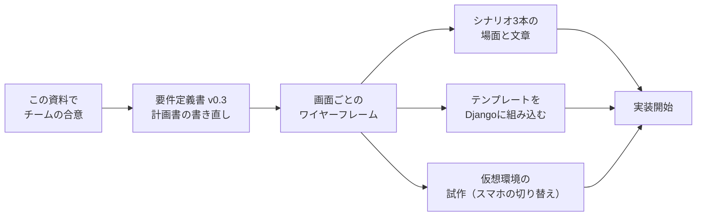

# 1. 内容のすり合わせ（企画プレゼン後）

> 制作開始前の検討資料｜版 0.2（2026年11月13日）｜チームF「詐欺シミュ」
> もとにしたもの：企画プレゼンのスライド（Canva「チームF」14枚、11/12発表）と台本（11/12修正版）

これまでの [要件定義書 v0.2](../requirements.md) と [プロジェクト計画書 v0.1](../project-plan/README.md) は、企画プレゼンより前に書いた「ミヌケル」（仮称）の案である。作るものはスライドより大きい（シナリオ24本、フローチャート、展示会モードなど）。
**これからはスライドを基準にする。** この資料では、スライドで決まったこと、前の資料との違い、まだ決まっていないことを並べ、チームで答えをそろえる。

---

## 1.1 スライドで決まったこと

| # | 項目 | 決まった内容 | スライド |
| --- | --- | --- | --- |
| K1 | 作品名 | **詐欺シミュ** | 1 |
| K2 | コンセプト | 実際にあるネット犯罪を体験して防ごう | 2 |
| K3 | どんな作品か | だまされた「その後」まで体験できるWebアプリ | 8 |
| K4 | ターゲット | ネットに疎い人、「自分は引っかからない」と思っている人、高齢者 | 4 |
| K5 | シナリオ（3本） | ① **フィッシング**：宅配業者を名乗るSMSから偽のログイン画面へ（学ぶ：URLの見分け方） ② **偽通販**：検索で見つけた激安ショッピングサイト（学ぶ：会社情報・支払方法） ③ **サポート詐欺**：突然の警告画面と「今すぐお電話を」（学ぶ：電話しない・画面の閉じ方） | 8 |
| K6 | 体験の流れ | 詐欺の場面を選んで体験 → だまされたら被害の「その後」へ（カードの不正利用、商品が届かない など） → 解説で見抜き方と対処法・連絡先を学ぶ | 8 |
| K7 | 安全面 | 実在する企業の名前やロゴを使わず、架空のブランドで作る。入力した内容は保存も送信もしない | 8（台本） |
| K8 | 画面遷移 | ホーム → モード選択 → 詐欺シミュ開始画面。ホーム → ログイン → モード選択。ログイン → 新規登録 | 11 |
| K9 | ログイン | **ログインしなくても、すべてのシナリオを体験できる。** ログインすると、どのシナリオを体験したかと体験結果を記録できる | 11（台本） |
| K10 | 端末 | スマホやパソコンなど、さまざまな端末で体験できる。文字を大きく、ボタンを押しやすく | 11（台本） |
| K11 | 技術 | Python、Django、HTML・CSS・JavaScript、MySQL。VS Code で開発 | 12 |
| K12 | シナリオの追加 | Django の管理画面からシナリオを追加できるようにする | 12（台本） |
| K13 | 目標 | 体験の前と後に**同じテスト（各10問）**を受けてもらい、正答率が上がること。**1月中に15人以上**で確かめる。体験の後にアンケート（「分かりやすさ」「緊張感」を5段階） | 13（台本） |
| K14 | スケジュール | **12月末までに3シナリオを完成**させ、その後もシナリオを増やす | 13（台本） |
| K15 | 競合との違い | Google フィッシング詐欺クイズには「押してしまった先」がない。詐欺シミュは押した先の被害と対処まで一続きで体験できる。入口（SMS・検索・警告画面）も違う | 10 |
| K16 | 体験の形 | ブラウザの中に**仮想環境**を作り、その中の**仮想パソコン（ブラウザ）と仮想スマホ**を使い分けて、詐欺を体験し、防ぐ（[4章](04-virtual-env.md)） | 11/13 決定 |
| K17 | テンプレートの置き場所 | テンプレートは**Googleドライブに保存**する。GitHub のリポジトリには入れない（[3章 3.5節](03-template.md#35-規約と置き場所)） | 11/13 決定 |

---

## 1.2 前の資料との違いと、どうするか（案）

| # | 項目 | スライド（基準） | 要件定義書 v0.2・計画書 v0.1 | どうするか（案） |
| --- | --- | --- | --- | --- |
| D1 | 名前 | 詐欺シミュ | ミヌケル（仮称） | **詐欺シミュ**にそろえる |
| D2 | シナリオの本数 | 3本（12月末）＋その後に追加 | 12本（12/18）、24本（2/5） | **3本を必須**にする。追加の本数は1月に決める（目安：2/5までに合計5本） |
| D3 | 手口 | フィッシング・偽通販・サポート詐欺 | ニセ警察詐欺、SNS型投資詐欺などを含む12本 | 3つを先に作る。ほかは追加の候補にする |
| D4 | 体験の形 | 場面を選ぶ → だまされたら「その後」 → 解説。**仮想環境の中で、仮想パソコンと仮想スマホを使い分ける**（K16） | 仮想のスマホ1台の中で、メール・メッセージ・ブラウザを操作。結末は4段階。会話型のチャット | 仮想パソコンと仮想スマホの2台にする。1本に**決める場面を2〜3回**置き、どこでも引き返せるようにする。結末は「だまされた」「見抜いた」を基本にし、だまされ方で「その後」を変える。サポート詐欺の通話はチャット形式にする |
| D5 | 振り返り | 解説画面（見抜き方・対処法・連絡先） | Detroit 風の分岐のフローチャート、実際の被害データ | 解説画面を必須にする。フローチャートと被害データは追加の候補（「分析」の機能として使える） |
| D6 | 効果の測り方 | 体験の前後のテスト（10問）＋アンケート | 2本目以降の結末の変化、SUS | **前後のテストを一番の指標**にする。アンケートにSUSを入れるかは決める（1.4節の U6） |
| D7 | データベース | MySQL | SQLite | **MySQL にそろえる**。各自のWindowsに MySQL を入れる手順を、最初に用意する |
| D8 | CSSフレームワーク | 書いていない | Bootstrap 5.3 | テンプレート ＋ **Bootstrap 5.3**（概要説明の必須条件。[3章](03-template.md)） |
| D9 | 見た目 | 決めていない | 自作 | Template Party のテンプレートを使う（[3章](03-template.md)） |
| D10 | 保存・共有・分析 | 「記録できる」だけ | 履歴・お気に入り・ランキング・コメント・統計など | 1.3節の案にしぼる |
| D11 | 展示会（2/26・27） | 書いていない | 展示会モード、大画面のダッシュボード | まず普通の画面で体験してもらう。展示会用の画面は追加の候補 |
| D12 | 計画書のゴール・スケジュール | 3本・前後テスト・15人 | 24本・SUS・展示会100人 | この資料で合意したあと、計画書の2章（ゴール）と4章（スケジュール）を書き直す |

---

## 1.3 概要説明の必須条件と、満たし方

| 条件（[概要説明](../overview.md)・[チェックリスト](../checklist.md)） | 満たし方 | 状態 |
| --- | --- | --- |
| Windows上で動く Python のフレームワーク | Django | OK |
| DBを使い、テーブルを3つ以上 | MySQL。ユーザー、シナリオ、場面、選択肢、体験の記録、テストの問題、テストの回答、アンケートなど（8つ以上） | OK |
| CSSフレームワーク（Bootstrap か Tailwind CSS） | Bootstrap 5.3 をテンプレートと一緒に使う | **スライドに未記載**。D8のとおり入れる |
| スマホ対応のレスポンシブデザイン | テンプレートがスマホに対応している | OK |
| **保存**（お気に入り・履歴・マイページ） | ログインした人の**マイページ**に、体験したシナリオと結果、テストの点数の前後を残す | 案 |
| **共有**（ランキング・レビュー・コメント） | 【要決定 U4】案A：**みんなの結果**（シナリオごとの「だまされた人の割合」、テストの平均点の前後）／案B：テストの点数の**ランキング**（ニックネームで表示）／案C：体験後の**ひとことコメント**（審査が必要になる） | 未決 |
| **分析**（統計・トレンドの可視化） | テストの正答率の前後をグラフで比べる（個人と全体）。シナリオごと・選択肢ごとの「だまされた割合」をグラフにする（Chart.js） | 案 |
| パスワードのハッシュ化（ソルト付き） | Django 標準の認証（PBKDF2、ソルト付き） | OK |
| 外部APIは1つまで | 使わない | OK |

---

## 1.4 まだ決まっていないこと

| # | 決めること | 案 | 期限 |
| --- | --- | --- | --- |
| U1 | 「モード選択」に何を並べるか | 3つの詐欺（フィッシング・偽通販・サポート詐欺）のカードと、「テストを受ける」。カードには学べることと所要時間（3〜5分）を書く | 11月第3週 |
| U2 | テストをアプリの中に作るか | **アプリの中に作る**（結果がDBに残り、「分析」の機能にもなる）。Googleフォームより手間はかかる | 11月第3週 |
| U3 | テストの出し方 | スライドどおり前後で**同じ10問**にする。答えを覚えただけで点が上がる心配があるので、前後で問題の順番と選択肢の順番を入れ替える。体験の前後の間に、少なくとも3本を体験してもらう | 11月第3週 |
| U4 | 「共有」の機能 | 1.3節の案A〜C から選ぶ。おすすめは**案A＋案B**（コメントは荒らし対策の手間が大きい） | 11月第3週 |
| U5 | ゲスト（ログインしない人）のテスト結果 | ブラウザのセッションの間だけ前後を比べられる。保存はしない。全体の集計には名前を出さずに入れる | 11月第3週 |
| U6 | アンケートの項目 | 「分かりやすさ」「緊張感」（5段階）、「また使いたいか」、自由記述。SUS（10問）を入れるかどうか | 12月中 |
| U7 | 各シナリオの場面と分岐 | [2章 2.5節](02-screen-flow.md#25-シナリオごとの場面案)の案をもとに、1本あたり場面4〜6、決める場面2〜3回にする。どの場面で、どちらのデバイスを使えるかも決める | 11月末 |
| U8 | 架空のブランド名 | [seed/brands.yaml](../../seed/brands.yaml)（26ブランド）から選ぶ。案：フィッシング＝**ハシレ運輸**（宅配業者）、サポート詐欺＝**ミハリ番セキュリティ**（セキュリティソフト）、その後の場面のカード会社＝**ホシゾラカード**。偽通販の店は、同じ名前の実在の店がないことをWeb検索で確かめて新しく名前を付ける | 11月第3週 |
| U9 | 表示するURL・電話番号 | 要件定義書の作成のルール（C-02・C-03）どおり、予約済みのドメイン（例：`hashire-unyu.example`）と、一部を伏せた電話番号（例：`050-XXXX-XXXX`）を使う。リンクを押しても外のサイトには移動しない | 11月末 |
| U10 | 役割分担 | 例：バックエンド（Django・DB）、画面（テンプレートの組み込み）、仮想環境の共通部分（仮想スマホ・仮想パソコン）、シナリオ①〜③の画面と文章、テスト・アンケート・集計 | 11月第3週 |
| U11 | ~~テンプレートと公開リポジトリ~~ | **決定（11/13）**：テンプレートはGoogleドライブに保存し、リポジトリには入れない（K17）。ドライブの共有はメンバーと担当教員だけにする | 済 |
| U12 | 要件定義書・計画書の書き直し | この資料で合意したら、要件定義書を v0.3（詐欺シミュ版）に、計画書の2章・4章を書き直す | 11月第4週 |
| U13 | 仮想環境のアプリと見せ方 | [4章 4.8節](04-virtual-env.md#48-決めること)（検索サイトの名前、音、スマホでの切り替え、ヒント、急かす演出） | 11月末 |

---

## 1.5 これからの進め方（本体を作り始める前まで）

---

[表紙・目次](README.md) ｜ [2. 画面一覧と画面遷移 →](02-screen-flow.md)
