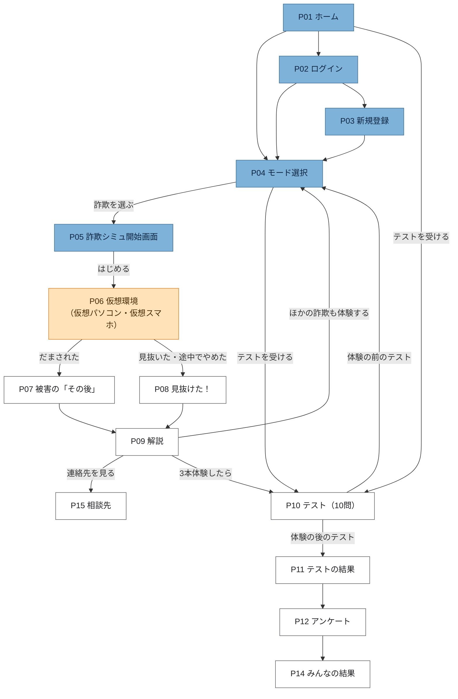
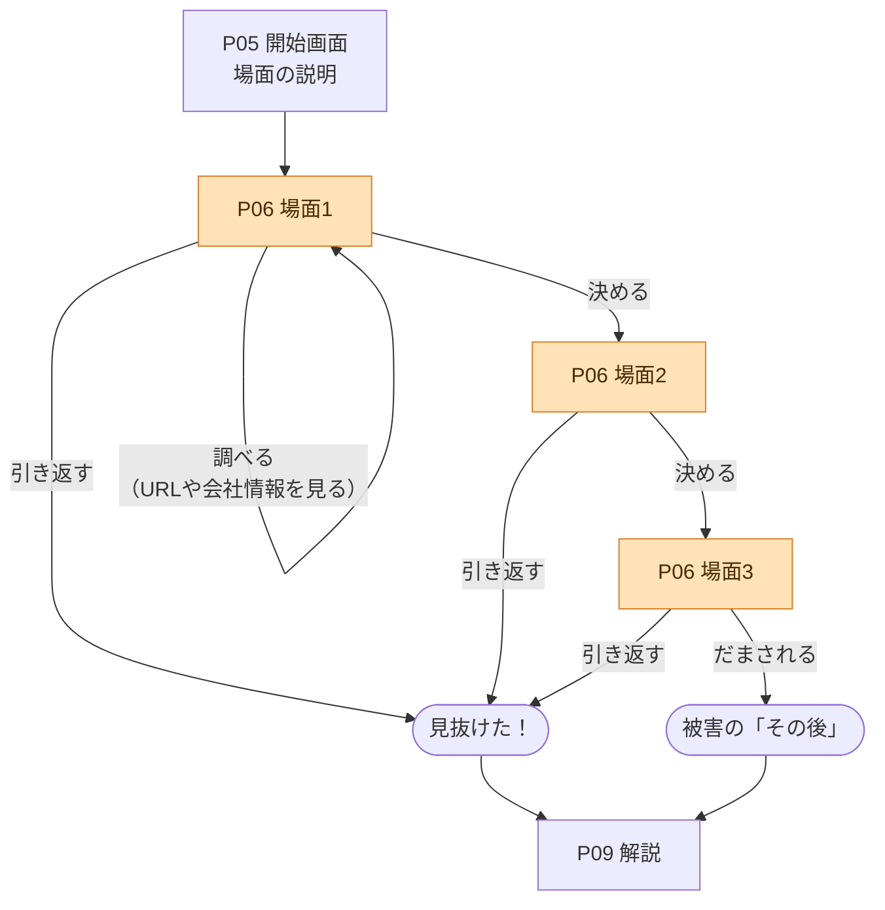
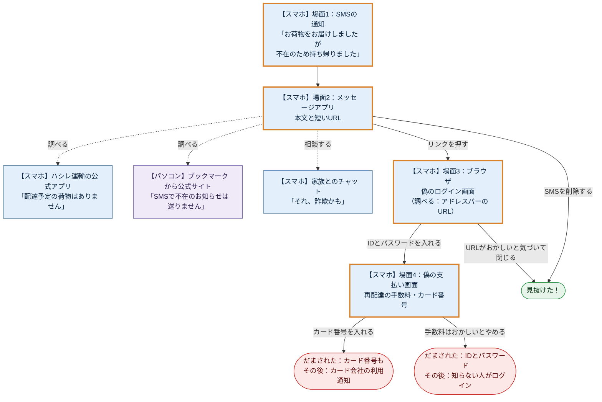
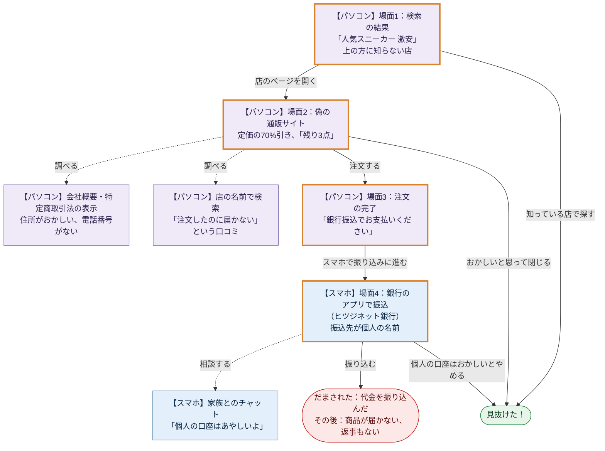
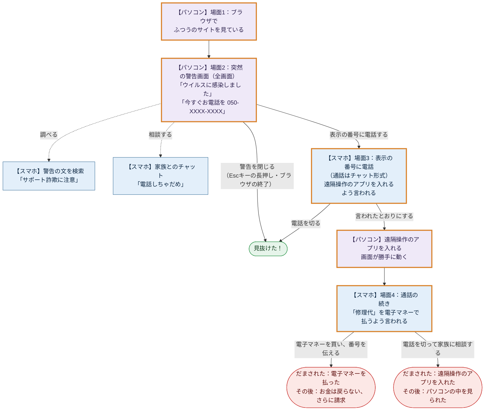
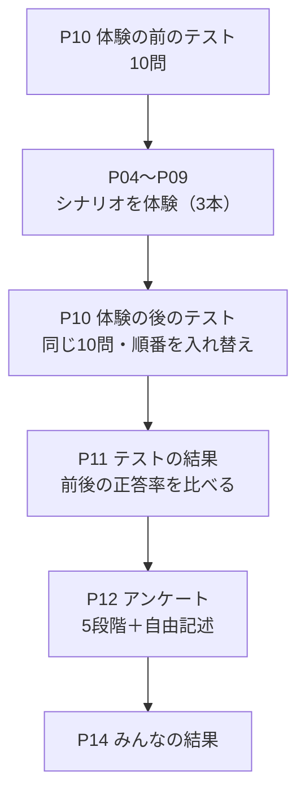

# 2. 画面一覧と画面遷移

> 制作開始前の検討資料｜版 0.2（2026年11月13日）｜チームF「詐欺シミュ」
> もとにしたもの：スライド11「画面遷移」、スライド8「アプリ概要」、スライド13「目標」と台本

スライド11には5つの画面（ホーム、ログイン、新規登録、モード選択、詐欺シミュ開始画面）がある。体験の流れ（スライド8）とテスト（スライド13）、必須の「保存・共有・分析」（[1章 1.3節](01-alignment.md#13-概要説明の必須条件と満たし方)）まで動かすために、足りない画面を足した。
図では、**スライドにある画面を青**、**足した画面を白**、**仮想環境（偽の画面を体験する場所）をオレンジ**で表している。

詐欺を体験する画面（P06）は、ブラウザの中の**仮想環境**にする。仮想パソコンと仮想スマホを置き、2台を使い分けて詐欺を体験し、防ぐ（[4章](04-virtual-env.md)）。

---

## 2.1 画面一覧

「枠」の列は、その画面がどの見た目で作られるかを表す。**テンプレート**は Template Party のテンプレートのヘッダー・メニュー・フッター（[3章](03-template.md)）、**仮想環境**は仮想パソコンと仮想スマホを置いた自作の画面（[4章](04-virtual-env.md)）である。

| ID | 画面 | 主な中身 | スライド | ログイン | 枠 |
| --- | --- | --- | --- | --- | --- |
| P01 | ホーム | 作品の説明（だまされた「その後」まで体験できる）、「体験をはじめる」「テストを受ける」のボタン、これは練習用であることの説明 | 11 | 不要 | テンプレート |
| P02 | ログイン | ユーザー名とパスワード。「新規登録はこちら」「ログインせずに体験する」 | 11 | 不要 | テンプレート |
| P03 | 新規登録 | ユーザー名、パスワード（2回）、ニックネーム。登録するとそのままログインする | 11 | 不要 | テンプレート |
| P04 | モード選択 | 3つの詐欺のカード（入口、学べること、所要時間3〜5分、体験済みの印）、「テストを受ける」 | 11 | 不要 | テンプレート |
| P05 | 詐欺シミュ開始画面 | 場面の説明（例：「あなたのスマホにSMSが届きました」）、「これは練習用です。入力した内容は保存も送信もしません」、「はじめる」 | 11 | 不要 | テンプレート |
| P06 | 仮想環境 | 仮想パソコンと仮想スマホ。偽のSMS・偽のログイン画面・偽の通販サイト・突然の警告画面・電話を、2台を使い分けて体験し、防ぐ。シナリオごとの場面は2.5節 | 8 | 不要 | **仮想環境** |
| P07 | 被害の「その後」 | だまされた場合。カードの不正利用の通知、商品が届かない、電子マネーを払わされた など。仮想環境の中で起きたあと、まとめの画面で説明する | 8 | 不要 | 仮想環境 → テンプレート |
| P08 | 見抜けた！ | だまされなかった場合。どこで気づけたかを1行で | ー | 不要 | テンプレート |
| P09 | 解説 | 見抜くポイント（画面のどこを見ればよかったか）、こうすれば防げた、だまされたときの対処と連絡先 | 8 | 不要 | テンプレート |
| P10 | テスト（10問） | 体験の前と後で同じ10問。後のテストは問題と選択肢の順番を入れ替える | 13 | 不要 | テンプレート |
| P11 | テストの結果 | 前と後の正答率を並べたグラフ、間違えた問題と答え | 13 | 不要 | テンプレート |
| P12 | アンケート | 「分かりやすさ」「緊張感」などを5段階、自由記述 | 13 | 不要 | テンプレート |
| P13 | マイページ | 体験したシナリオと結果、テストの点数の前後（**保存**） | ー | **必要** | テンプレート |
| P14 | みんなの結果 | シナリオごとの「だまされた人の割合」、全体のテストの平均点の前後（**共有・分析**）。ランキングを入れるかは未決（[1章 U4](01-alignment.md#14-まだ決まっていないこと)） | ー | 不要 | テンプレート |
| P15 | 相談先 | 警察相談専用電話 #9110、消費者ホットライン 188、IPA 情報セキュリティ安心相談窓口、カード会社への連絡 | ー | 不要 | テンプレート |
| A01 | 管理画面 | Django 標準の管理サイト。シナリオ・場面・選択肢・テストの問題を追加・修正する | 12 | 管理者 | Django 標準 |

---

## 2.2 全体の画面遷移

- スライド11の矢印（ホーム → モード選択、ホーム → ログイン → モード選択、ログイン → 新規登録）はそのまま残した。
- 新規登録のあとは、そのままログインした状態でモード選択に進む。
- **ログインしなくても、すべての画面を使える**（マイページを除く）。

---

## 2.3 いつでも行ける画面（ヘッダーのメニュー）

テンプレートのメニューは、どの画面幅でも隠れずに表示される（ハンバーガーメニューがない）。メニューは5つまでにする。

| メニュー | 行き先 | 備考 |
| --- | --- | --- |
| ホーム | P01 | |
| 体験する | P04 モード選択 | |
| みんなの結果 | P14 | |
| 相談先 | P15 | |
| ログイン ／ マイページ | P02 ／ P13 | ログインしているとマイページ。ヘッダーの右上のボタンにする |

**仮想環境（P06）の間はメニューを出さない。** 偽の画面を本物らしく見せるためである。代わりに、画面の上に「練習中」の帯（ミッション・ヒント・やめる）を置く（[4章 4.2節](04-virtual-env.md#42-画面の配置)）。

---

## 2.4 体験の流れ（3本に共通）

- 1本は3〜5分。**決める場面は2〜3回**で、どの場面でも引き返せる。
- 「調べる」操作（URLを確かめる、公式アプリを開く、もう1台で検索する など）では、物語は進まない。**仮想パソコンと仮想スマホは、どの場面でも切り替えて使える。**
- 選んだ選択肢は記録し、「みんなの結果」（P14）で「どの場面で何%の人がだまされたか」を出す（**分析**）。ログインしていない人の記録も、名前を出さずに集計に入れる。

---

## 2.5 シナリオごとの場面（案）

場面の文章は、[問題集](../question-bank/README.md)の事例をもとに書く。URLと電話番号は作成のルールどおり、予約済みのドメインと伏せ字を使う（[1章 U9](01-alignment.md#14-まだ決まっていないこと)）。

それぞれの画面のデザインは [5章](05-screen-design.md) にある。

図の見方：**水色＝仮想スマホ**、**紫＝仮想パソコン**での操作。**オレンジの太い枠＝詐欺の場面**。**点線の矢印＝「調べる」「相談する」操作**（物語は進まない。確かめたあとに詐欺だと分かり、やめることができる）。結末は**緑＝見抜けた**、**赤＝だまされた**。

### ① フィッシング（宅配業者を名乗るSMS → 偽のログイン画面）

解説で学ぶこと：**URLの見分け方**（公式のドメインとの違い）、SMSのリンクは押さず**公式アプリやブックマークから確かめる**、入力してしまったらパスワードを変えてカード会社に連絡する。

### ② 偽通販（検索で見つけた激安ショッピングサイト）

解説で学ぶこと：**会社情報と支払方法**のチェック（住所・電話番号・メールアドレス、極端な値引き、銀行振込だけ・個人名義の口座）、店の名前で検索して評判を確かめる、振り込んでしまったら振込先の銀行と警察（#9110）・消費者ホットライン（188）に相談する。

### ③ サポート詐欺（突然の警告画面と「今すぐお電話を」）

解説で学ぶこと：**警告画面の番号に電話しない**、**画面の閉じ方**、遠隔操作のアプリを入れてしまったら消してパソコンを点検する、電子マネーを払ってしまったら発行会社と警察・消費者ホットライン（188）に連絡する。

---

## 2.6 テストとアンケートの流れ

- 1月のユーザーテスト（15人以上）は、この順番で受けてもらう。
- ふだん使う人は、テストを受けずに体験だけしてもよい。
- 体験の前のテストを受けていない人が後のテストを受けた場合は、前後の比較をせず点数だけを出す。

---

## 2.7 ログインの有無でできること

| できること | ログインしない | ログインする |
| --- | --- | --- |
| 3つのシナリオを体験する | ○ | ○ |
| 解説・相談先を見る | ○ | ○ |
| テストを受け、前後を比べる | ○（ブラウザを閉じるまで） | ○（ずっと残る） |
| アンケートに答える | ○ | ○ |
| みんなの結果を見る | ○ | ○ |
| 体験したシナリオと結果を記録する（マイページ） | × | ○ |
| モード選択で体験済みの印を見る | ×（ブラウザを閉じるまでは表示） | ○ |

---

[← 1. 内容のすり合わせ](01-alignment.md) ｜ [表紙・目次](README.md) ｜ [3. テンプレートの選定 →](03-template.md)
