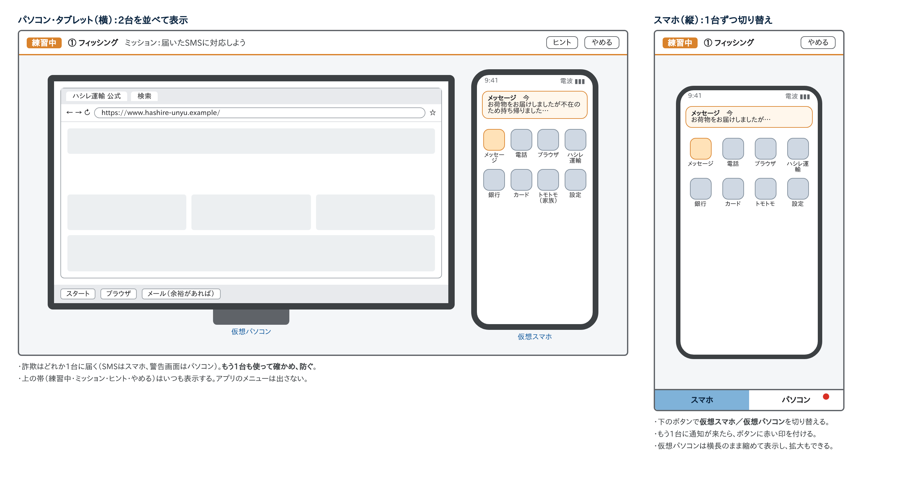

# 4. 仮想環境（ブラウザの中で詐欺を体験する仕組み）

> 制作開始前の検討資料｜版 0.2（2026年11月13日）｜チームF「詐欺シミュ」
> 11/13 にチームで決めた体験の形を、画面と仕組みに落とした案

---

## 4.1 考え方

ブラウザの中に**仮想環境**を作る。仮想環境には、利用者が持っているという設定の**仮想パソコン**と**仮想スマホ**を置く。

- 詐欺は、どれか1台に届く（SMSはスマホに、警告画面はパソコンに）。
- 利用者は、**もう1台も使って確かめ、詐欺を防ぐ**（スマホの公式アプリで荷物を確かめる、パソコンで店の名前を調べる、家族にチャットで相談する など）。
- だまされる方を選ぶと、その先の画面にそのまま進み、被害の「その後」（カードの利用通知、届かない商品、払わされた電子マネー）も仮想環境の中で起きる。

ふだんの生活でも、詐欺に気づくきっかけは「**届いたメッセージのリンクではなく、別の方法で確かめること**」である。デバイスを使い分ける形にすると、この行動をそのまま練習できる。Google のフィッシングクイズ（スライド10）との違いも、さらにはっきりする。

---

## 4.2 画面の配置

| 画面の幅 | 見せ方 |
| --- | --- |
| パソコン・タブレット（横） | 左に仮想パソコン、右に仮想スマホを**並べて**表示する。両方をいつでも操作できる |
| スマホ（縦） | 1台ずつ全画面で表示し、下のボタンで**切り替える**。もう1台に通知が来たら、ボタンに赤い印を付ける。仮想パソコンは横長のまま縮めて表示し、拡大もできる |
| 共通 | 上の帯に「練習中」、シナリオ名、ミッション（例：届いたSMSに対応しよう）、ヒント、やめる をいつも表示する。テンプレートのメニューは出さない |

---

## 4.3 デバイスとアプリ

アプリの名前は [seed/brands.yaml](../../seed/brands.yaml) の架空のブランドを使う。「必須」は3本のシナリオに必要なもの、「追加」は余裕があれば作るもの。

| デバイス | アプリ・機能 | できること | 使うシナリオ | 優先度 |
| --- | --- | --- | --- | --- |
| 仮想スマホ | ロック画面と通知 | SMSやアプリの通知が届く。押すとそのアプリが開く | ① ② ③ | 必須 |
| 仮想スマホ | メッセージ（SMS） | 読む、リンクを押す、削除する | ① | 必須 |
| 仮想スマホ | 電話 | 番号を入れて発信する、着信に出る、通話（チャット形式で話す）、切る | ③ | 必須 |
| 仮想スマホ | ブラウザ | ページを開く、アドレスバーでURLを確かめる、検索する | ① ③ | 必須 |
| 仮想スマホ | ハシレ運輸（宅配の公式アプリ） | 荷物の状況を見る（「配達予定の荷物はありません」） | ① | 必須 |
| 仮想スマホ | ヒツジネット銀行（ネットバンキング） | 振り込む。振込先の名前を確かめる | ② | 必須 |
| 仮想スマホ | ホシゾラカード（カード会社のアプリ） | 利用の通知を見る（被害の「その後」） | ① | 必須 |
| 仮想スマホ | トモトモ（家族とのチャット） | 家族に相談する。家族が「それは詐欺かも」と返す | ① ② ③ | 必須 |
| 仮想パソコン | デスクトップとタスクバー | アプリを開く・閉じる | ② ③ | 必須 |
| 仮想パソコン | ブラウザ | タブ、アドレスバー、ブックマーク、架空の検索サイト。全画面の警告を閉じる操作（Escキーの長押し、ブラウザの終了） | ① ② ③ | 必須 |
| 仮想パソコン | 遠隔操作のアプリ（偽物） | 「サポート担当」に言われて入れる。入れると画面が勝手に動く演出 | ③ | 必須 |
| 仮想パソコン | メール | メールを読む（フィッシングメールのシナリオを増やすとき） | 追加のシナリオ | 追加 |

---

## 4.4 シナリオでのデバイスの使い方

詳しい流れは [2章 2.5節](02-screen-flow.md#25-シナリオごとの場面案) のフローチャートにある。

| シナリオ | 詐欺が届くデバイス | 確かめる・防ぐのに使うデバイス | 被害の「その後」が起きるデバイス |
| --- | --- | --- | --- |
| ① フィッシング | スマホ（SMS → スマホのブラウザで偽のログイン画面） | スマホの公式アプリ、パソコンのブックマークから公式サイト、家族とのチャット | スマホ（カード会社の利用通知） |
| ② 偽通販 | パソコン（検索 → 偽の通販サイト） | パソコンで店の名前を検索（口コミ）、会社概要、スマホの銀行アプリで振込先の名前、家族とのチャット | スマホ（届かない商品、返事のないメール） |
| ③ サポート詐欺 | パソコン（突然の警告画面） | パソコンで警告を閉じる、スマホで警告の文を検索、家族とのチャット | パソコン（遠隔操作）とスマホ（通話・電子マネー） |

---

## 4.5 操作のきまり

| # | きまり | 内容 |
| --- | --- | --- |
| R1 | デバイスはいつでも切り替えられる | 場面の途中でも、もう1台を使ってよい |
| R2 | 「調べる」と「決める」 | 調べる操作（URLを見る、公式アプリを開く、検索する）は記録するが、物語は進まない。決める操作（リンクを押す、入力する、振り込む、電話する、削除する）で次の場面に進む |
| R3 | 出来事は時間ときっかけで起きる | 例：開始から数秒でSMSの通知が届く。サイトを開いて数秒で警告画面が出る |
| R4 | 入力した内容は保存も送信もしない | 入力欄に書いた文字は、その場で消す。記録するのは「入力した」ということだけ（スライド8の約束） |
| R5 | 仮想環境の外には出ない | リンクやボタンはすべて仮想環境の中で動く。本物のサイトには移動しない。URLと電話番号は予約済みのドメインと伏せ字 |
| R6 | 練習中だと分かるようにする | 上の帯はいつも表示する。最初に「これは練習用です」と説明する |
| R7 | いつでもやめられる | 「やめる」で解説の画面に進む |
| R8 | 音は最初に選ぶ | 警告音や着信音を出すかどうかを、開始画面で選ぶ（展示会や電車の中で使う人のため） |

---

## 4.6 作り方の方針（実装のときに行う）

1. 仮想環境は、Django のテンプレート1枚の中に JavaScript で作る。デバイスやアプリを切り替えても、ページは読み直さない。
2. シナリオのデータ（デバイスの最初の状態、場面、出来事、操作と行き先、結末の条件）は、Django から JSON で受け取る。シナリオは管理画面から追加できるようにする（スライド12）。
3. 操作の記録（どの場面で何を選んだか）は、JavaScript から Django に送り、DB に保存する。
4. 仮想デバイスの見た目は Bootstrap と自作のCSSで作る。テンプレート（tp_universal1）は使わない。
5. **共通の部品を先に作る**：仮想スマホ（枠、ロック画面、通知、アプリの起動）と仮想パソコン（枠、タスクバー、ブラウザ）。3本のシナリオは、その上にアプリの中のページと出来事を足すだけにする。

---

## 4.7 スケジュールへの影響と対策

| 心配なこと | 対策 |
| --- | --- |
| 作るものが増え、12月末に3本が間に合わない | 11月中に共通の部品とシナリオ①を先に作り、12月に②③を足す。アプリは4.3節の「必須」だけにする |
| スマホの小さい画面で、2台の切り替えが分かりにくい | 11月中に試作し、メンバーの家族（高齢の方）に触ってもらって確かめる |
| 本物そっくりの画面を作る手間が大きい | 1つの画面に要素を詰め込まない。見るべき場所（URL、送信元、会社概要、振込先の名前）だけを丁寧に作る |

---

## 4.8 決めること

| # | 決めること | 案 |
| --- | --- | --- |
| V1 | 架空の検索サイトの名前 | 同じ名前の実在のサービスがないことを確かめて付ける |
| V2 | 仮想パソコンにメールを入れるか | 3本では使わないので、追加のシナリオを作るときに入れる |
| V3 | 警告音・着信音を出すか | 出せるようにして、開始画面でオン／オフを選ぶ（R8） |
| V4 | スマホでの切り替えの見せ方 | 4.2節の「下のボタンで切り替え」案でよいか、試作で確かめる |
| V5 | ヒントの出し方 | 「ヒント」を押すと、今の場面で見るとよい場所を1つ光らせる |
| V6 | 急かす演出（残り時間など）を入れるか | スライド9の「緊張感の中で判断する練習」に合う。高齢の方には負担なので、オン／オフを選べるようにする |

---

[← 3. テンプレートの選定](03-template.md) ｜ [表紙・目次](README.md)
