# 5. シナリオ別の画面デザイン

> 制作開始前の検討資料｜版 0.3（2026年11月19日）｜チームF「詐欺シミュ」
> 画面は [プロトタイプ](../../prototype/README.md) で動かして見られる。この章の画像は、プロトタイプの画面を写したもの

仮想環境（[4章](04-virtual-env.md)）の中に出す画面を、シナリオごとにデザインした。[2章 2.5節](02-screen-flow.md#25-シナリオごとの場面案)の場面の流れに合わせて、**詐欺の画面**と、確かめるための**本物の画面**の両方を作っている。

**11/19 の作り直し**：画面の見た目を、[Refero Styles](https://styles.refero.design) の実在サイトのスタイル（色・文字・余白・部品の作りの数値）を参考にして作り直した。1から考えた見た目は「AIが作った感じ」になりやすいためである。場面ごとにどのスタイルを参考にしたかは [prototype/DESIGN.md](../../prototype/DESIGN.md) にある。11/13 の見本（mockups/）は、プロトタイプにまとめたので消した。

---

## 5.1 デザインの決まりごと

| # | 決まりごと | 内容 |
| --- | --- | --- |
| D1 | 本物そっくり、でもすべて架空 | 会社・アプリ・サイトは架空のブランド（[seed/brands.yaml](../../seed/brands.yaml) と 5.8節）。URLは予約済みの `.example`、電話番号は `050-XXXX-XXXX` のように伏せる。実在の会社のロゴ・文章・写真は使わない |
| D2 | 見抜くポイントを仕込む | 1画面に1〜4個。実際の詐欺でよく見られる特徴（違うドメイン、期限で急がせる、銀行振込だけ、画面に電話番号 など）を入れる |
| D3 | 偽物は本物と同じくらいきれいに作る | 偽のログイン画面は本物（公式アプリ・公式サイト）と同じ作りにし、偽の通販サイトもふつうのきれいな通販サイトにする。違うのは**細かいところ**（アドレスの登録ドメイン、会社名の字、会社の情報、振込先）だけにして、「見た目では分からない。アドレスや会社の情報で確かめる」ことを学べるようにする |
| D4 | 本物の画面も作る | 公式アプリ・公式サイト・注意喚起・家族とのチャットを用意し、**もう1台で確かめると分かる**ようにする |
| D5 | 見やすさ | 仮想環境の中でも、本文は14px以上、ボタンは大きくする（ターゲットに高齢者がいるため） |
| D6 | 印は解説で使う | 画像の**赤い番号＝見抜くポイント**、**緑の番号＝確かめると分かること**。体験中の画面には出さず、解説の画面（P09）で同じ印を重ねて見せる |
| D7 | 実在のサイトの作りに寄せる | 場面ごとに Refero Styles の参考スタイルを1つ決め、その数値（色の数、角の丸み、線、文字の大きさ）にそろえる。絵文字のアイコン、写真の代わりの文字や絵は使わない（[prototype/DESIGN.md](../../prototype/DESIGN.md)） |

---

## 5.2 ブランドと見た目

| ブランド（すべて架空） | 役 | 見た目（参考スタイル） | 使うシナリオ |
| --- | --- | --- | --- |
| ハシレ運輸 | 宅配業者（本物）。公式ドメイン `hashire-unyu.example` | 緑＋細い灰色の線、角 8px、丸いボタン（Custo） | ① |
| 偽のハシレ運輸 | フィッシングサイト。`hashire-unyu.redelivery-info.example` | 本物のスマホ用サイトとそっくり。会社名の字が1つ違う | ① |
| ホシゾラカード | カード会社（その後の通知） | 紺＋金色の星のアイコン | ① |
| トモトモ | 家族とのチャット | オレンジ。よくあるチャットの作り | ① ② ③ |
| サガシモ | 検索サイト。`www.sagashimo.example` | 生成りの地＋墨色、色は青緑1色（Perplexity） | ② ③ |
| KUTSU-YASU MARKET（運営：クツヤス商事） | 偽の通販サイト。`kutsuyasu-market.example` | 白と黒だけのきれいな通販サイト。黒い告知の帯、角のない写真（Adanola） | ② |
| ポチッと通販 | いつもの通販サイト | 灰色の地に角の丸い白いカード、オレンジ1色（Shop） | ② |
| ヒツジネット銀行 | 利用者のネット銀行のアプリ | 白い地＋1px の黒い線、角 4px、青1色（Varo Bank） | ② |
| コトリ銀行 | 偽通販の振込先の銀行 | ー（名前だけ） | ② |
| そよかぜ市・そよかぜ警察署 | 注意喚起を出す公的機関 | 白い地＋灰色の線、角 6px（Common） | ② ③ |
| ことこと献立帖 | ふつうのレシピサイト | 生成りの地＋墨色、太い見出し、丸いボタン（Eat Real Food） | ③ |
| ミハリ番セキュリティ | 名前をかたられるセキュリティ会社 | 偽の警告は、実際の詐欺によくある青い全画面 | ③ |
| リモッテ | 偽の遠隔操作アプリ | ほぼ白の地、黒と青の丸いボタン（Cap） | ③ |
| しつもん広場・通販ひょうばん帳 | Q&Aサイト・口コミサイト（検索結果に出る） | ー | ② ③ |

写真は、自由に使えるもの（CC0・パブリックドメイン）で、実在のブランドのロゴが写っていないものを4枚使っている（[prototype/img/CREDITS.md](../../prototype/img/CREDITS.md)）。

---

## 5.3 ① フィッシング

**デザインの狙い**：スマホで完結するいつもの画面（ロック画面・SMS・ブラウザ）にする。偽のログイン画面は本物のスマホ用サイトと同じ見た目にし、**アドレスでしか見分けられない**ことを体験させる。確かめる手段として、公式アプリとパソコンのブックマークを用意する。

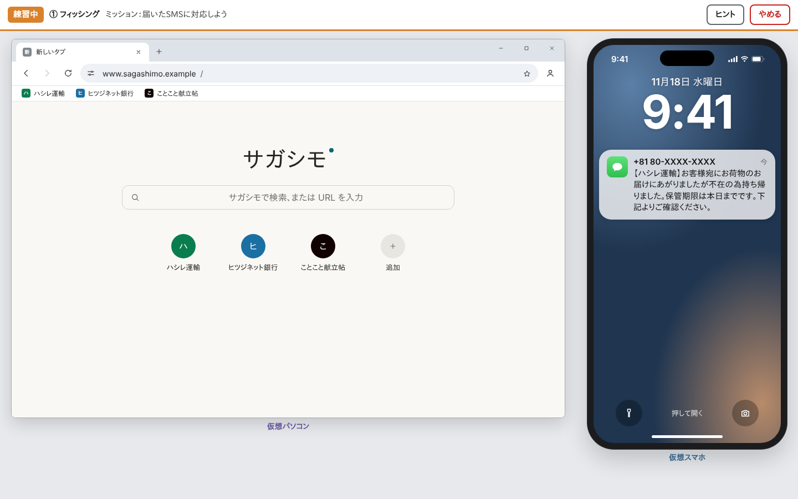

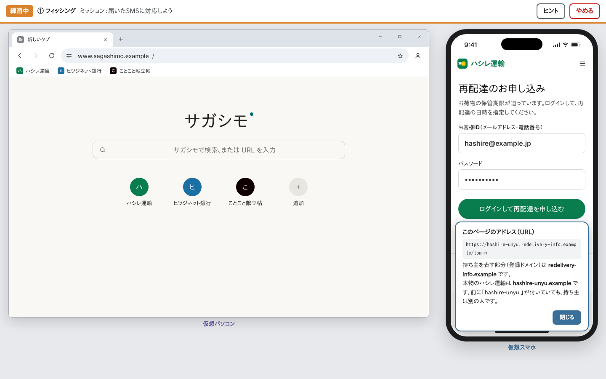

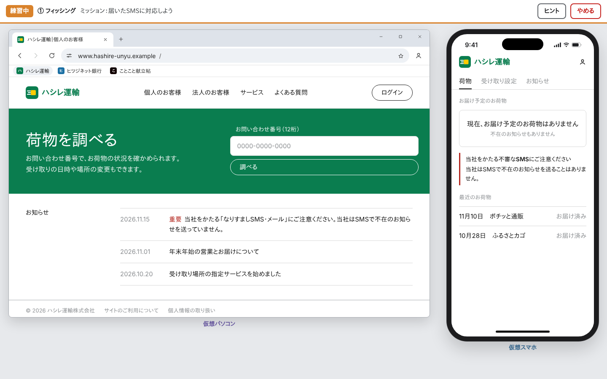

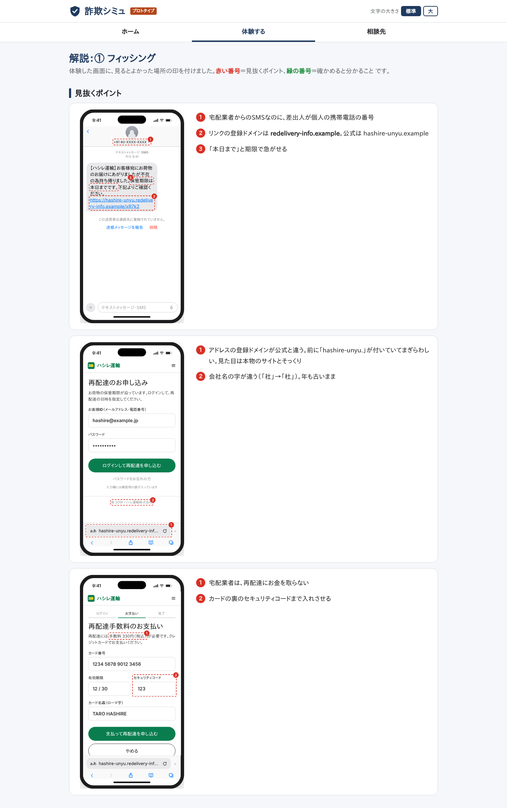

| 画面 | 2章の場面 | 見抜くポイント（赤）／確かめると分かること（緑） |
| --- | --- | --- |
| ロック画面のSMSの通知 | 場面1 | 差出人が知らない携帯電話の番号 |
| メッセージ（SMS） | 場面2 | 差出人が個人の番号／リンクの登録ドメインが違う／「本日まで」と急がせる |
| 偽のログイン画面 | 場面3 | アドレスの登録ドメイン／会社名の字（社→杜）と古い年 |
| 偽の支払い画面 | 場面4 | 再配達に手数料は取らない／セキュリティコードまで入れさせる |
| 公式アプリ（本物） | 調べる | 届く予定の荷物はない／SMSで不在の連絡はしない |
| 公式サイト（本物） | 調べる | 公式のアドレス／お知らせ／ブックマークから開く |
| カード会社の通知 | その後 | 入力したカードがすぐ使われた → カード会社に連絡 |
| 家族とのチャット | 相談する | 迷ったら相談。返事はシナリオごとに決める |

---

## 5.4 ② 偽通販

**デザインの狙い**：パソコンで、**自分から検索して**偽のサイトにたどり着く流れにする。偽の通販サイトは、白と黒だけのきれいなファッション通販の見た目にする（実際の偽の通販サイトも、ふつうの通販サイトのテーマをまねていることが多い）。見抜く手がかりは、安すぎる値段・残り時間・少しおかしい日本語と、会社の情報・店の名前での検索。最後の振込だけ**スマホの銀行アプリ**で行い、振込先が個人の名前であることに気づける最後のチャンスにする。

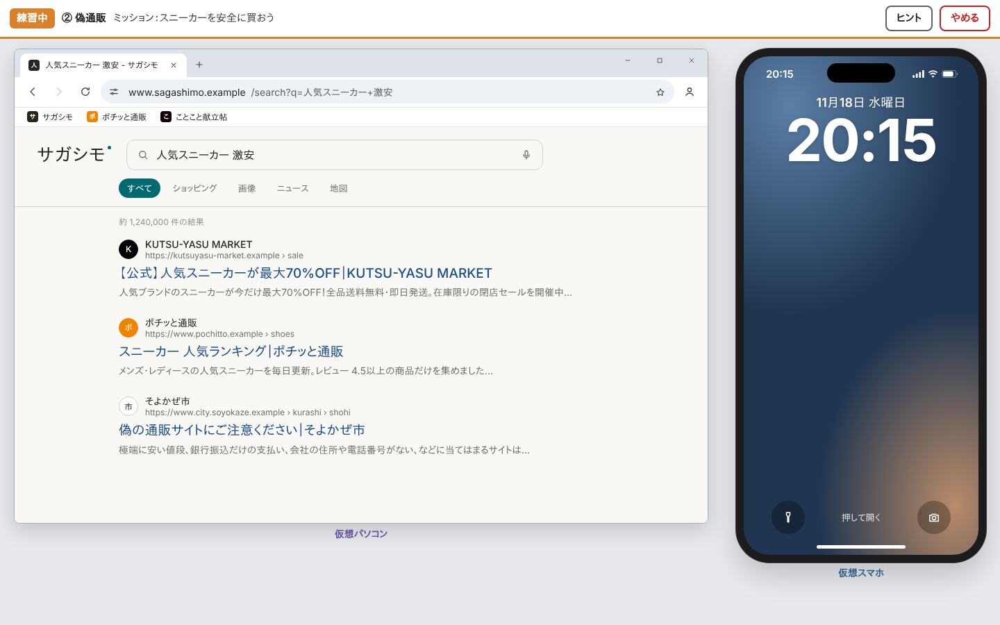

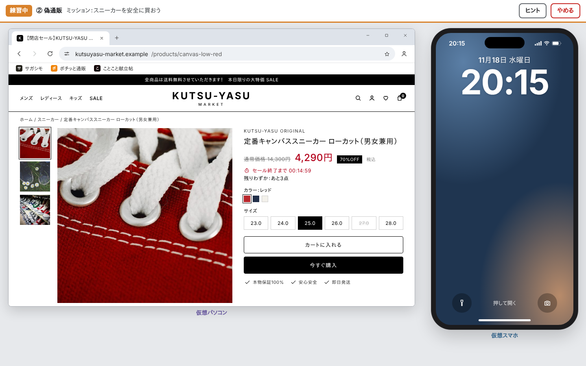

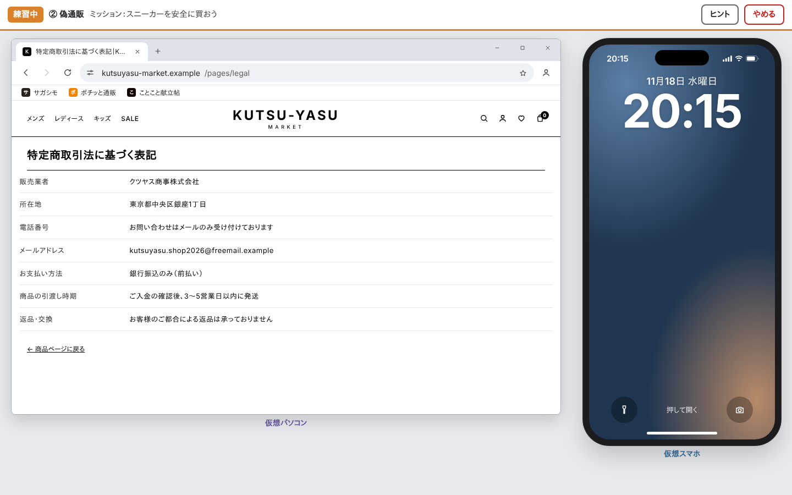

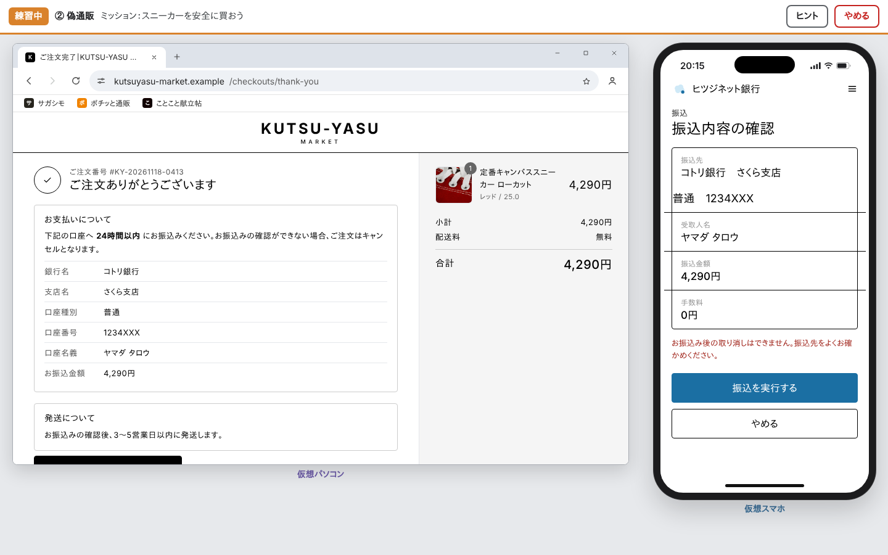

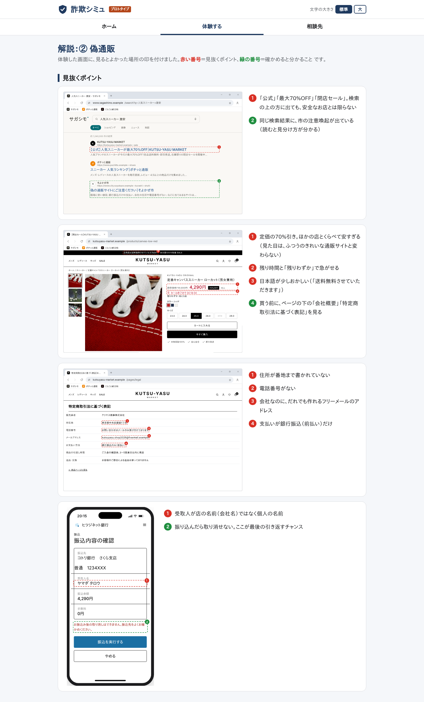

| 画面 | 2章の場面 | 見抜くポイント（赤）／確かめると分かること（緑） |
| --- | --- | --- |
| 検索の結果 | 場面1 | 「公式」「最大70%OFF」でも安全とは限らない／市の注意喚起が同じ検索結果にある |
| 偽の通販サイトの商品ページ | 場面2 | 安すぎる値段／残り時間と「残りわずか」／少しおかしい日本語／会社概要を見る場所 |
| 特定商取引法に基づく表記 | 調べる | 番地がない住所／電話番号がない／フリーメール／銀行振込（前払い）だけ |
| 店の名前で検索 | 調べる | 「届かない」という書き込み／市の一覧に名前がある |
| 注文の完了 | 場面3 | 個人の名前の口座／「24時間以内」と急がせる |
| 銀行のアプリで振込 | 場面4 | 受取人が個人の名前／振り込んだら取り消せない |

---

## 5.5 ③ サポート詐欺

**デザインの狙い**：ふつうのレシピサイトから**突然**、青い全画面の警告に変わる落差で、本物の「こわさ」を再現する。警告画面は、実際の詐欺の画面によくある作り（パソコンの部品をまねた窓、大きな電話番号、偽のスキャン、ブラウザの「〜の内容」の小窓）にする。閉じ方（Escキーの長押し）は、実際のブラウザと同じように画面の上に小さく出す。電話は**スマホの通話画面**で、話した内容を文字で見せる。

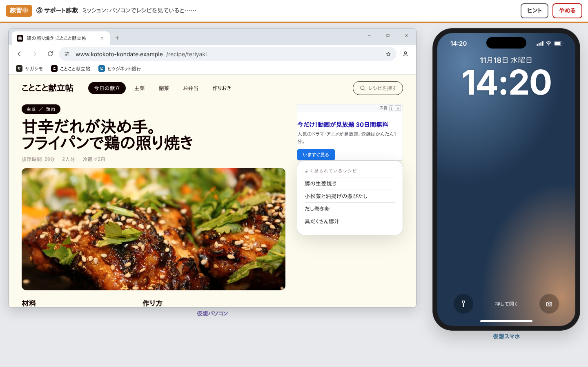

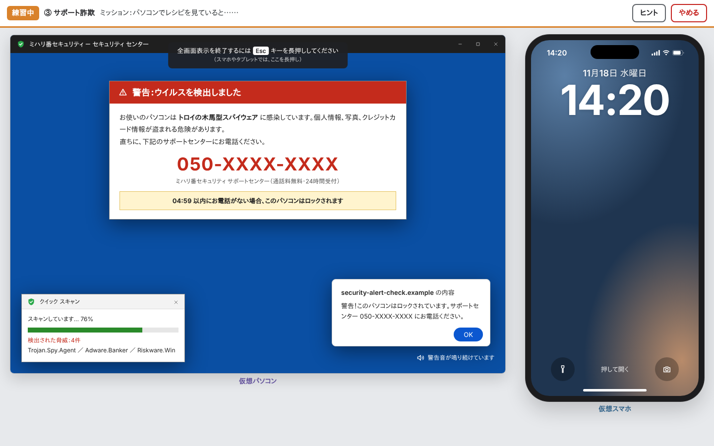

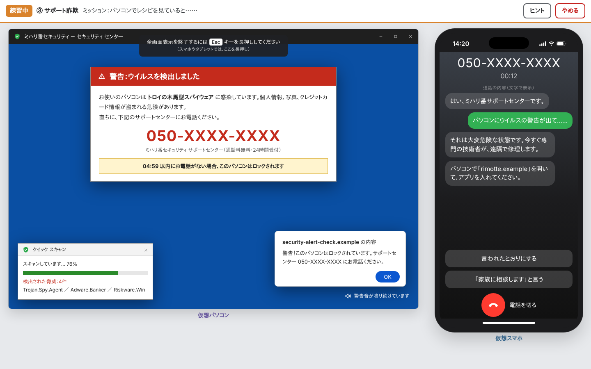

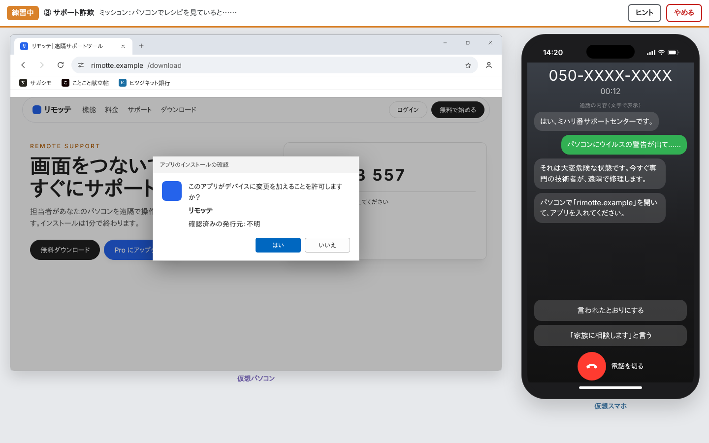

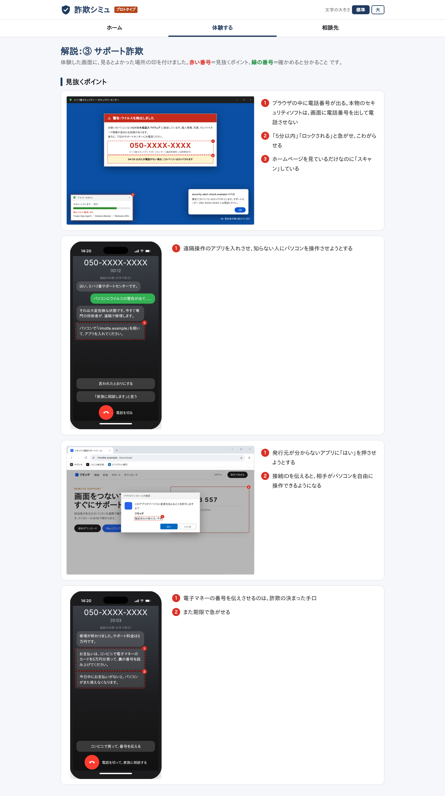

| 画面 | 2章の場面 | 見抜くポイント（赤）／確かめると分かること（緑） |
| --- | --- | --- |
| ふつうのレシピサイト | 場面1 | ふつうのサイトでも、広告などから突然あやしい画面に変わることがある |
| 突然の警告画面 | 場面2 | 画面に電話番号／「5分以内」「ロックされる」／ブラウザなのに「スキャン」／Escキーの長押しで閉じられる |
| スマホで警告の文を検索 | 調べる | 警察の防犯情報／名前を使われた会社の「電話番号は出さない」 |
| 表示の番号に電話 | 場面3 | 遠隔操作のアプリを入れさせようとする |
| 遠隔操作のアプリを入れる | 場面3の続き | 発行元が不明のアプリ／接続IDを伝えると操作される |
| 「修理代」を電子マネーで | 場面4 | 電子マネーの番号を伝えさせる／また期限で急がせる |

---

## 5.6 画面の見方

| 見るもの | 場所 |
| --- | --- |
| 動かして見る | [prototype/index.html](../../prototype/index.html) をブラウザで開く（[使い方](../../prototype/README.md)） |
| 見抜くポイントの印つきで見る | プロトタイプで体験したあとの「解説」の画面 |
| 参考にしたスタイル | [prototype/DESIGN.md](../../prototype/DESIGN.md) |
| 写真の出典 | [prototype/img/CREDITS.md](../../prototype/img/CREDITS.md) |

---

## 5.7 決めること

| # | 決めること | 案 |
| --- | --- | --- |
| G1 | ~~（仮）の名前~~ | **決定（11/19）**：5.8節のとおり |
| G2 | 解説の画面での印の見せ方 | プロトタイプのとおり、体験した画面に赤・緑の番号を重ねて、番号ごとに説明する |
| G3 | 警告音 | 開始画面で音のオン／オフを選ぶ（4章 R8）。プロトタイプではブラウザで作った短い音を鳴らしている |
| G4 | 公的機関の名前 | 仮想環境の中は架空の「そよかぜ市」「そよかぜ警察署」にする。解説の画面と相談先（P15）では、本物の窓口（#9110、188、IPAの安心相談窓口）を書く |
| G5 | 写真を増やすか | 使える写真が少ないので、増やすときも CC0 かパブリックドメインで、ブランドのロゴが写っていないものにする。メンバーが自分で撮った写真を使ってもよい |

---

## 5.8 名前の確認（2026年11月19日）

新しく作った名前を、同じ名前の実在のサービスがないか Web検索で確かめた。実在するもの、まぎらわしいものは名前を変えた。

| 役 | 最初の案 | 調べた結果 | 決めた名前 |
| --- | --- | --- | --- |
| 偽の通販サイト | KUTSU-YASU MARKET | 同じ名前の店は見つからない | **KUTSU-YASU MARKET**（そのまま） |
| 偽の通販サイトの運営会社 | クツヤス商事 | 同じ名前の会社は見つからない | **クツヤス商事**（そのまま） |
| Q&Aサイト | しつもん広場 | 運営しているサイトは見つからない（名前の案として出ているページだけ） | **しつもん広場**（そのまま） |
| 偽の遠隔操作アプリ | RemoteHelp | **同じ名前の遠隔操作ツールが実在する**（オープンソース） | **リモッテ**（同じ名前のアプリは見つからない） |
| ふつうのレシピサイト | おうちごはんレシピ帳 | 同じ名前は見つからないが、**よく似た名前のレシピアプリがある**（「うちれぴ」「おうちごはん」） | **ことこと献立帖**（同じ名前は見つからない） |
| 口コミサイト | みんなの通販レビュー | 同じ名前は見つからないが、**実在の口コミサイト「みん評」に近い** | **通販ひょうばん帳**（同じ名前は見つからない） |
| 検索サイト | SEARCH（名前は未定） | ふつうの英単語なので、架空の名前を付ける | **サガシモ**（同じ名前のサービスは見つからない。絵本『サガシモノ』は別のもの） |

- [seed/brands.yaml](../../seed/brands.yaml) の26ブランド（ハシレ運輸、ホシゾラカード、ヒツジネット銀行、コトリ銀行、トモトモ、ミハリ番セキュリティ、そよかぜ市など）は、2026年10月9日に確かめ済み。
- 公開の前に、チームでもう一度確かめる。

---

[← 4. 仮想環境](04-virtual-env.md) ｜ [表紙・目次](README.md)
