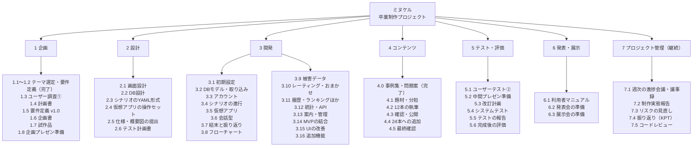
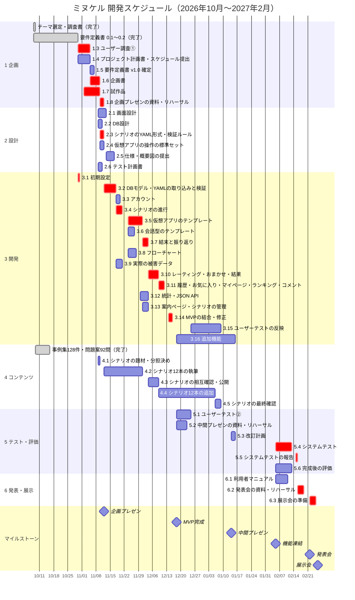
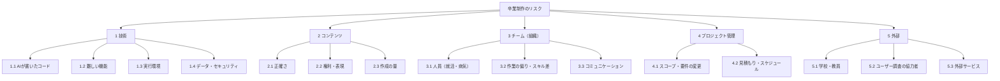

# プロジェクト計画書：ネット詐欺見抜きトレーニング「ミヌケル」（仮称）

| 項目 | 内容 |
| --- | --- |
| 版 | 0.1（ドラフト。チームの確認待ち） |
| 作成日 | 2026年10月30日 |
| 作成 | Claude（Claude Code）。チームが確認・修正して確定する |
| 関連資料 | [概要説明](overview.md)、[チェックリスト](checklist.md)、[要件定義書](requirements.md)、[仮のガントチャート](gantt-chart.xlsx) |

**この文書の役割**：要件定義書が「何を作るか」を決めるのに対し、この計画書は「**どうやって、いつまでに、誰と作るか**」を決める。必須工程の「4. スケジュール提出」と「8. レビューを受けた改訂計画の提出」の元にする。

**※の付いた章**（[2章 ゴール](#2-ゴール設定smart)、[4章 WBS・PERT・スケジュール](#4-wbspertスケジュール)、[8章 リスク分析](#8-リスク分析)）は、課題の指示で「五輪組も作る」とされた項目。

## 目次

1. [プロジェクトの概要と体制](#1-プロジェクトの概要と体制)
2. [ゴール設定（SMART）※](#2-ゴール設定smart)
3. [成果物一覧](#3-成果物一覧)
4. [WBS・PERT・スケジュール ※](#4-wbspertスケジュール)
5. [ステークホルダー一覧と対応方針](#5-ステークホルダー一覧と対応方針)
6. [コミュニケーション計画](#6-コミュニケーション計画)
7. [品質計画](#7-品質計画)
8. [リスク分析 ※](#8-リスク分析)
9. [プロジェクトルール](#9-プロジェクトルール)
10. [企画書に盛り込む内容](#10-企画書に盛り込む内容)
11. [未決事項](#11-未決事項チームで決めること)
12. [変更履歴](#12-変更履歴)

---

## 1. プロジェクトの概要と体制

### 1.1 概要

| 項目 | 内容 |
| --- | --- |
| 作品 | ミヌケル（仮称）：本物そっくりに動く架空のメールアプリやチャットの中で、ネット詐欺への対処を体験し、分岐のフローチャートと実際の被害データで振り返る学習Webアプリ（[要件定義書 1章](requirements.md#1-概要)） |
| 期間 | 2026年10月8日（テーマ検討の開始）〜2027年2月27日（展示会の最終日） |
| 主な日程 | 企画プレゼン 11/12、MVP完成 12/18、中間プレゼン 1/14、機能凍結 2/5、発表会 2/22（予定）、展示会 2/26・27 |
| 開発の進め方 | コードは主に Claude Code が書き、人がレビューして説明できる状態にしてから取り込む。シナリオ（コンテンツ）は人が Claude と一緒に書き、別の人が確認する |

### 1.2 体制と役割

メンバーは4人を想定している（人数と名前は[11章](#11-未決事項チームで決めること)で決める）。1人が複数の役割を持ってもよい。どの役割も、シナリオを1人3本（最終6本）書く。

| 役割 | 名前 | 主な責任 | 主な担当（[4.3節](#43-pert前後関係の整理)のWBS番号） |
| --- | --- | --- | --- |
| PM（リーダー） | （未定） | 計画・進捗・リスクの管理、教員への報告、会議の司会、文書のとりまとめ | 1.4〜1.6、2.5、3.6、3.13、5.3、6.1 |
| BE（バックエンド） | （未定） | DB・シナリオの進行・集計・API。Claude Code への開発の依頼とレビューの中心 | 2.2、2.3、3.1、3.2、3.4、3.8、3.10、3.12 |
| FE（フロントエンド・UI） | （未定） | 画面設計、仮想アプリと会話の画面、使いやすさの改善 | 2.1、2.4、3.3、3.5、3.7、3.11、3.15 |
| 品質（コンテンツ・テスト） | （未定） | シナリオと被害データの正しさ、テスト計画とテスト、ユーザー調査 | 1.3、2.6、3.9、4.3、4.5、5.1、5.4〜5.6 |

レビューの組み合わせ：BE ⇄ FE がお互いのコードを、品質 ⇄ PM がお互いの文書を確認する。シナリオは、書いた人以外の1人が確認する（[要件定義書 C-07](requirements.md#56-作成のルール必ず守る)）。

---

## 2. ゴール設定（SMART）※

### 2.1 最終ゴール

> **2027年2月5日（機能凍結）までに**、分岐型のシナリオ**24本**で遊べるネット詐欺対策トレーニング「ミヌケル」を、要件定義書の**必須と追加の機能がすべて動く状態**で完成させる。**2月26・27日の展示会で100人以上**に体験してもらい、**SUS 68点以上**、同じ手口の2本目以降で「安全」以上の結末になる割合が1本目より**15ポイント以上**上がることを確かめて、**2月22日の発表会**で結果を発表する。

| 観点 | 内容 |
| --- | --- |
| **S**pecific（具体的） | 誰に：スマホを使う一般の方（学生とその家族）。何を：仮想のアプリと会話で詐欺への対処を体験し、フローチャートと実際の被害データで振り返るWebアプリ。どこで：教室のプレゼン3回と展示会 |
| **M**easurable（測れる） | 下の[2.2節](#22-測る指標)の8つの指標で、達成したかどうかを数字で判断する |
| **A**chievable（達成できる） | 開発の大部分を Claude Code が行う。必須（MVP）と追加・余裕を分けている。外部APIを使わない。シナリオの素材（出典を確かめた事例128件・問題案92問）がすでにある。計画上、MVPまでの最も厳しい経路にも2日の余裕があり、MVPのあとに14日の余裕がある（[4.5節](#45-クリティカルパス)） |
| **R**elevant（目的に合う） | 概要説明の評価の観点（目的明確度・完成度・挑戦度・品質・プレゼン・チームワーク）と、3階層（安全・データ分析・地域社会）に直接つながる |
| **T**ime-bound（期限がある） | 11/12 企画プレゼン、12/18 MVP、1/14 中間プレゼン、2/5 機能凍結、2/22 発表会、2/26・27 展示会 |

### 2.2 測る指標

| # | 指標 | 目標 | 測り方・時期 | 評価の観点 |
| --- | --- | --- | --- | --- |
| G1 | 機能の完成 | 必須の要件の「確認方法」をすべて満たす（12/18）。追加の要件をすべて満たす（2/5） | 要件ごとのチェック表（[7.4節](#74-品質を確かめる活動)） | 完成度 |
| G2 | シナリオの本数 | 公開12本（12/18）、24本（2/5） | シナリオの管理画面 | 完成度 |
| G3 | 品質 | 自動テストのカバレッジ80%以上。システムテストで重大な不具合0件。[チェックリスト](checklist.md)すべてにチェック | coverage、不具合の一覧（2/15） | 品質 |
| G4 | 使いやすさ | SUS 68点以上（目標75点） | 完成後のアンケート（2/5〜2/12） | 品質 |
| G5 | 学習効果 | 同じ手口の2本目以降の「安全」以上の割合が、1本目より15ポイント以上高い | アプリの記録（[要件定義書 F-13-7](requirements.md#f-13-統計分析)） | 目的明確度 |
| G6 | 展示会 | 2日間で100人以上が体験する。サーバーの停止0回 | 展示会モードの記録 | プレゼン |
| G7 | プレゼン | 3回すべてを全員で行い、時間（8分・6分・8分）の±30秒に収める | リハーサルで時間を測る | プレゼン |
| G8 | チームワーク | 全員が毎週1件以上のPRかレビューをする。全員がシナリオを書く | GitHub の記録、週次会議 | チームワーク |

### 2.3 マイルストーンごとのゴール

| # | 日付 | マイルストーン | ゴール（終わった状態） |
| --- | --- | --- | --- |
| M1 | 11/12（木） | 企画プレゼン | 試作品で、SMSのシナリオ1本が「操作 → 結末 → フローチャート」まで動き、8分の発表で見せられる。ユーザー調査①の結果（10人以上）を入れる |
| M2 | 12/18（金） | MVP完成 | 必須の要件がすべて動き、シナリオ12本が公開状態。CIがLinuxとWindowsで通る |
| M3 | 1/14（木） | 中間プレゼン | MVPのデモと、ユーザーテスト②（5人以上）の結果を発表する |
| M4 | 2/5（金） | 機能凍結 | 追加の要件がすべて動き、シナリオ24本が公開状態。これ以降は不具合の修正だけ |
| M5 | 2/22（月） | 発表会 | 完成後の評価（G4・G5）とシステムテストの結果を発表する |
| M6 | 2/26（金）・27（土） | 展示会 | 100人以上が体験し、止まらずに運営できる |

---

## 3. 成果物一覧

プログラム（PG）と利用者マニュアルのほかに、**計画・設計・テスト・評価・発表・運用の記録**が必要になる。教員はプログラムだけでなく、「計画どおり進めたか」「品質を確かめたか」「ユーザーの声を取り入れたか」を見るため。概要説明の必須工程（①〜⑨）に当たるものには番号を付けた。

| 区分 | 成果物 | 内容 | 主な読み手・提出先 | 期限 | 担当 | 置き場所 | 状態 |
| --- | --- | --- | --- | --- | --- | --- | --- |
| 企画 | 制作テーマ（①） | テーマの候補と選んだ理由 | 担当教員 | 済 | 全員 | `docs/theme-research*.md` | 完了 |
| 企画 | 調査書（②） | 背景（詐欺の被害の統計）、既存のサービスとの違い、ユーザー調査①の結果 | 担当教員 | 11/9 | 品質・PM | `docs/research-report.md` | 未着手（素材は事例集・テーマ選定の調査） |
| 企画 | 企画書（②） | 目的・ターゲット・コンセプト・主な機能・3階層・ゴール・スケジュール概要 | 担当教員、プレゼンの聞き手 | 11/9 | PM | `docs/proposal.md` | 未着手 |
| 管理 | プロジェクト計画書（④） | 本書。ゴール・WBS・スケジュール・体制・リスクなど | 担当教員、チーム | 11/4 | PM | `docs/project-plan.md` | 作成中 |
| 管理 | 改訂計画書（⑧） | 技術レビューと中間プレゼンの指摘を受けた計画の見直し | 担当教員 | 1/15 | PM | 本書の改版と変更点の一覧 | 未着手 |
| 管理 | 進捗の記録（⑥ 制作実態報告） | 週次の議事録、進捗、リスクの見直し | 担当教員、チーム | 毎週 | PM | `docs/minutes/` | 未着手 |
| 管理 | 課題・タスクの一覧 | 作業・不具合・リスクのIssueとボード | チーム | 随時 | 全員 | GitHub Issues・Projects | 未着手 |
| 要件 | 要件定義書 | 何を作るか。機能・画面・DB・非機能要件 | チーム、Claude Code、教員 | 11/6（v1.0） | PM | `docs/requirements.md` | 0.2版 |
| 設計（⑤） | システム構成図 | サーバー・DB・ブラウザ・展示会の機材のつながり | 教員、技術レビュー | 11/16 | BE | `docs/design/architecture.md` | 未着手 |
| 設計（⑤） | 画面設計書 | 画面一覧・画面遷移図・ワイヤーフレーム | チーム、教員 | 11/12 | FE | `docs/design/screens.md` | 未着手（画面一覧は要件定義書 7章） |
| 設計（⑤） | DB設計書 | ER図・テーブル定義 | チーム、技術レビュー | 11/10 | BE | `docs/design/database.md` | 未着手（案は要件定義書 9章） |
| 設計（⑤） | API仕様書 | 自前のJSON APIの入力・出力・権限 | チーム、技術レビュー | 12/3 | BE | `docs/design/api.md` | 未着手 |
| 設計 | シナリオの書き方（仕様と手引き） | YAMLの形式、検証ルール、書き方の例 | シナリオを書く人 | 11/11 | BE・品質 | `docs/scenario-guide.md` | 未着手 |
| 開発 | ソースコード | Django のアプリ、テンプレート、静的ファイル | チーム、教員 | 2/5 | 全員 | リポジトリ | 未着手 |
| 開発 | 自動テスト・CI | 単体・結合のテスト、GitHub Actions | チーム | 2/5 | BE | `tests/`、`.github/workflows/` | 未着手 |
| 開発 | README・CLAUDE.md | セットアップと起動の手順、DBのバックアップと戻し方、開発のルール | チーム、Claude Code、教員 | 10/30〜随時 | BE | リポジトリの直下 | README のみあり |
| コンテンツ | シナリオのデータ | YAMLで24本。出典付き | 利用者 | 12/18（12本）、2/5（24本） | 全員 | `seed/scenarios/` | 素材あり（事例集・問題案） |
| コンテンツ | 被害データ | 公的機関の統計と出典 | 利用者 | 11/20 | 品質 | `seed/victim_stats.yaml` | 初期値あり |
| テスト | テスト計画書 | テストの範囲・方法・合格の基準・時期 | チーム、教員 | 11/10 | 品質 | `docs/test/test-plan.md` | 未着手 |
| テスト（⑦） | テスト仕様書・テスト結果報告書 | テストケース、結果、不具合と対応 | 教員 | 2/15 | 品質 | `docs/test/` | 未着手 |
| 評価 | ユーザー調査の計画と結果報告 | ①アンケート・聞き取り、②ユーザーテスト、③完成後の評価（SUS・学習効果） | 教員、プレゼンの聞き手 | 11/4、12/24、2/12 | 品質 | `docs/research/` | 未着手 |
| 発表（③⑨） | プレゼン資料（3回分） | 企画・中間・発表会のスライドと台本 | クラス・他クラス・教員 | 11/11、1/13、2/18 | 全員 | `docs/slides/` | 未着手 |
| マニュアル | 利用者マニュアル | 遊び方、画面の説明、よくある質問 | 利用者、展示会の来場者 | 2/10 | PM | `docs/manual/user.md` | 未着手 |
| マニュアル | 管理者マニュアル | シナリオの作成と公開、被害データの更新、展示会モードの操作 | 編集者・管理者（チーム） | 2/10 | BE | `docs/manual/admin.md` | 未着手 |
| 展示 | 展示会の資料 | ポスター、操作の案内、デモの手順、機材と当日のチェックリスト | 来場者、チーム | 2/24 | 全員 | `docs/exhibition/` | 未着手 |
| 振り返り | 振り返りの記録 | マイルストーンごとのKPT（よかったこと・問題・次にやること） | チーム、教員 | M1〜M6 のあと | PM | `docs/retrospectives/` | 未着手 |

---

## 4. WBS・PERT・スケジュール※

### 4.1 前提

| 項目 | 決めたこと |
| --- | --- |
| 単位 | 日数は**稼働日**（平日）で数える。授業の日だけでなく、各自が授業の外で作業する日を含む |
| 休み | 土日、祝日（11/3、11/23、1/1、1/11、2/11、2/23）、年末年始（12/28〜1/4。学校の予定が分かったら直す） |
| 起点 | 2026年10月30日（本書の作成日）。それより前の作業は「完了」として載せる |
| 見積もりの考え方 | 開発の作業は、Claude Code が書いたものを人がレビューし、動かして確かめるまでを含む。人だけで書く場合のおよそ半分の日数にしている。見積もりが外れたときの対応は[8章](#8-リスク分析)のR14 |
| マイルストーン | 日付が決まっている（プレゼン・MVP・機能凍結・発表会・展示会）。前の作業はその前日までに終える |

### 4.2 WBS（作業の洗い出し）

成果物（[3章](#3-成果物一覧)）を作るのに必要な作業を、6つの工程に分けて洗い出した。「継続」の作業は全期間を通して行うため、[4.3節](#43-pert前後関係の整理)のネットワークには入れていない。

**WBSの一覧**（完了した作業と、継続の作業を含む）

| WBS | 作業 | 成果物 | 担当 | 日数 | 状態 |
| --- | --- | --- | --- | ---: | --- |
| **1** | **企画** | | | | |
| 1.1 | テーマ選定・調査 | 制作テーマ | 全員 | ― | 完了（10/8） |
| 1.2 | 要件定義書 0.1〜0.2 | 要件定義書 | PM | ― | 完了（10/29） |
| 1.3 | ユーザー調査①（アンケート10〜20人、聞き取り3〜5人） | 調査の結果 | 品質 | 3 | |
| 1.4 | プロジェクト計画書・スケジュール提出 | 本書 | PM | 3 | 作成中 |
| 1.5 | 要件定義書 v1.0 の確定（未決事項を決める） | 要件定義書 | PM | 2 | |
| 1.6 | 企画書・調査書 | 企画書、調査書 | PM | 3 | |
| 1.7 | 試作品（SMSのシナリオ1本が動く） | 試作品 | BE・FE | 5 | |
| 1.8 | 企画プレゼンの資料・リハーサル | スライド | 全員 | 2 | |
| **2** | **設計** | | | | |
| 2.1 | 画面設計（ワイヤーフレーム・画面遷移） | 画面設計書 | FE | 4 | |
| 2.2 | DB設計（ER図・テーブル定義） | DB設計書 | BE | 2 | |
| 2.3 | シナリオのYAML形式・検証ルール | シナリオの書き方 | BE | 2 | |
| 2.4 | 仮想アプリの操作の標準セット | 画面設計書 | FE | 2 | |
| 2.5 | 仕様・概要図の提出（システム構成図・API） | 仕様・概要図 | PM | 2 | |
| 2.6 | テスト計画書 | テスト計画書 | 品質 | 2 | |
| **3** | **開発** | | | | |
| 3.1 | 初期設定（Django・CI・CLAUDE.md） | ソースコード | BE | 1 | |
| 3.2 | DBモデル・YAMLの取り込みと検証 | ソースコード | BE | 4 | |
| 3.3 | アカウント | ソースコード | FE | 2 | |
| 3.4 | シナリオの進行（場面・調べる・決める・記録） | ソースコード | BE | 3 | |
| 3.5 | 仮想アプリのテンプレート | ソースコード | FE | 5 | |
| 3.6 | 会話型のテンプレート | ソースコード | PM | 3 | |
| 3.7 | 結末と振り返り | ソースコード | FE | 3 | |
| 3.8 | フローチャート（集計・配置・SVG） | ソースコード | BE | 4 | |
| 3.9 | 実際の被害データ | ソースコード、被害データ | 品質 | 3 | |
| 3.10 | レーティング・おまかせ・結果 | ソースコード | BE | 3 | |
| 3.11 | 履歴・お気に入り・マイページ・ランキング・コメント | ソースコード | FE | 3 | |
| 3.12 | 統計・JSON API | ソースコード、API仕様書 | BE | 4 | |
| 3.13 | 案内ページ・シナリオの管理 | ソースコード | PM | 3 | |
| 3.14 | MVPの結合・修正 | MVP | 全員 | 2 | |
| 3.15 | ユーザーテストの反映（UIの改善） | ソースコード | FE | 5 | |
| 3.16 | 追加機能（展示会モード・挑戦状・結末の一覧・ヒント・URLの読み方ほか） | ソースコード | BE・FE | 14 | |
| **4** | **コンテンツ** | | | | |
| 4.0 | 事例集（128件、出典を確認）・問題案（92問） | 事例集、問題案 | 全員 | ― | 完了（10/15） |
| 4.1 | シナリオの題材・分担決め | 分担表 | 全員 | 1 | |
| 4.2 | シナリオ12本の執筆（1人3本） | シナリオのデータ | 全員 | 12 | |
| 4.3 | シナリオの相互確認・公開 | シナリオのデータ | 品質 | 3 | |
| 4.4 | シナリオ12本の追加（24本へ） | シナリオのデータ | 全員 | 14 | |
| 4.5 | シナリオの最終確認 | シナリオのデータ | 品質 | 3 | |
| **5** | **テスト・評価** | | | | |
| 5.1 | ユーザーテスト②（MVPで操作に迷う場所を見つける） | 調査の結果 | 品質 | 5 | |
| 5.2 | 中間プレゼンの資料・リハーサル | スライド | 全員 | 3 | |
| 5.3 | 改訂計画（技術レビューと中間プレゼンの指摘を反映） | 改訂計画書 | PM | 2 | |
| 5.4 | システムテスト | テスト仕様書・結果 | 品質 | 5 | |
| 5.5 | システムテストの報告 | テスト結果報告書 | 品質 | 1 | |
| 5.6 | 完成後の評価（SUS・学習効果） | 評価の結果 | 品質 | 5 | |
| **6** | **発表・展示** | | | | |
| 6.1 | 利用者マニュアル・管理者マニュアル | マニュアル | PM・BE | 4 | |
| 6.2 | 発表会の資料・リハーサル | スライド | 全員 | 3 | |
| 6.3 | 展示会の準備（機材・デモデータ・ポスター・リハーサル） | 展示会の資料 | 全員 | 2 | |
| **7** | **プロジェクト管理（継続）** | | | | |
| 7.1 | 週次の進捗会議・議事録 | 議事録 | PM | 毎週 | |
| 7.2 | 制作実態報告 | 報告書 | PM | 指示のたび | |
| 7.3 | リスクの見直し | リスク一覧 | PM | 毎週 | |
| 7.4 | 振り返り（KPT） | 振り返りの記録 | 全員 | M1〜M6 のあと | |
| 7.5 | コードレビュー | PRのレビュー | 全員 | PRのたび | |

### 4.3 PERT（前後関係の整理）

作業ごとに「前に終わっていなければならない作業」を決め、最早・最遅の日付と余裕（遅れてもよい稼働日数）を計算した。余裕が最も小さい作業（**太字**）がクリティカルパス（[4.5節](#45-クリティカルパス)）。

| ID | 作業 | 日数 | 前の作業 | 最早開始 | 最早終了 | 最遅開始 | 最遅終了 | 余裕 | 担当 |
| --- | --- | ---: | --- | --- | --- | --- | --- | ---: | --- |
| 1.3 | **ユーザー調査①（アンケート・聞き取り）** | 3 | ― | 10/30（金） | 11/4（水） | 10/30（金） | 11/4（水） | 0 | 品質 |
| 1.4 | プロジェクト計画書・スケジュール提出 | 3 | ― | 10/30（金） | 11/4（水） | 11/9（月） | 11/11（水） | 5 | PM |
| 1.5 | 要件定義書 v1.0 確定 | 2 | 1.3 | 11/5（木） | 11/6（金） | 11/10（火） | 11/11（水） | 3 | PM |
| 1.6 | **企画書** | 3 | 1.3 | 11/5（木） | 11/9（月） | 11/5（木） | 11/9（月） | 0 | PM |
| 3.1 | **初期設定（Django・CI・CLAUDE.md）** | 1 | ― | 10/30（金） | 10/30（金） | 10/30（金） | 10/30（金） | 0 | BE |
| 1.7 | **試作品（シナリオ1本が動く）** | 5 | 3.1 | 11/2（月） | 11/9（月） | 11/2（月） | 11/9（月） | 0 | BE・FE |
| 1.8 | **企画プレゼンの資料・リハーサル** | 2 | 1.6・1.7 | 11/10（火） | 11/11（水） | 11/10（火） | 11/11（水） | 0 | 全員 |
| M1 | ◆ **企画プレゼン** | 0 | 1.8・1.4 | 11/12（木） | ― | ― | ― | ― | 全員 |
| 2.1 | 画面設計（ワイヤーフレーム・画面遷移） | 4 | 1.5 | 11/9（月） | 11/12（木） | 11/19（木） | 11/25（水） | 8 | FE |
| 2.2 | DB設計（ER図・テーブル定義） | 2 | 1.5 | 11/9（月） | 11/10（火） | 11/12（木） | 11/13（金） | 3 | BE |
| 2.3 | **シナリオのYAML形式・検証ルール** | 2 | 1.7 | 11/10（火） | 11/11（水） | 11/12（木） | 11/13（金） | 2 | BE |
| 2.4 | 仮想アプリの操作の標準セット | 2 | 1.7 | 11/10（火） | 11/11（水） | 11/24（火） | 11/25（水） | 9 | FE |
| 2.5 | 仕様・概要図の提出 | 2 | 2.1・2.2 | 11/13（金） | 11/16（月） | 12/16（水） | 12/17（木） | 22 | PM |
| 2.6 | テスト計画書 | 2 | 1.5 | 11/9（月） | 11/10（火） | 2/4（木） | 2/5（金） | 55 | 品質 |
| 3.2 | **DBモデル・YAMLの取り込みと検証** | 4 | 2.2・2.3 | 11/12（木） | 11/17（火） | 11/16（月） | 11/19（木） | 2 | BE |
| 3.3 | アカウント | 2 | 3.2 | 11/18（水） | 11/19（木） | 12/4（金） | 12/7（月） | 11 | FE |
| 3.4 | **シナリオの進行（場面・調べる・決める・記録）** | 3 | 3.2 | 11/18（水） | 11/20（金） | 11/20（金） | 11/25（水） | 2 | BE |
| 3.5 | **仮想アプリのテンプレート** | 5 | 2.1・2.4・3.4 | 11/24（火） | 11/30（月） | 11/26（木） | 12/2（水） | 2 | FE |
| 3.6 | 会話型のテンプレート | 3 | 2.1・3.4 | 11/24（火） | 11/26（木） | 11/30（月） | 12/2（水） | 4 | PM |
| 3.7 | **結末と振り返り** | 3 | 3.5・3.6 | 12/1（火） | 12/3（木） | 12/3（木） | 12/7（月） | 2 | FE |
| 3.8 | フローチャート（集計・配置・SVG） | 4 | 3.4 | 11/24（火） | 11/27（金） | 12/4（金） | 12/9（水） | 8 | BE |
| 3.9 | 実際の被害データ | 3 | 3.2 | 11/18（水） | 11/20（金） | 12/7（月） | 12/9（水） | 12 | 品質 |
| 3.10 | **レーティング・おまかせ・結果** | 3 | 3.3・3.7 | 12/4（金） | 12/8（火） | 12/8（火） | 12/10（木） | 2 | BE |
| 3.11 | **履歴・お気に入り・マイページ・ランキング・コメント** | 3 | 3.10 | 12/9（水） | 12/11（金） | 12/11（金） | 12/15（火） | 2 | FE |
| 3.12 | 統計・JSON API | 4 | 3.8・3.9 | 11/30（月） | 12/3（木） | 12/10（木） | 12/15（火） | 8 | BE |
| 3.13 | 案内ページ・シナリオの管理 | 3 | 3.5 | 12/1（火） | 12/3（木） | 12/8（火） | 12/10（木） | 5 | PM |
| 4.1 | シナリオの題材・分担決め | 1 | 1.5 | 11/9（月） | 11/9（月） | 11/24（火） | 11/24（火） | 10 | 全員 |
| 4.2 | シナリオ12本の執筆 | 12 | 2.3・4.1 | 11/12（木） | 11/30（月） | 11/25（水） | 12/10（木） | 8 | 全員 |
| 4.3 | シナリオの相互確認・公開 | 3 | 4.2・3.2・3.13 | 12/4（金） | 12/8（火） | 12/11（金） | 12/15（火） | 5 | 品質 |
| 3.14 | **MVPの結合・修正** | 2 | 3.11・3.12・3.13・4.3 | 12/14（月） | 12/15（火） | 12/16（水） | 12/17（木） | 2 | 全員 |
| M2 | ◆ **MVP完成** | 0 | 3.14・2.5 | 12/18（金） | ― | ― | ― | ― | 全員 |
| 5.1 | ユーザーテスト②（MVP） | 5 | M2 | 12/18（金） | 12/24（木） | 1/22（金） | 1/28（木） | 18 | 品質 |
| 5.2 | 中間プレゼンの資料・リハーサル | 3 | M2 | 12/18（金） | 12/22（火） | 1/8（金） | 1/13（水） | 9 | 全員 |
| M3 | ◆ **中間プレゼン** | 0 | 5.2 | 1/14（木） | ― | ― | ― | ― | 全員 |
| 5.3 | 改訂計画（レビューを受けて） | 2 | M3・5.1 | 1/14（木） | 1/15（金） | 2/3（水） | 2/4（木） | 14 | PM |
| 3.15 | ユーザーテストの反映（UIの改善） | 5 | 5.1 | 12/25（金） | 1/8（金） | 1/29（金） | 2/4（木） | 18 | FE |
| 3.16 | 追加機能（展示会モード・挑戦状・結末の一覧・ヒントほか） | 14 | M2 | 12/18（金） | 1/15（金） | 1/18（月） | 2/4（木） | 14 | BE・FE |
| 4.4 | シナリオ12本の追加（24本へ） | 14 | 4.3 | 12/9（水） | 1/5（火） | 1/13（水） | 2/1（月） | 18 | 全員 |
| 4.5 | シナリオの最終確認 | 3 | 4.4 | 1/6（水） | 1/8（金） | 2/2（火） | 2/4（木） | 18 | 品質 |
| M4 | ◆ **機能凍結** | 0 | 3.15・3.16・4.5・5.3 | 2/5（金） | ― | ― | ― | ― | 全員 |
| 5.4 | **システムテスト** | 5 | M4・2.6 | 2/5（金） | 2/12（金） | 2/8（月） | 2/15（月） | 1 | 品質 |
| 5.5 | **システムテストの報告** | 1 | 5.4 | 2/15（月） | 2/15（月） | 2/16（火） | 2/16（火） | 1 | 品質 |
| 5.6 | 完成後の評価（SUS・学習効果） | 5 | M4 | 2/5（金） | 2/12（金） | 2/9（火） | 2/16（火） | 2 | 品質 |
| 6.1 | 利用者マニュアル | 4 | M4 | 2/5（金） | 2/10（水） | 2/17（水） | 2/22（月） | 7 | PM |
| 6.2 | **発表会の資料・リハーサル** | 3 | 5.5・5.6 | 2/16（火） | 2/18（木） | 2/17（水） | 2/19（金） | 1 | 全員 |
| M5 | ◆ **発表会** | 0 | 6.2 | 2/22（月） | ― | ― | ― | ― | 全員 |
| 6.3 | **展示会の準備（機材・デモデータ・ポスター・リハーサル）** | 2 | M5・6.1 | 2/22（月） | 2/24（水） | 2/24（水） | 2/25（木） | 1 | 全員 |
| M6 | ◆ **展示会** | 0 | 6.3 | 2/26（金） | ― | ― | ― | ― | 全員 |

- **最早開始・最早終了**：前の作業がすべて最短で終わったときに、始められる日・終わる日。
- **最遅開始・最遅終了**：次のマイルストーンに間に合うために、遅くとも始める日・終える日。
- **余裕**：最遅開始 − 最早開始（稼働日）。0 は1日も遅れられないこと。

**ネットワーク図**（箱が作業、矢印が前後関係。赤い枠がクリティカルパス、黄色の六角形がマイルストーン）

```mermaid
flowchart LR
    n1_3["1.3 ユーザー調査①<br>3日・余裕0"]
    n1_4["1.4 プロジェクト計画書・スケジュール提出<br>3日・余裕5"]
    n1_5["1.5 要件定義書 v1.0 確定<br>2日・余裕3"]
    n1_6["1.6 企画書<br>3日・余裕0"]
    n3_1["3.1 初期設定<br>1日・余裕0"]
    n1_7["1.7 試作品<br>5日・余裕0"]
    n1_8["1.8 企画プレゼンの資料・リハーサル<br>2日・余裕0"]
    nM1{{"◆ 企画プレゼン<br>11/12（木）"}}
    n2_1["2.1 画面設計<br>4日・余裕8"]
    n2_2["2.2 DB設計<br>2日・余裕3"]
    n2_3["2.3 シナリオのYAML形式・検証ルール<br>2日・余裕2"]
    n2_4["2.4 仮想アプリの操作の標準セット<br>2日・余裕9"]
    n2_5["2.5 仕様・概要図の提出<br>2日・余裕22"]
    n2_6["2.6 テスト計画書<br>2日・余裕55"]
    n3_2["3.2 DBモデル・YAMLの取り込みと検証<br>4日・余裕2"]
    n3_3["3.3 アカウント<br>2日・余裕11"]
    n3_4["3.4 シナリオの進行<br>3日・余裕2"]
    n3_5["3.5 仮想アプリのテンプレート<br>5日・余裕2"]
    n3_6["3.6 会話型のテンプレート<br>3日・余裕4"]
    n3_7["3.7 結末と振り返り<br>3日・余裕2"]
    n3_8["3.8 フローチャート<br>4日・余裕8"]
    n3_9["3.9 実際の被害データ<br>3日・余裕12"]
    n3_10["3.10 レーティング・おまかせ・結果<br>3日・余裕2"]
    n3_11["3.11 履歴・お気に入り・マイページ・ランキング・コメント<br>3日・余裕2"]
    n3_12["3.12 統計・JSON API<br>4日・余裕8"]
    n3_13["3.13 案内ページ・シナリオの管理<br>3日・余裕5"]
    n4_1["4.1 シナリオの題材・分担決め<br>1日・余裕10"]
    n4_2["4.2 シナリオ12本の執筆<br>12日・余裕8"]
    n4_3["4.3 シナリオの相互確認・公開<br>3日・余裕5"]
    n3_14["3.14 MVPの結合・修正<br>2日・余裕2"]
    nM2{{"◆ MVP完成<br>12/18（金）"}}
    n5_1["5.1 ユーザーテスト②<br>5日・余裕18"]
    n5_2["5.2 中間プレゼンの資料・リハーサル<br>3日・余裕9"]
    nM3{{"◆ 中間プレゼン<br>1/14（木）"}}
    n5_3["5.3 改訂計画<br>2日・余裕14"]
    n3_15["3.15 ユーザーテストの反映<br>5日・余裕18"]
    n3_16["3.16 追加機能<br>14日・余裕14"]
    n4_4["4.4 シナリオ12本の追加<br>14日・余裕18"]
    n4_5["4.5 シナリオの最終確認<br>3日・余裕18"]
    nM4{{"◆ 機能凍結<br>2/5（金）"}}
    n5_4["5.4 システムテスト<br>5日・余裕1"]
    n5_5["5.5 システムテストの報告<br>1日・余裕1"]
    n5_6["5.6 完成後の評価<br>5日・余裕2"]
    n6_1["6.1 利用者マニュアル<br>4日・余裕7"]
    n6_2["6.2 発表会の資料・リハーサル<br>3日・余裕1"]
    nM5{{"◆ 発表会<br>2/22（月）"}}
    n6_3["6.3 展示会の準備<br>2日・余裕1"]
    nM6{{"◆ 展示会<br>2/26（金）"}}
    n1_3 --> n1_5
    n1_3 --> n1_6
    n3_1 --> n1_7
    n1_6 --> n1_8
    n1_7 --> n1_8
    n1_8 --> nM1
    n1_4 --> nM1
    n1_5 --> n2_1
    n1_5 --> n2_2
    n1_7 --> n2_3
    n1_7 --> n2_4
    n2_1 --> n2_5
    n2_2 --> n2_5
    n1_5 --> n2_6
    n2_2 --> n3_2
    n2_3 --> n3_2
    n3_2 --> n3_3
    n3_2 --> n3_4
    n2_1 --> n3_5
    n2_4 --> n3_5
    n3_4 --> n3_5
    n2_1 --> n3_6
    n3_4 --> n3_6
    n3_5 --> n3_7
    n3_6 --> n3_7
    n3_4 --> n3_8
    n3_2 --> n3_9
    n3_3 --> n3_10
    n3_7 --> n3_10
    n3_10 --> n3_11
    n3_8 --> n3_12
    n3_9 --> n3_12
    n3_5 --> n3_13
    n1_5 --> n4_1
    n2_3 --> n4_2
    n4_1 --> n4_2
    n4_2 --> n4_3
    n3_2 --> n4_3
    n3_13 --> n4_3
    n3_11 --> n3_14
    n3_12 --> n3_14
    n3_13 --> n3_14
    n4_3 --> n3_14
    n3_14 --> nM2
    n2_5 --> nM2
    nM2 --> n5_1
    nM2 --> n5_2
    n5_2 --> nM3
    nM3 --> n5_3
    n5_1 --> n5_3
    n5_1 --> n3_15
    nM2 --> n3_16
    n4_3 --> n4_4
    n4_4 --> n4_5
    n3_15 --> nM4
    n3_16 --> nM4
    n4_5 --> nM4
    n5_3 --> nM4
    nM4 --> n5_4
    n2_6 --> n5_4
    n5_4 --> n5_5
    nM4 --> n5_6
    nM4 --> n6_1
    n5_5 --> n6_2
    n5_6 --> n6_2
    n6_2 --> nM5
    nM5 --> n6_3
    n6_1 --> n6_3
    n6_3 --> nM6
    classDef crit fill:#f4cccc,stroke:#cc0000,stroke-width:3px,color:#000
    classDef ms fill:#fff2cc,stroke:#b45f06,stroke-width:2px,color:#000
    class n1_3,n1_6,n1_7,n1_8,n2_3,n3_1,n3_10,n3_11,n3_14,n3_2,n3_4,n3_5,n3_7,n5_4,n5_5,n6_2,n6_3 crit
    class nM1,nM2,nM3,nM4,nM5,nM6 ms
```

### 4.4 スケジュール（ガントチャート）

最早の日付で並べた。赤がクリティカルパスの作業、灰色が完了した作業。Excel 版は [gantt-chart.xlsx](gantt-chart.xlsx)（仮。本書に合わせて直す）。

**人の重なりの調整**：PERT は人の数を考えないため、作業が多い時期は担当を分けた（例：11/24〜12/3 は FE が仮想アプリと結末、PM が会話型と管理画面、BE がフローチャートと統計）。同じ人の作業が短く重なるところ（11/5〜11/11 の PM・BE・FE の設計の作業など）は、余裕のある作業を後ろにずらして調整する（例：2.4 は余裕9日、2.6 は余裕55日）。4.2 と 4.4（シナリオの執筆）は全員が開発と並行して、1日1〜2時間ずつ進める。

### 4.5 クリティカルパス

日付が決まったマイルストーンでスケジュールが区切られるため、**区間ごとに余裕が最も小さい経路**をクリティカルパスとした。

| 区間 | クリティカルパス | 余裕 | 意味 |
| --- | --- | ---: | --- |
| ① 今日 〜 企画プレゼン（11/12） | 3.1 初期設定 → 1.7 試作品 → 1.8 プレゼン準備 → M1 1.3 ユーザー調査① → 1.6 企画書 → 1.8 → M1 | 0日 | 試作品と企画書が1日でも遅れると、プレゼンで見せられない |
| ② 企画プレゼン 〜 MVP（12/18） | 1.7 → 2.3 YAML形式 → 3.2 DBモデル・取り込み → 3.4 シナリオの進行 → 3.5 仮想アプリ → 3.7 結末と振り返り → 3.10 レーティング・おまかせ → 3.11 履歴・ランキング → 3.14 MVPの結合 → M2 | 2日 | **最も長い経路（1.7 から 3.14 まで9作業・30稼働日）。** ここが遅れるとMVPと中間プレゼンのデモに響く |
| ③ MVP 〜 機能凍結（2/5） | 3.16 追加機能 → M4 | 14日 | 余裕が大きい。区間②が遅れたときの**バッファ**として使う |
| ④ 機能凍結 〜 展示会（2/26） | M4 → 5.4 システムテスト → 5.5 報告 → 6.2 発表会の準備 → M5 → 6.3 展示会の準備 → M6 | 1日 | テストで見つかった不具合を直す時間が少ない。2/5 の機能凍結を必ず守る |

**クリティカルパスの管理**

1. 週次の進捗会議で、クリティカルパスの作業の残りの日数と余裕を必ず確かめる（[6章](#6-コミュニケーション計画)）。
2. クリティカルパスの作業は、ほかの作業より優先する。Claude Code への依頼も先に出す。
3. 区間②で2日を超えて遅れそうなときは、次の順で対応する：(1) ほかの人が手伝う（余裕のある 3.8・3.12・2.1 の担当） → (2) 3.11 のコメント・ランキングをMVPのあとに回す → (3) 区間③の余裕を使い、追加機能（3.16）を減らす。
4. 区間④を守るため、2/5 以降は新しい機能を入れない。

---

## 5. ステークホルダー一覧と対応方針

影響力（計画や評価を変えられる力）と関心の高さで、対応方針を4つに分けた。

| 方針 | 対象 | やること |
| --- | --- | --- |
| 重点的に関わる | 影響力：高・関心：高 | 早めに相談し、決めたことを確かめてもらう |
| 満足してもらう | 影響力：高・関心：中以下 | 必要なときに要点を短く伝える |
| 情報を伝える | 影響力：中以下・関心：高 | 進み具合や結果を定期的に伝え、意見をもらう |
| 様子を見る | 影響力：低・関心：低 | ルールを守り、必要なときに対応する |

| 区分 | ステークホルダー | 関心・期待 | 影響力 | 関心 | 方針 | 具体的な対応 |
| --- | --- | --- | --- | --- | --- | --- |
| ユーザ | 学生（クラスメイト・同世代） | 楽しく、短い時間で、自分が引っかかりやすい手口を知りたい | 中 | 高 | 情報を伝える | ユーザー調査①②で意見を聞く。試作品・MVPを触ってもらう |
| ユーザ | 家族（親・祖父母） | 文字が大きく、操作が簡単。電話の詐欺が心配 | 低 | 中 | 情報を伝える | ユーザーテスト②に参加してもらう。文字を大きくする機能と会話型で対応する |
| ユーザ | 他クラスの学生（プレゼンの評価者） | 目的が分かりやすく、デモが動き、工夫が伝わる | 高 | 中 | 満足してもらう | 評価の観点（概要説明）に合わせて資料を作る。リハーサルで時間を守る |
| ユーザ | 展示会の来場者・保護者 | 2〜3分で体験でき、驚きや学びがある | 中 | 中 | 満足してもらう | 1本だけ遊ぶ展示会モード、大画面のフローチャート、声かけの準備 |
| 開発側 | チームメンバー（PM・BE・FE・品質） | 単位を取る、作業の偏りがない、無理のない計画 | 高 | 高 | 重点的に関わる | 週次会議、担当表、心理的安全性（責めずに問題を出せる場） |
| 開発側 | 開発支援AI（Claude Code） | 明確な要件と確認方法 | 中 | ― | （道具として管理） | 依頼は Issue 単位。CLAUDE.md に共通ルール。出力は必ず人がレビューする（[9.4節](#94-claude-code-の使い方)） |
| 開発側 | 他チーム | ユーザー調査で協力し合う | 低 | 中 | 情報を伝える | お互いのアンケートとテストに協力する。日程を早めに伝える |
| 開発側 | 展示会の運営チーム（卒業アルバムと展示会を担当する1チーム） | 機材・場所・時間の情報 | 中 | 中 | 満足してもらう | 1月から必要な機材・電源・机の数を伝え、当日の流れを合わせる |
| 教職員 | 担当教員 | 計画どおり進み、品質を確かめ、技術を説明できる | 高 | 高 | 重点的に関わる | 必須工程の提出、制作実態報告、テーマと進め方の相談（[11章](#11-未決事項チームで決めること)） |
| 教職員 | 技術レビューを行う教員 | 設計とコードの質、セキュリティ | 高 | 中 | 満足してもらう | 設計書とコードの説明を準備し、指摘を Issue にして改訂計画に入れる |
| 教職員 | 学校（施設・ネットワークの担当） | 校内のルールとネットワークの安全 | 中 | 低 | 様子を見る | 展示会はLANの中だけで動かす。機材の持ち込みを事前に確かめる |
| 外部 | 公的機関（警察庁・国民生活センター・IPA・フィッシング対策協議会など） | 注意喚起と統計が正しく使われる | 中 | 低 | 様子を見る | 出典を明記し、ページを開いて確かめた内容だけを使う。相談先の番号は掲載前に確かめる |
| 外部 | なりすましに使われやすい実在の企業 | 名前・ロゴが勝手に使われない | 中 | 低 | 様子を見る | 実在の名前・ロゴを使わず、架空ブランドにする（[要件定義書 C-01](requirements.md#56-作成のルール必ず守る)） |
| 外部 | 詐欺の被害にあった人・その家族 | 責められたり、からかわれたりしない | 低 | 中 | 様子を見る | 「だれでもだまされうる」を前提に書く（C-08） |
| 外部 | 外部サービス（GitHub、Claude） | 利用規約を守る | 低 | 低 | 様子を見る | 規約を守る。秘密情報・個人情報を入れない |

---

## 6. コミュニケーション計画

| # | 目的 | いつ（頻度） | だれ → だれ | 方法 | 記録・成果物 |
| --- | --- | --- | --- | --- | --- |
| C1 | 今日の作業と困りごとの共有（朝会） | 授業の日の始めに10分 | チーム全員 | 対面。1人1分で「昨日・今日・困っていること」 | タスクボードを更新 |
| C2 | 進捗・クリティカルパス・リスクの確認 | 毎週1回 30分（授業の終わり） | 全員（司会はPM） | 対面またはオンライン通話 | 議事録 `docs/minutes/YYYY-MM-DD.md` |
| C3 | 日々の連絡・相談 | 随時。平日は24時間以内に返信 | チーム全員 | チームのチャット | 決めたことは Issue か文書に書き写す |
| C4 | 作業の割り当てと進み具合 | 随時 | 全員 | GitHub Issues・Projects（未着手 → 作業中 → レビュー待ち → 完了） | Issue の履歴 |
| C5 | コードと文書のレビュー | PRのたび。平日は24時間以内 | 作成者 → レビュアー1人以上 | GitHub の Pull Request | レビューのコメント |
| C6 | 開発の依頼 | Issueのたび | 担当 → Claude Code | Issue（要件ID・確認方法）と CLAUDE.md | PR と会話の要約 |
| C7 | 制作実態報告 | 授業で指示があったとき（目安は月1回） | PM → 担当教員 | 報告書と口頭での説明 | `docs/reports/` |
| C8 | テーマ・進め方の相談 | 10月中、11/9 までに1回 | PM・全員 ⇄ 担当教員 | 授業中の相談 | 議事録 |
| C9 | 技術レビュー | 1月（授業の10〜12回目） | チーム ⇄ 教員 | デモと、設計書・コードの説明 | 指摘を Issue にし、改訂計画（5.3）に入れる |
| C10 | プレゼン | 11/12、1/14、2/22 | チーム → クラス・他クラス・教員 | スライドとデモ | 評価の結果を振り返り（C13）に入れる |
| C11 | ユーザー調査 | ①10/30〜11/4、②12/18〜12/24、③2/5〜2/12 | 品質 → 他チーム・家族 | Googleフォーム、対面の聞き取り・操作テスト | 調査の結果報告 |
| C12 | 展示会の準備の調整 | 1月から毎週1回 | PM ⇄ 展示会の運営チーム | 打ち合わせ | 機材・配置のメモ |
| C13 | 振り返り（KPT） | 各マイルストーンのあと 30分 | 全員 | 対面 | `docs/retrospectives/` |

**困ったときの上げ方（エスカレーション）**

| 状況 | だれに | いつまでに |
| --- | --- | --- |
| 作業が半日以上止まっている | チームのチャットで全員に | その日のうちに |
| クリティカルパスの作業が1日以上遅れそう | PM | 気づいた日のうちに。PMは翌日までに対応を決める（[4.5節](#45-クリティカルパス)） |
| スコープ（作る機能）を変えたい | チーム全員で決める。大きな変更は担当教員にも相談 | 週次会議で。決めたら要件定義書と本書の変更履歴に書く |
| メンバーが数日以上参加できない | PM | 分かった時点で（理由は言わなくてよい） |

---

## 7. 品質計画

品質は **JIS X 25010:2013（ISO/IEC 25010:2011）** の品質モデルで考える。利用者が使ったときの品質（利用時の品質）と、作品そのものの品質（製品品質）に分けて、目標と確かめ方を決めた。なお、ISO/IEC 25010 は2023年に改訂され、利用時の品質は ISO/IEC 25019:2023 に分かれたが、授業で扱う2011年版の分類を使う。

### 7.1 利用時の品質モデル

| 特性 | この作品での意味 | 目標 | 確かめ方 | 重要度 |
| --- | --- | --- | --- | --- |
| 有効性 | 体験を通して、詐欺に気づき、正しく対処する力が身につく | 同じ手口の2本目以降の「安全」以上の割合が15ポイント以上上がる。確かめる操作をした割合が上がる | アプリの記録（F-13-7） | 高 |
| 効率性 | 迷わずに、短い時間で体験できる | 1本3〜5分。初めての人が説明なしで最初の操作ができる。ユーザーテスト②の課題を90%以上の人が最後までできる | ユーザーテスト②、プレイ時間の記録 | 中 |
| 満足性 | 楽しい、また遊びたい、人に勧めたい | SUS 68点以上（目標75点）。「また遊びたい」80%以上 | 完成後のアンケート | 高 |
| リスク回避性 | 利用者に害を与えない | 実在のサイトへの移動・実際の発信が0件。個人情報を集めない。怖がらせすぎる表現・責める表現が0件 | 自動テスト（F-03-6）、シナリオの相互確認 | 高 |
| 利用状況網羅性 | スマホ・PC・展示会のタブレット、高齢の方でも使える | 幅360px〜1920pxで使える。文字を大きくできる。ネットなしで動く | 実機での確認、展示会のリハーサル | 中 |

### 7.2 製品品質モデル

| 特性（主な副特性） | 目標 | 対応する要件・基準 | 確かめ方 | 重要度 |
| --- | --- | --- | --- | --- |
| 機能適合性（機能完全性・機能正確性） | 必須と追加の要件の確認方法をすべて満たす。シナリオの分岐が正しい | 要件定義書 6章、10.7節 | 受け入れテスト、シナリオの自動検証 | 高 |
| 性能効率性（時間効率性） | 通常の画面は1秒以内、操作から次の場面まで0.5秒以内（10人が同時に使う状態） | N-01、N-02 | 負荷をかけた計測 | 中 |
| 互換性（共存性） | Chrome・Edge・Safari の最新版と1つ前の版で動く | N-05 | ブラウザごとの確認 | 低 |
| 使用性（習得性・運用操作性・ユーザエラー防止性・アクセシビリティ） | 本文16px以上、ボタン44px以上、コントラスト比4.5：1以上、色だけで意味を伝えない | N-06〜N-10、[チェックリスト](checklist.md)のUI | ユーザーテスト、チェックリスト | 高 |
| 信頼性（可用性・回復性） | 展示会の2日間で停止0回。止まっても予備のPCで5分以内に再開できる。エラーで画面が真っ白にならない | N-03、N-21、N-26 | 展示会のリハーサル、障害の練習 | 高 |
| セキュリティ（機密性・インテグリティ・真正性） | パスワードはソルト付きハッシュ。XSS・SQLインジェクション・CSRF・権限の漏れがない | N-11〜N-17、チェックリストのセキュリティ | 自動テスト、技術レビュー | 高 |
| 保守性（モジュール性・解析性・試験性） | 重要な処理のカバレッジ80%以上。命名・コメントのルールを守る | N-22〜N-24、[9章](#9-プロジェクトルール) | coverage、コードレビュー | 中 |
| 移植性（設置性） | Windows 10／11 で、手順書どおりに起動と初期データの投入ができる | N-05、N-25 | 別のPCで手順書どおりに入れ直す | 中 |

**コンテンツ（データ）の品質**：シナリオと被害データは、作品の価値の中心になる。正確さ（出典と一致する）、表現（作成のルール C-01〜C-09）、新しさ（統計の年）を、[要件定義書 5.6節](requirements.md#56-作成のルール必ず守る)のルールと相互確認で確かめる。

### 7.3 品質の目標値のまとめ

| 指標 | 目標 | 測る時期 |
| --- | --- | --- |
| 必須の要件の達成率 | 100% | 12/18 |
| 追加の要件の達成率 | 100%（余裕の要件は数えない） | 2/5 |
| 自動テストのカバレッジ（重要な処理） | 80%以上 | 毎回のCI |
| システムテストで見つかった重大な不具合（データが壊れる・止まる・安全に関わる）の未解決数 | 0件 | 2/15 |
| SUS | 68点以上（目標75点） | 2/12 |
| 学習効果 | +15ポイント以上 | 2/12 |

### 7.4 品質を確かめる活動

| 活動 | 時期 | 内容 |
| --- | --- | --- |
| レビュー | PRのたび | コード・文書・シナリオを、作った人以外が確認する（[9.3節](#93-ソースコードの共有)） |
| 自動テスト・CI | PRのたび | Linux と Windows でテストとシナリオの検証を実行する。通らないPRは取り込まない |
| 要件ごとのチェック | 12/18、2/5 | 要件定義書の「確認方法」を一覧にし、満たしたかを記録する |
| ユーザーテスト | ②12/18〜、③2/5〜 | 操作に迷う場所、SUS、学習効果 |
| システムテスト | 2/5〜2/12 | テスト計画書に沿って、正しい操作・間違った操作・想定外の入力を試す（チェックリストの「テスト」） |
| チェックリスト | 12/18、2/5、展示会前 | [チェックリスト](checklist.md)のすべての項目 |

---

## 8. リスク分析※

### 8.1 RBS（リスクの分類）

### 8.2 リスク一覧と対応

**評価のしかた**：発生確率（高3・中2・低1）×影響度（大3・中2・小1）＝重要度（最大9）。重要度6以上を「重点リスク」として毎週見直す。

| ID | 分類 | リスク（〜すると、〜になる） | 確率 | 影響 | 重要度 | 予防策（起きる前） | 兆候（気づくきっかけ） | 顕在化した場合の対応 | 担当 |
| --- | --- | --- | :-: | :-: | :-: | --- | --- | --- | --- |
| R13 | 4.1 | 作りたい機能が増えて、MVPや機能凍結に間に合わない | 3 | 3 | **9** | 必須・追加・余裕を分けて守る。機能を足すときはチームで決め、要件定義書の変更履歴に書く | 週次会議で「ついでに」の機能の話が出る。Issue が予定より増える | 余裕 → 追加の順に機能を削る。2/5 以降は機能を入れない | PM |
| R01 | 1.1 | Claude Code が書いたコードを説明できず、技術レビューや質疑で答えられない | 2 | 3 | **6** | PRを人が読み、要点をPRの説明に書く。担当分野を決める。週1回、5分のコード説明 | PRが読まれずに取り込まれる。レビューのコメントが0件 | その機能の説明を書き直し、ペアで読み合わせる。想定される質問と答えを作る | BE |
| R02 | 1.2 | フローチャートの配置や仮想アプリの画面が難しく、MVPに間に合わない | 2 | 3 | **6** | 試作品（1.7）で先に作って難しさを確かめる。配置は簡単な方法（要件定義書 10.6節）にする | 試作品で図が崩れる。3.5・3.8 の見積もりを超える | フローチャートを「選択肢ごとの割合の表」に置き換えてMVPを守り、図は追加に回す | BE |
| R03 | 1.3 | 展示会でネットがつながらない・遅い | 2 | 3 | **6** | ネットなしで動かす（N-03）。自前のルーター。前日にリハーサル | リハーサルでの遅さ、会場の Wi-Fi の情報 | サーバーのPCで直接体験してもらう。スマホのテザリングに切り替える | FE |
| R09 | 2.3 | シナリオの作成が遅れ、12本・24本に届かない | 3 | 2 | **6** | 1人3本の分担。書き方の例とひな形。事例集・問題案を素材にし、下書きは Claude と作る | 週次会議で、書き終えた本数が予定の半分以下 | 本数を減らして質を優先する（MVP 8本、最終16本まで）。分岐を少なくした短いシナリオにする | 品質 |
| R10 | 3.1 | メンバーが就職活動や病気で、長く参加できない | 3 | 2 | **6** | 予定をカレンダーで共有。どの作業も2人が分かる状態にし、文書を残す | 予定表の空き、返信が遅い | 担当を付け替え、追加・余裕の機能を削る。プレゼンは全員が全部を話せるように練習する | PM |
| R14 | 4.2 | 見積もりが甘く、クリティカルパス（区間②の余裕は2日）が遅れる | 2 | 3 | **6** | 週次でクリティカルパスの残りを確かめる。クリティカルの作業を優先する | 作業の進み（Issue の完了）が予定より2日以上遅い | [4.5節](#45-クリティカルパス)の順に対応（人を集める → 3.11 を後ろへ → 区間③の余裕を使う） | PM |
| R15 | 4.1 | テーマや要件が大きく変わり、作り直しが必要になる（**0.1 → 0.2 で一度起きた**） | 2 | 3 | **6** | 11/6 に要件定義書 v1.0 を確定し、以降の変更は影響を見積もってから決める | 「やっぱり〜にしたい」という意見 | 影響（作り直す作業と日数）を出し、全員と教員で判断する。中間プレゼン以降は大きな変更をしない | PM |
| R06 | 1.4 | セキュリティの欠陥（XSS・権限の漏れ）が見つかる | 2 | 2 | 4 | テンプレートのエスケープ、権限の自動テスト、チェックリスト | 技術レビューやテストでの指摘 | その機能を止めて直し、同じ種類の問題をほかに探して再テストする | BE |
| R07 | 2.1 | シナリオの内容が事実や出典と違う | 2 | 2 | 4 | 出典のページを開いて確かめる。書いた人以外が確認する（C-07） | 確認での指摘、利用者のコメント | すぐに非公開にして直し、確認してから再公開する | 品質 |
| R11 | 3.2 | 作業がだれかに偏る、スキルの差で進まない | 2 | 2 | 4 | 担当表、週次でタスクの量を確かめる、ペア作業 | 1人のPRやIssueが極端に多い・少ない | 作業を配り直す。振り返りで話し合う | PM |
| R12 | 3.3 | 連絡不足で、同じ作業をしたり、思い違いをしたりする | 2 | 2 | 4 | 作業は Issue で「やります」と宣言する。朝会 | 同じ箇所を2人が直している、決めたことの食い違い | 週次会議で整理し、決めたことを Issue に書く | PM |
| R17 | 5.2 | ユーザー調査の協力者が集まらない | 2 | 2 | 4 | 他チームと相互に協力する。家族に早めに頼む | 回答数が目標の半分以下 | 人数を減らして聞き取りを深くする。展示会で評価を集める | 品質 |
| R18 | 5.3 | Claude Code の利用制限や停止で、開発が止まる（**作業中に一度起きた**） | 2 | 2 | 4 | 大きな依頼は分けて出す。締め切りの直前に大きな依頼をしない。人が直せる知識を持つ | 利用制限の表示 | 人が手で直す。制限が戻るまで、文書・シナリオ・テストなど別の作業を進める | BE |
| R04 | 1.3 | Windows で動かない（開発のPCやCIの環境と違う） | 1 | 3 | 3 | CIで Windows のテストを動かす。週1回 Windows の実機で起動する | Windows のCIだけが失敗する | 原因を切り分けて直す。展示会用のPCで早めに通しで確かめる | BE |
| R05 | 1.4 | PCの故障などで、データやコードが消える | 1 | 3 | 3 | 毎日 GitHub に push。DBのバックアップの手順。予備のPC | ― | 予備のPCに GitHub とバックアップから戻す | BE |
| R08 | 2.2 | 実在の企業名やロゴに似たもの、怖がらせすぎる表現を使ってしまう | 1 | 3 | 3 | 作成のルール（C-01・C-08）、取り込み時の自動チェック、相互確認 | 確認での指摘 | すぐに非公開にして直す。必要なら関係者に説明する | 品質 |
| R19 | 5.1 | プレゼンを欠席する（3回のプレゼンは単位の必須条件） | 1 | 3 | 3 | 全員が全部のパートを話せるように練習する | 体調不良・就活の予定 | ほかの人が代わりに話す。欠席した人は次の授業でプレゼンする | PM |
| R16 | 5.1 | 評価の方針や日程が変わる（発表会は「予定」） | 1 | 2 | 2 | 授業ごとに日程を確かめる | 授業での連絡 | 本書のスケジュールを直し、クリティカルパスを計算し直す | PM |

### 8.3 リスクマップ

| 確率＼影響 | 小（1） | 中（2） | 大（3） |
| --- | --- | --- | --- |
| **高（3）** | | R09、R10 | **R13** |
| **中（2）** | | R06、R07、R11、R12、R17、R18 | R01、R02、R03、R14、R15 |
| **低（1）** | | R16 | R04、R05、R08、R19 |

### 8.4 リスクの管理のしかた

1. 週次の進捗会議（C2）で、重要度6以上のリスクの兆候を確かめる。
2. 兆候が見えたら、担当が「顕在化した場合の対応」を始め、PMに知らせる。
3. 新しいリスクに気づいたら、だれでもこの表に追加してよい（Issue に `risk` ラベルを付ける）。
4. 各マイルストーンのあとの振り返り（C13）で、確率と影響を付け直す。

---

## 9. プロジェクトルール

### 9.1 命名規則

| 対象 | 規則 | 例 |
| --- | --- | --- |
| Python の変数・関数 | 英小文字とアンダースコア（snake_case）。関数は動詞から | `scenario_code`、`calc_rating()` |
| Python のクラス | 単語の頭を大文字（PascalCase）。Django のモデルは単数形 | `Scenario`、`RunStep` |
| 定数 | 英大文字とアンダースコア | `K_USER = 32`、`MIN_GROUP_SIZE = 5` |
| Django のアプリ | 英小文字の複数形か機能名 | `accounts`、`scenarios`、`plays`、`stats`、`exhibition` |
| DBのテーブル | 要件定義書 9.2節の名前（英小文字・複数形・snake_case）を `db_table` で指定する | `run_steps`、`victim_stats` |
| URL | 英小文字とハイフン。URLの名前は `アプリ名:動詞` | `/scenarios/<code>/play/`、`plays:play` |
| テンプレート | `アプリ名/画面名.html`。部品は `_` から始める | `plays/ending.html`、`plays/_chat_bubble.html` |
| CSS のクラス | 英小文字とハイフン。自作のものは `mk-` を付ける（Bootstrap と区別する） | `mk-phone-frame`、`mk-ending-badge` |
| JavaScript | 変数・関数は camelCase、ファイルは英小文字とハイフン | `showClue()`、`long-press.js` |
| シナリオのコード | `SC-形式-番号`（形式は MAIL・SMS・SNS・WEB・TALK） | `SC-SMS-001` |
| シナリオの場面・結末のキー | 英小文字の snake_case で、内容が分かる名前 | `sms_arrived`、`end_card_stolen` |
| ブランチ | `種類/Issue番号-短い英語`（種類は feature・fix・docs・content・test） | `feature/12-flowchart`、`content/40-sms-scenarios` |
| テスト | `test_` から始め、何を確かめるかが分かる名前 | `test_hide_ratio_when_less_than_5_players` |
| 文書のファイル | `docs/` の下に英小文字とハイフン。日付は `YYYY-MM-DD` | `docs/project-plan.md`、`docs/minutes/2026-11-06.md` |

### 9.2 コメントと文書

- コメントは**日本語**で、「何をしているか」より「**なぜそうするか**」を書く（要件定義書 N-22）。
- 関数とクラスには docstring（目的・引数・戻り値）を書く。
- 要件に対応する処理には、要件のIDを書く。例：`# F-19-3: 分母が5人未満なら割合を出さない`
- やり残しは `# TODO(名前): 内容 #Issue番号` と書き、必ず Issue にする。放置しない。
- Claude Code が書いたコメントも同じルールで見直す。意味のないコメントや、コードを言い換えただけのコメントは消す。
- 画面の文言は、中学生でも読める短い文にする。
- 文書は Markdown で `docs/` に置く。決めたことは議事録だけでなく、該当する文書（要件定義書・本書）に反映する。

### 9.3 ソースコードの共有

| ルール | 内容 |
| --- | --- |
| 置き場所 | GitHub の [Atelier2006/graduation-project](https://github.com/Atelier2006/graduation-project) |
| main ブランチ | 常に動く状態にする。直接 push しない（ブランチ保護を設定する） |
| 作業の単位 | 1 Issue ＝ 1 ブランチ ＝ 1 Pull Request。PRは小さく（目安は変更400行まで） |
| PRに書くこと | 対応する Issue 番号、変更の内容、確かめ方（スクリーンショット）、Claude Code が書いた部分とその要点 |
| 取り込みの条件 | CI（Linux と Windows）が通る。作った人以外の1人以上が承認する。要件の確認方法を満たす |
| 取り込み方 | Squash and merge（1つのPRを1つのコミットにまとめる） |
| コミット | 日本語。1行目は50文字以内で「何をしたか」、本文に「なぜ」。例：`フローチャートの割合を1本目の記録で計算する (#12)` |
| push | その日の作業の終わりに必ず push する（途中ならドラフトのPRにする） |
| 入れないもの | `.env`（秘密の設定）、DBのファイル、個人情報、アンケートの生の回答（[.gitignore](../.gitignore)） |
| 競合（コンフリクト） | PRを作った人が直す。分からないときは、そのファイルを最後に変えた人と一緒に直す |

### 9.4 Claude Code の使い方

1. 依頼は Issue 単位で出す。Issue には要件のIDと「確認方法」を書く。共通のルールは `CLAUDE.md` に書く。
2. Claude Code が書いたコードは、**担当の人が読んで説明できる状態にしてから**取り込む。PRに「説明できる」のチェックを入れる。
3. 数字・出典・事実（統計や手口の説明）は、人が出典を開いて確かめる。
4. 秘密の設定値、個人情報、アンケートの生の回答は渡さない。
5. 利用制限に備えて、締め切りの直前に大きな依頼をしない（R18）。

### 9.5 完了の定義（Done）

作業は、次をすべて満たしたときに「完了」とする。

- [ ] 要件の「確認方法」を満たす
- [ ] 自動テストを書き、CI（Linux・Windows）が通る
- [ ] 作った人以外がレビューして承認した
- [ ] 関係する文書（要件定義書・設計書・README など）を直した
- [ ] スマホ（幅360px）と PC で画面を確かめた

### 9.6 タスク管理

- GitHub Issues のラベル：`feature`（機能）、`bug`（不具合）、`docs`（文書）、`content`（シナリオ・データ）、`risk`（リスク）、`critical-path`（クリティカルパスの作業）。
- GitHub Projects のボード：未着手 → 作業中 → レビュー待ち → 完了。作業中は1人2件まで。
- Issue には、WBS の番号、担当、期限（最遅終了日）を書く。

---

## 10. 企画書に盛り込む内容

企画書（必須工程②）には、本書から次を短くまとめて入れる。

| 本書の章 | 企画書に入れる内容 |
| --- | --- |
| 2章 ゴール | 最終ゴールの1文と、主な指標（G2・G4・G5・G6） |
| 4章 スケジュール | マイルストーンの表と、クリティカルパスの要点（区間②の9作業） |
| 1.2節 体制 | 役割と担当 |
| 8章 リスク | 重点リスク（重要度6以上）の上位3つと対策 |

---

## 11. 未決事項（チームで決めること）

| # | 決めること | 期限 | 備考 |
| --- | --- | --- | --- |
| 1 | メンバーの人数・名前と役割の割り当て | 11/2 | 本書は4人を想定。人数が違えば、4.3節の担当と日数を直す |
| 2 | 冬休み・学校行事の日程 | 11/6 | 4.1節の休みを直し、クリティカルパスを計算し直す |
| 3 | 制作実態報告・スケジュール提出の期限と形式 | 授業で確認 | 担当教員に確かめる |
| 4 | チームのチャットの手段 | 11/2 | 決めたら6章の C3 に書く |
| 5 | main ブランチの保護と、レビューの組み合わせ | 11/2 | 9.3節 |
| 6 | 評価の方法（SUS の質問票、学習効果の測り方）の細かい手順 | 11/10（テスト計画書） | 7章 |

---

## 12. 変更履歴

| 版 | 日付 | 変更 | 理由 |
| --- | --- | --- | --- |
| 0.1 | 2026-10-30 | 初版 | ― |
