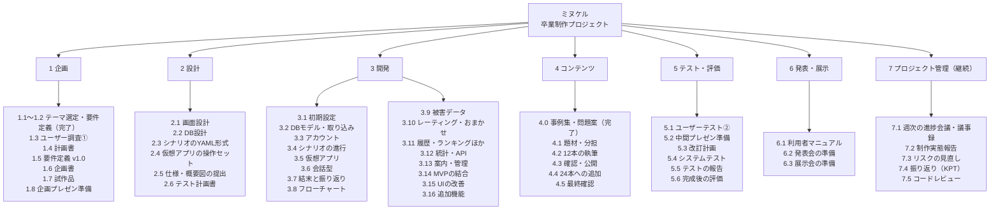
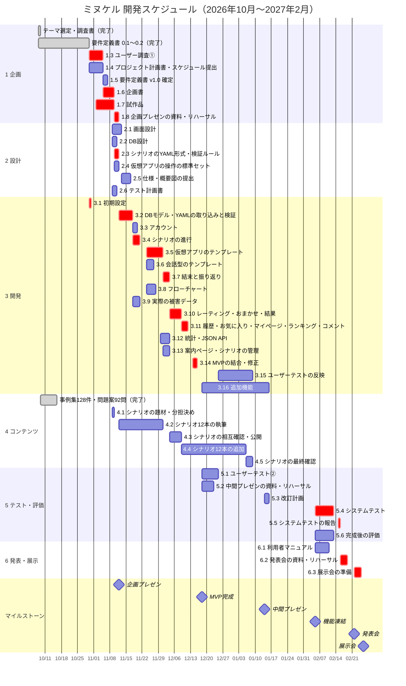

# 4. WBS・PERT・スケジュール※

> [プロジェクト計画書](README.md)（ミヌケル）の 4章。版 0.1（ドラフト）

## 4.1 前提

| 項目 | 決めたこと |
| --- | --- |
| 単位 | 日数は**稼働日**（平日）で数える。授業の日だけでなく、各自が授業の外で作業する日を含む |
| 休み | 土日、祝日（11/3、11/23、1/1、1/11、2/11、2/23）、年末年始（12/28〜1/4。学校の予定が分かったら直す） |
| 起点 | 2026年10月30日（本書の作成日）。それより前の作業は「完了」として載せる |
| 見積もりの考え方 | 開発の作業は、Claude Code が書いたものを人がレビューし、動かして確かめるまでを含む。人だけで書く場合のおよそ半分の日数にしている。見積もりが外れたときの対応は[8章](08-risk.md#8-リスク分析)のR14 |
| マイルストーン | 日付が決まっている（プレゼン・MVP・機能凍結・発表会・展示会）。前の作業はその前日までに終える |

## 4.2 WBS（作業の洗い出し）

成果物（[3章](03-deliverables.md#3-成果物一覧)）を作るのに必要な作業を、6つの工程に分けて洗い出した。「継続」の作業は全期間を通して行うため、[4.3節](#43-pert前後関係の整理)のネットワークには入れていない。

**WBSの一覧**（完了した作業と、継続の作業を含む）

| WBS | 作業 | 成果物 | 担当 | 日数 | 状態 |
| --- | --- | --- | --- | ---: | --- |
| **1** | **企画** | | | | |
| 1.1 | テーマ選定・調査 | 制作テーマ | 全員 | ― | 完了（10/8） |
| 1.2 | 要件定義書 0.1〜0.2 | 要件定義書 | PM | ― | 完了（10/29） |
| 1.3 | ユーザー調査①（アンケート10〜20人、聞き取り3〜5人） | 調査の結果 | 品質 | 3 | |
| 1.4 | プロジェクト計画書・スケジュール提出 | 本書 | PM | 3 | 作成中 |
| 1.5 | 要件定義書 v1.0 の確定（未決事項を決める） | 要件定義書 | PM | 2 | |
| 1.6 | 企画書・調査書 | 企画書、調査書 | PM | 3 | |
| 1.7 | 試作品（SMSのシナリオ1本が動く） | 試作品 | BE・FE | 5 | |
| 1.8 | 企画プレゼンの資料・リハーサル | スライド | 全員 | 2 | |
| **2** | **設計** | | | | |
| 2.1 | 画面設計（ワイヤーフレーム・画面遷移） | 画面設計書 | FE | 4 | |
| 2.2 | DB設計（ER図・テーブル定義） | DB設計書 | BE | 2 | |
| 2.3 | シナリオのYAML形式・検証ルール | シナリオの書き方 | BE | 2 | |
| 2.4 | 仮想アプリの操作の標準セット | 画面設計書 | FE | 2 | |
| 2.5 | 仕様・概要図の提出（システム構成図・API） | 仕様・概要図 | PM | 2 | |
| 2.6 | テスト計画書 | テスト計画書 | 品質 | 2 | |
| **3** | **開発** | | | | |
| 3.1 | 初期設定（Django・CI・CLAUDE.md） | ソースコード | BE | 1 | |
| 3.2 | DBモデル・YAMLの取り込みと検証 | ソースコード | BE | 4 | |
| 3.3 | アカウント | ソースコード | FE | 2 | |
| 3.4 | シナリオの進行（場面・調べる・決める・記録） | ソースコード | BE | 3 | |
| 3.5 | 仮想アプリのテンプレート | ソースコード | FE | 5 | |
| 3.6 | 会話型のテンプレート | ソースコード | PM | 3 | |
| 3.7 | 結末と振り返り | ソースコード | FE | 3 | |
| 3.8 | フローチャート（集計・配置・SVG） | ソースコード | BE | 4 | |
| 3.9 | 実際の被害データ | ソースコード、被害データ | 品質 | 3 | |
| 3.10 | レーティング・おまかせ・結果 | ソースコード | BE | 3 | |
| 3.11 | 履歴・お気に入り・マイページ・ランキング・コメント | ソースコード | FE | 3 | |
| 3.12 | 統計・JSON API | ソースコード、API仕様書 | BE | 4 | |
| 3.13 | 案内ページ・シナリオの管理 | ソースコード | PM | 3 | |
| 3.14 | MVPの結合・修正 | MVP | 全員 | 2 | |
| 3.15 | ユーザーテストの反映（UIの改善） | ソースコード | FE | 5 | |
| 3.16 | 追加機能（展示会モード・挑戦状・結末の一覧・ヒント・URLの読み方ほか） | ソースコード | BE・FE | 14 | |
| **4** | **コンテンツ** | | | | |
| 4.0 | 事例集（128件、出典を確認）・問題案（92問） | 事例集、問題案 | 全員 | ― | 完了（10/15） |
| 4.1 | シナリオの題材・分担決め | 分担表 | 全員 | 1 | |
| 4.2 | シナリオ12本の執筆（1人3本） | シナリオのデータ | 全員 | 12 | |
| 4.3 | シナリオの相互確認・公開 | シナリオのデータ | 品質 | 3 | |
| 4.4 | シナリオ12本の追加（24本へ） | シナリオのデータ | 全員 | 14 | |
| 4.5 | シナリオの最終確認 | シナリオのデータ | 品質 | 3 | |
| **5** | **テスト・評価** | | | | |
| 5.1 | ユーザーテスト②（MVPで操作に迷う場所を見つける） | 調査の結果 | 品質 | 5 | |
| 5.2 | 中間プレゼンの資料・リハーサル | スライド | 全員 | 3 | |
| 5.3 | 改訂計画（技術レビューと中間プレゼンの指摘を反映） | 改訂計画書 | PM | 2 | |
| 5.4 | システムテスト | テスト仕様書・結果 | 品質 | 5 | |
| 5.5 | システムテストの報告 | テスト結果報告書 | 品質 | 1 | |
| 5.6 | 完成後の評価（SUS・学習効果） | 評価の結果 | 品質 | 5 | |
| **6** | **発表・展示** | | | | |
| 6.1 | 利用者マニュアル・管理者マニュアル | マニュアル | PM・BE | 4 | |
| 6.2 | 発表会の資料・リハーサル | スライド | 全員 | 3 | |
| 6.3 | 展示会の準備（機材・デモデータ・ポスター・リハーサル） | 展示会の資料 | 全員 | 2 | |
| **7** | **プロジェクト管理（継続）** | | | | |
| 7.1 | 週次の進捗会議・議事録 | 議事録 | PM | 毎週 | |
| 7.2 | 制作実態報告 | 報告書 | PM | 指示のたび | |
| 7.3 | リスクの見直し | リスク一覧 | PM | 毎週 | |
| 7.4 | 振り返り（KPT） | 振り返りの記録 | 全員 | M1〜M6 のあと | |
| 7.5 | コードレビュー | PRのレビュー | 全員 | PRのたび | |

## 4.3 PERT（前後関係の整理）

作業ごとに「前に終わっていなければならない作業」を決め、最早・最遅の日付と余裕（遅れてもよい稼働日数）を計算した。余裕が最も小さい作業（**太字**）がクリティカルパス（[4.5節](#45-クリティカルパス)）。

| ID | 作業 | 日数 | 前の作業 | 最早開始 | 最早終了 | 最遅開始 | 最遅終了 | 余裕 | 担当 |
| --- | --- | ---: | --- | --- | --- | --- | --- | ---: | --- |
| 1.3 | **ユーザー調査①（アンケート・聞き取り）** | 3 | ― | 10/30（金） | 11/4（水） | 10/30（金） | 11/4（水） | 0 | 品質 |
| 1.4 | プロジェクト計画書・スケジュール提出 | 3 | ― | 10/30（金） | 11/4（水） | 11/9（月） | 11/11（水） | 5 | PM |
| 1.5 | 要件定義書 v1.0 確定 | 2 | 1.3 | 11/5（木） | 11/6（金） | 11/10（火） | 11/11（水） | 3 | PM |
| 1.6 | **企画書** | 3 | 1.3 | 11/5（木） | 11/9（月） | 11/5（木） | 11/9（月） | 0 | PM |
| 3.1 | **初期設定（Django・CI・CLAUDE.md）** | 1 | ― | 10/30（金） | 10/30（金） | 10/30（金） | 10/30（金） | 0 | BE |
| 1.7 | **試作品（シナリオ1本が動く）** | 5 | 3.1 | 11/2（月） | 11/9（月） | 11/2（月） | 11/9（月） | 0 | BE・FE |
| 1.8 | **企画プレゼンの資料・リハーサル** | 2 | 1.6・1.7 | 11/10（火） | 11/11（水） | 11/10（火） | 11/11（水） | 0 | 全員 |
| M1 | ◆ **企画プレゼン** | 0 | 1.8・1.4 | 11/12（木） | ― | ― | ― | ― | 全員 |
| 2.1 | 画面設計（ワイヤーフレーム・画面遷移） | 4 | 1.5 | 11/9（月） | 11/12（木） | 11/19（木） | 11/25（水） | 8 | FE |
| 2.2 | DB設計（ER図・テーブル定義） | 2 | 1.5 | 11/9（月） | 11/10（火） | 11/12（木） | 11/13（金） | 3 | BE |
| 2.3 | **シナリオのYAML形式・検証ルール** | 2 | 1.7 | 11/10（火） | 11/11（水） | 11/12（木） | 11/13（金） | 2 | BE |
| 2.4 | 仮想アプリの操作の標準セット | 2 | 1.7 | 11/10（火） | 11/11（水） | 11/24（火） | 11/25（水） | 9 | FE |
| 2.5 | 仕様・概要図の提出 | 2 | 2.1・2.2 | 11/13（金） | 11/16（月） | 12/16（水） | 12/17（木） | 22 | PM |
| 2.6 | テスト計画書 | 2 | 1.5 | 11/9（月） | 11/10（火） | 2/4（木） | 2/5（金） | 55 | 品質 |
| 3.2 | **DBモデル・YAMLの取り込みと検証** | 4 | 2.2・2.3 | 11/12（木） | 11/17（火） | 11/16（月） | 11/19（木） | 2 | BE |
| 3.3 | アカウント | 2 | 3.2 | 11/18（水） | 11/19（木） | 12/4（金） | 12/7（月） | 11 | FE |
| 3.4 | **シナリオの進行（場面・調べる・決める・記録）** | 3 | 3.2 | 11/18（水） | 11/20（金） | 11/20（金） | 11/25（水） | 2 | BE |
| 3.5 | **仮想アプリのテンプレート** | 5 | 2.1・2.4・3.4 | 11/24（火） | 11/30（月） | 11/26（木） | 12/2（水） | 2 | FE |
| 3.6 | 会話型のテンプレート | 3 | 2.1・3.4 | 11/24（火） | 11/26（木） | 11/30（月） | 12/2（水） | 4 | PM |
| 3.7 | **結末と振り返り** | 3 | 3.5・3.6 | 12/1（火） | 12/3（木） | 12/3（木） | 12/7（月） | 2 | FE |
| 3.8 | フローチャート（集計・配置・SVG） | 4 | 3.4 | 11/24（火） | 11/27（金） | 12/4（金） | 12/9（水） | 8 | BE |
| 3.9 | 実際の被害データ | 3 | 3.2 | 11/18（水） | 11/20（金） | 12/7（月） | 12/9（水） | 12 | 品質 |
| 3.10 | **レーティング・おまかせ・結果** | 3 | 3.3・3.7 | 12/4（金） | 12/8（火） | 12/8（火） | 12/10（木） | 2 | BE |
| 3.11 | **履歴・お気に入り・マイページ・ランキング・コメント** | 3 | 3.10 | 12/9（水） | 12/11（金） | 12/11（金） | 12/15（火） | 2 | FE |
| 3.12 | 統計・JSON API | 4 | 3.8・3.9 | 11/30（月） | 12/3（木） | 12/10（木） | 12/15（火） | 8 | BE |
| 3.13 | 案内ページ・シナリオの管理 | 3 | 3.5 | 12/1（火） | 12/3（木） | 12/8（火） | 12/10（木） | 5 | PM |
| 4.1 | シナリオの題材・分担決め | 1 | 1.5 | 11/9（月） | 11/9（月） | 11/24（火） | 11/24（火） | 10 | 全員 |
| 4.2 | シナリオ12本の執筆 | 12 | 2.3・4.1 | 11/12（木） | 11/30（月） | 11/25（水） | 12/10（木） | 8 | 全員 |
| 4.3 | シナリオの相互確認・公開 | 3 | 4.2・3.2・3.13 | 12/4（金） | 12/8（火） | 12/11（金） | 12/15（火） | 5 | 品質 |
| 3.14 | **MVPの結合・修正** | 2 | 3.11・3.12・3.13・4.3 | 12/14（月） | 12/15（火） | 12/16（水） | 12/17（木） | 2 | 全員 |
| M2 | ◆ **MVP完成** | 0 | 3.14・2.5 | 12/18（金） | ― | ― | ― | ― | 全員 |
| 5.1 | ユーザーテスト②（MVP） | 5 | M2 | 12/18（金） | 12/24（木） | 1/22（金） | 1/28（木） | 18 | 品質 |
| 5.2 | 中間プレゼンの資料・リハーサル | 3 | M2 | 12/18（金） | 12/22（火） | 1/8（金） | 1/13（水） | 9 | 全員 |
| M3 | ◆ **中間プレゼン** | 0 | 5.2 | 1/14（木） | ― | ― | ― | ― | 全員 |
| 5.3 | 改訂計画（レビューを受けて） | 2 | M3・5.1 | 1/14（木） | 1/15（金） | 2/3（水） | 2/4（木） | 14 | PM |
| 3.15 | ユーザーテストの反映（UIの改善） | 5 | 5.1 | 12/25（金） | 1/8（金） | 1/29（金） | 2/4（木） | 18 | FE |
| 3.16 | 追加機能（展示会モード・挑戦状・結末の一覧・ヒントほか） | 14 | M2 | 12/18（金） | 1/15（金） | 1/18（月） | 2/4（木） | 14 | BE・FE |
| 4.4 | シナリオ12本の追加（24本へ） | 14 | 4.3 | 12/9（水） | 1/5（火） | 1/13（水） | 2/1（月） | 18 | 全員 |
| 4.5 | シナリオの最終確認 | 3 | 4.4 | 1/6（水） | 1/8（金） | 2/2（火） | 2/4（木） | 18 | 品質 |
| M4 | ◆ **機能凍結** | 0 | 3.15・3.16・4.5・5.3 | 2/5（金） | ― | ― | ― | ― | 全員 |
| 5.4 | **システムテスト** | 5 | M4・2.6 | 2/5（金） | 2/12（金） | 2/8（月） | 2/15（月） | 1 | 品質 |
| 5.5 | **システムテストの報告** | 1 | 5.4 | 2/15（月） | 2/15（月） | 2/16（火） | 2/16（火） | 1 | 品質 |
| 5.6 | 完成後の評価（SUS・学習効果） | 5 | M4 | 2/5（金） | 2/12（金） | 2/9（火） | 2/16（火） | 2 | 品質 |
| 6.1 | 利用者マニュアル | 4 | M4 | 2/5（金） | 2/10（水） | 2/17（水） | 2/22（月） | 7 | PM |
| 6.2 | **発表会の資料・リハーサル** | 3 | 5.5・5.6 | 2/16（火） | 2/18（木） | 2/17（水） | 2/19（金） | 1 | 全員 |
| M5 | ◆ **発表会** | 0 | 6.2 | 2/22（月） | ― | ― | ― | ― | 全員 |
| 6.3 | **展示会の準備（機材・デモデータ・ポスター・リハーサル）** | 2 | M5・6.1 | 2/22（月） | 2/24（水） | 2/24（水） | 2/25（木） | 1 | 全員 |
| M6 | ◆ **展示会** | 0 | 6.3 | 2/26（金） | ― | ― | ― | ― | 全員 |

- **最早開始・最早終了**：前の作業がすべて最短で終わったときに、始められる日・終わる日。
- **最遅開始・最遅終了**：次のマイルストーンに間に合うために、遅くとも始める日・終える日。
- **余裕**：最遅開始 − 最早開始（稼働日）。0 は1日も遅れられないこと。

**ネットワーク図**（箱が作業、矢印が前後関係。赤い枠がクリティカルパス、黄色の六角形がマイルストーン）

```mermaid
flowchart LR
    n1_3["1.3 ユーザー調査①<br>3日・余裕0"]
    n1_4["1.4 プロジェクト計画書・スケジュール提出<br>3日・余裕5"]
    n1_5["1.5 要件定義書 v1.0 確定<br>2日・余裕3"]
    n1_6["1.6 企画書<br>3日・余裕0"]
    n3_1["3.1 初期設定<br>1日・余裕0"]
    n1_7["1.7 試作品<br>5日・余裕0"]
    n1_8["1.8 企画プレゼンの資料・リハーサル<br>2日・余裕0"]
    nM1{{"◆ 企画プレゼン<br>11/12（木）"}}
    n2_1["2.1 画面設計<br>4日・余裕8"]
    n2_2["2.2 DB設計<br>2日・余裕3"]
    n2_3["2.3 シナリオのYAML形式・検証ルール<br>2日・余裕2"]
    n2_4["2.4 仮想アプリの操作の標準セット<br>2日・余裕9"]
    n2_5["2.5 仕様・概要図の提出<br>2日・余裕22"]
    n2_6["2.6 テスト計画書<br>2日・余裕55"]
    n3_2["3.2 DBモデル・YAMLの取り込みと検証<br>4日・余裕2"]
    n3_3["3.3 アカウント<br>2日・余裕11"]
    n3_4["3.4 シナリオの進行<br>3日・余裕2"]
    n3_5["3.5 仮想アプリのテンプレート<br>5日・余裕2"]
    n3_6["3.6 会話型のテンプレート<br>3日・余裕4"]
    n3_7["3.7 結末と振り返り<br>3日・余裕2"]
    n3_8["3.8 フローチャート<br>4日・余裕8"]
    n3_9["3.9 実際の被害データ<br>3日・余裕12"]
    n3_10["3.10 レーティング・おまかせ・結果<br>3日・余裕2"]
    n3_11["3.11 履歴・お気に入り・マイページ・ランキング・コメント<br>3日・余裕2"]
    n3_12["3.12 統計・JSON API<br>4日・余裕8"]
    n3_13["3.13 案内ページ・シナリオの管理<br>3日・余裕5"]
    n4_1["4.1 シナリオの題材・分担決め<br>1日・余裕10"]
    n4_2["4.2 シナリオ12本の執筆<br>12日・余裕8"]
    n4_3["4.3 シナリオの相互確認・公開<br>3日・余裕5"]
    n3_14["3.14 MVPの結合・修正<br>2日・余裕2"]
    nM2{{"◆ MVP完成<br>12/18（金）"}}
    n5_1["5.1 ユーザーテスト②<br>5日・余裕18"]
    n5_2["5.2 中間プレゼンの資料・リハーサル<br>3日・余裕9"]
    nM3{{"◆ 中間プレゼン<br>1/14（木）"}}
    n5_3["5.3 改訂計画<br>2日・余裕14"]
    n3_15["3.15 ユーザーテストの反映<br>5日・余裕18"]
    n3_16["3.16 追加機能<br>14日・余裕14"]
    n4_4["4.4 シナリオ12本の追加<br>14日・余裕18"]
    n4_5["4.5 シナリオの最終確認<br>3日・余裕18"]
    nM4{{"◆ 機能凍結<br>2/5（金）"}}
    n5_4["5.4 システムテスト<br>5日・余裕1"]
    n5_5["5.5 システムテストの報告<br>1日・余裕1"]
    n5_6["5.6 完成後の評価<br>5日・余裕2"]
    n6_1["6.1 利用者マニュアル<br>4日・余裕7"]
    n6_2["6.2 発表会の資料・リハーサル<br>3日・余裕1"]
    nM5{{"◆ 発表会<br>2/22（月）"}}
    n6_3["6.3 展示会の準備<br>2日・余裕1"]
    nM6{{"◆ 展示会<br>2/26（金）"}}
    n1_3 --> n1_5
    n1_3 --> n1_6
    n3_1 --> n1_7
    n1_6 --> n1_8
    n1_7 --> n1_8
    n1_8 --> nM1
    n1_4 --> nM1
    n1_5 --> n2_1
    n1_5 --> n2_2
    n1_7 --> n2_3
    n1_7 --> n2_4
    n2_1 --> n2_5
    n2_2 --> n2_5
    n1_5 --> n2_6
    n2_2 --> n3_2
    n2_3 --> n3_2
    n3_2 --> n3_3
    n3_2 --> n3_4
    n2_1 --> n3_5
    n2_4 --> n3_5
    n3_4 --> n3_5
    n2_1 --> n3_6
    n3_4 --> n3_6
    n3_5 --> n3_7
    n3_6 --> n3_7
    n3_4 --> n3_8
    n3_2 --> n3_9
    n3_3 --> n3_10
    n3_7 --> n3_10
    n3_10 --> n3_11
    n3_8 --> n3_12
    n3_9 --> n3_12
    n3_5 --> n3_13
    n1_5 --> n4_1
    n2_3 --> n4_2
    n4_1 --> n4_2
    n4_2 --> n4_3
    n3_2 --> n4_3
    n3_13 --> n4_3
    n3_11 --> n3_14
    n3_12 --> n3_14
    n3_13 --> n3_14
    n4_3 --> n3_14
    n3_14 --> nM2
    n2_5 --> nM2
    nM2 --> n5_1
    nM2 --> n5_2
    n5_2 --> nM3
    nM3 --> n5_3
    n5_1 --> n5_3
    n5_1 --> n3_15
    nM2 --> n3_16
    n4_3 --> n4_4
    n4_4 --> n4_5
    n3_15 --> nM4
    n3_16 --> nM4
    n4_5 --> nM4
    n5_3 --> nM4
    nM4 --> n5_4
    n2_6 --> n5_4
    n5_4 --> n5_5
    nM4 --> n5_6
    nM4 --> n6_1
    n5_5 --> n6_2
    n5_6 --> n6_2
    n6_2 --> nM5
    nM5 --> n6_3
    n6_1 --> n6_3
    n6_3 --> nM6
    classDef crit fill:#f4cccc,stroke:#cc0000,stroke-width:3px,color:#000
    classDef ms fill:#fff2cc,stroke:#b45f06,stroke-width:2px,color:#000
    class n1_3,n1_6,n1_7,n1_8,n2_3,n3_1,n3_10,n3_11,n3_14,n3_2,n3_4,n3_5,n3_7,n5_4,n5_5,n6_2,n6_3 crit
    class nM1,nM2,nM3,nM4,nM5,nM6 ms
```

## 4.4 スケジュール（ガントチャート）

最早の日付で並べた。赤がクリティカルパスの作業、灰色が完了した作業。Excel 版は [gantt-chart.xlsx](../gantt-chart.xlsx)（仮。本書に合わせて直す）。

**人の重なりの調整**：PERT は人の数を考えないため、作業が多い時期は担当を分けた（例：11/24〜12/3 は FE が仮想アプリと結末、PM が会話型と管理画面、BE がフローチャートと統計）。同じ人の作業が短く重なるところ（11/5〜11/11 の PM・BE・FE の設計の作業など）は、余裕のある作業を後ろにずらして調整する（例：2.4 は余裕9日、2.6 は余裕55日）。4.2 と 4.4（シナリオの執筆）は全員が開発と並行して、1日1〜2時間ずつ進める。

## 4.5 クリティカルパス

日付が決まったマイルストーンでスケジュールが区切られるため、**区間ごとに余裕が最も小さい経路**をクリティカルパスとした。

| 区間 | クリティカルパス | 余裕 | 意味 |
| --- | --- | ---: | --- |
| ① 今日 〜 企画プレゼン（11/12） | 3.1 初期設定 → 1.7 試作品 → 1.8 プレゼン準備 → M1 1.3 ユーザー調査① → 1.6 企画書 → 1.8 → M1 | 0日 | 試作品と企画書が1日でも遅れると、プレゼンで見せられない |
| ② 企画プレゼン 〜 MVP（12/18） | 1.7 → 2.3 YAML形式 → 3.2 DBモデル・取り込み → 3.4 シナリオの進行 → 3.5 仮想アプリ → 3.7 結末と振り返り → 3.10 レーティング・おまかせ → 3.11 履歴・ランキング → 3.14 MVPの結合 → M2 | 2日 | **最も長い経路（1.7 から 3.14 まで9作業・30稼働日）。** ここが遅れるとMVPと中間プレゼンのデモに響く |
| ③ MVP 〜 機能凍結（2/5） | 3.16 追加機能 → M4 | 14日 | 余裕が大きい。区間②が遅れたときの**バッファ**として使う |
| ④ 機能凍結 〜 展示会（2/26） | M4 → 5.4 システムテスト → 5.5 報告 → 6.2 発表会の準備 → M5 → 6.3 展示会の準備 → M6 | 1日 | テストで見つかった不具合を直す時間が少ない。2/5 の機能凍結を必ず守る |

**クリティカルパスの管理**

1. 週次の進捗会議で、クリティカルパスの作業の残りの日数と余裕を必ず確かめる（[6章](06-communication.md#6-コミュニケーション計画)）。
2. クリティカルパスの作業は、ほかの作業より優先する。Claude Code への依頼も先に出す。
3. 区間②で2日を超えて遅れそうなときは、次の順で対応する：(1) ほかの人が手伝う（余裕のある 3.8・3.12・2.1 の担当） → (2) 3.11 のコメント・ランキングをMVPのあとに回す → (3) 区間③の余裕を使い、追加機能（3.16）を減らす。
4. 区間④を守るため、2/5 以降は新しい機能を入れない。

---

[← 03-deliverables.md](03-deliverables.md) ｜ [表紙・目次](README.md) ｜ [05-stakeholders.md →](05-stakeholders.md)
