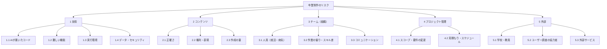

# 8. リスク分析※

> [プロジェクト計画書](README.md)（ミヌケル）の 8章。版 0.1（ドラフト）

## 8.1 RBS（リスクの分類）

## 8.2 リスク一覧と対応

**評価のしかた**：発生確率（高3・中2・低1）×影響度（大3・中2・小1）＝重要度（最大9）。重要度6以上を「重点リスク」として毎週見直す。

| ID | 分類 | リスク（〜すると、〜になる） | 確率 | 影響 | 重要度 | 予防策（起きる前） | 兆候（気づくきっかけ） | 顕在化した場合の対応 | 担当 |
| --- | --- | --- | :-: | :-: | :-: | --- | --- | --- | --- |
| R13 | 4.1 | 作りたい機能が増えて、MVPや機能凍結に間に合わない | 3 | 3 | **9** | 必須・追加・余裕を分けて守る。機能を足すときはチームで決め、要件定義書の変更履歴に書く | 週次会議で「ついでに」の機能の話が出る。Issue が予定より増える | 余裕 → 追加の順に機能を削る。2/5 以降は機能を入れない | PM |
| R01 | 1.1 | Claude Code が書いたコードを説明できず、技術レビューや質疑で答えられない | 2 | 3 | **6** | PRを人が読み、要点をPRの説明に書く。担当分野を決める。週1回、5分のコード説明 | PRが読まれずに取り込まれる。レビューのコメントが0件 | その機能の説明を書き直し、ペアで読み合わせる。想定される質問と答えを作る | BE |
| R02 | 1.2 | フローチャートの配置や仮想アプリの画面が難しく、MVPに間に合わない | 2 | 3 | **6** | 試作品（1.7）で先に作って難しさを確かめる。配置は簡単な方法（要件定義書 10.6節）にする | 試作品で図が崩れる。3.5・3.8 の見積もりを超える | フローチャートを「選択肢ごとの割合の表」に置き換えてMVPを守り、図は追加に回す | BE |
| R03 | 1.3 | 展示会でネットがつながらない・遅い | 2 | 3 | **6** | ネットなしで動かす（N-03）。自前のルーター。前日にリハーサル | リハーサルでの遅さ、会場の Wi-Fi の情報 | サーバーのPCで直接体験してもらう。スマホのテザリングに切り替える | FE |
| R09 | 2.3 | シナリオの作成が遅れ、12本・24本に届かない | 3 | 2 | **6** | 1人3本の分担。書き方の例とひな形。事例集・問題案を素材にし、下書きは Claude と作る | 週次会議で、書き終えた本数が予定の半分以下 | 本数を減らして質を優先する（MVP 8本、最終16本まで）。分岐を少なくした短いシナリオにする | 品質 |
| R10 | 3.1 | メンバーが就職活動や病気で、長く参加できない | 3 | 2 | **6** | 予定をカレンダーで共有。どの作業も2人が分かる状態にし、文書を残す | 予定表の空き、返信が遅い | 担当を付け替え、追加・余裕の機能を削る。プレゼンは全員が全部を話せるように練習する | PM |
| R14 | 4.2 | 見積もりが甘く、クリティカルパス（区間②の余裕は2日）が遅れる | 2 | 3 | **6** | 週次でクリティカルパスの残りを確かめる。クリティカルの作業を優先する | 作業の進み（Issue の完了）が予定より2日以上遅い | [4.5節](04-schedule.md#45-クリティカルパス)の順に対応（人を集める → 3.11 を後ろへ → 区間③の余裕を使う） | PM |
| R15 | 4.1 | テーマや要件が大きく変わり、作り直しが必要になる（**0.1 → 0.2 で一度起きた**） | 2 | 3 | **6** | 11/6 に要件定義書 v1.0 を確定し、以降の変更は影響を見積もってから決める | 「やっぱり〜にしたい」という意見 | 影響（作り直す作業と日数）を出し、全員と教員で判断する。中間プレゼン以降は大きな変更をしない | PM |
| R06 | 1.4 | セキュリティの欠陥（XSS・権限の漏れ）が見つかる | 2 | 2 | 4 | テンプレートのエスケープ、権限の自動テスト、チェックリスト | 技術レビューやテストでの指摘 | その機能を止めて直し、同じ種類の問題をほかに探して再テストする | BE |
| R07 | 2.1 | シナリオの内容が事実や出典と違う | 2 | 2 | 4 | 出典のページを開いて確かめる。書いた人以外が確認する（C-07） | 確認での指摘、利用者のコメント | すぐに非公開にして直し、確認してから再公開する | 品質 |
| R11 | 3.2 | 作業がだれかに偏る、スキルの差で進まない | 2 | 2 | 4 | 担当表、週次でタスクの量を確かめる、ペア作業 | 1人のPRやIssueが極端に多い・少ない | 作業を配り直す。振り返りで話し合う | PM |
| R12 | 3.3 | 連絡不足で、同じ作業をしたり、思い違いをしたりする | 2 | 2 | 4 | 作業は Issue で「やります」と宣言する。朝会 | 同じ箇所を2人が直している、決めたことの食い違い | 週次会議で整理し、決めたことを Issue に書く | PM |
| R17 | 5.2 | ユーザー調査の協力者が集まらない | 2 | 2 | 4 | 他チームと相互に協力する。家族に早めに頼む | 回答数が目標の半分以下 | 人数を減らして聞き取りを深くする。展示会で評価を集める | 品質 |
| R18 | 5.3 | Claude Code の利用制限や停止で、開発が止まる（**作業中に一度起きた**） | 2 | 2 | 4 | 大きな依頼は分けて出す。締め切りの直前に大きな依頼をしない。人が直せる知識を持つ | 利用制限の表示 | 人が手で直す。制限が戻るまで、文書・シナリオ・テストなど別の作業を進める | BE |
| R04 | 1.3 | Windows で動かない（開発のPCやCIの環境と違う） | 1 | 3 | 3 | CIで Windows のテストを動かす。週1回 Windows の実機で起動する | Windows のCIだけが失敗する | 原因を切り分けて直す。展示会用のPCで早めに通しで確かめる | BE |
| R05 | 1.4 | PCの故障などで、データやコードが消える | 1 | 3 | 3 | 毎日 GitHub に push。DBのバックアップの手順。予備のPC | ― | 予備のPCに GitHub とバックアップから戻す | BE |
| R08 | 2.2 | 実在の企業名やロゴに似たもの、怖がらせすぎる表現を使ってしまう | 1 | 3 | 3 | 作成のルール（C-01・C-08）、取り込み時の自動チェック、相互確認 | 確認での指摘 | すぐに非公開にして直す。必要なら関係者に説明する | 品質 |
| R19 | 5.1 | プレゼンを欠席する（3回のプレゼンは単位の必須条件） | 1 | 3 | 3 | 全員が全部のパートを話せるように練習する | 体調不良・就活の予定 | ほかの人が代わりに話す。欠席した人は次の授業でプレゼンする | PM |
| R16 | 5.1 | 評価の方針や日程が変わる（発表会は「予定」） | 1 | 2 | 2 | 授業ごとに日程を確かめる | 授業での連絡 | 本書のスケジュールを直し、クリティカルパスを計算し直す | PM |

## 8.3 リスクマップ

| 確率＼影響 | 小（1） | 中（2） | 大（3） |
| --- | --- | --- | --- |
| **高（3）** | | R09、R10 | **R13** |
| **中（2）** | | R06、R07、R11、R12、R17、R18 | R01、R02、R03、R14、R15 |
| **低（1）** | | R16 | R04、R05、R08、R19 |

## 8.4 リスクの管理のしかた

1. 週次の進捗会議（C2）で、重要度6以上のリスクの兆候を確かめる。
2. 兆候が見えたら、担当が「顕在化した場合の対応」を始め、PMに知らせる。
3. 新しいリスクに気づいたら、だれでもこの表に追加してよい（Issue に `risk` ラベルを付ける）。
4. 各マイルストーンのあとの振り返り（C13）で、確率と影響を付け直す。

---

[← 07-quality.md](07-quality.md) ｜ [表紙・目次](README.md) ｜ [09-rules.md →](09-rules.md)
