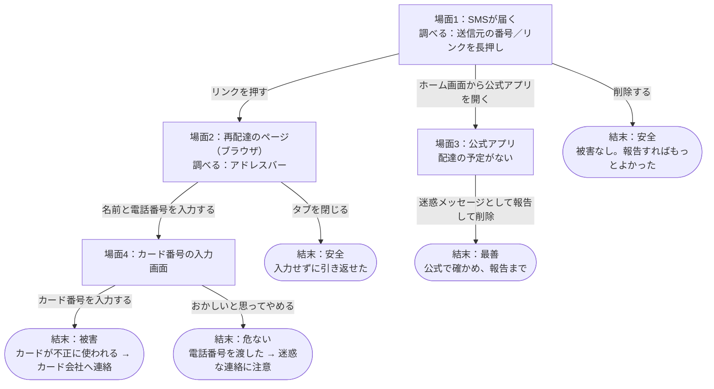
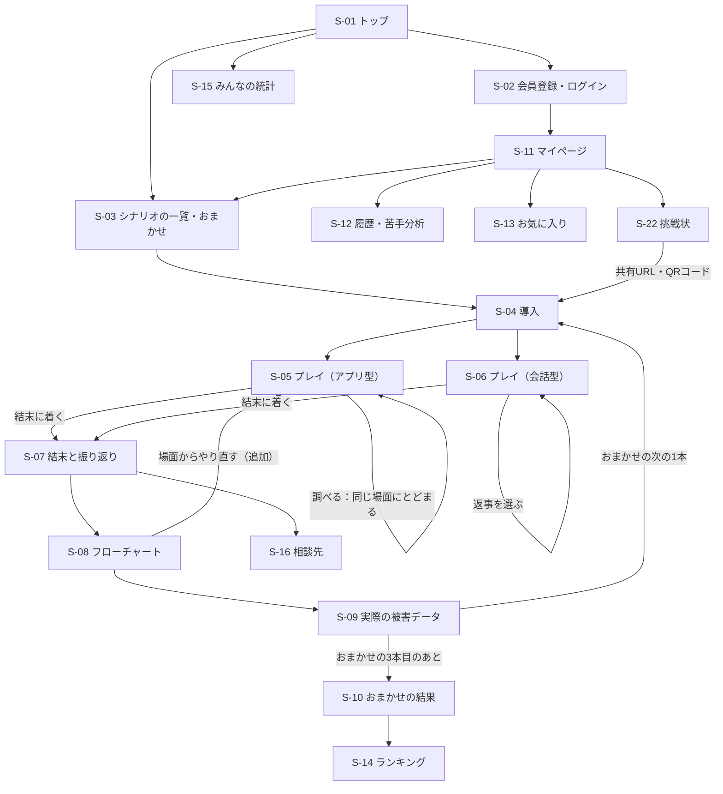
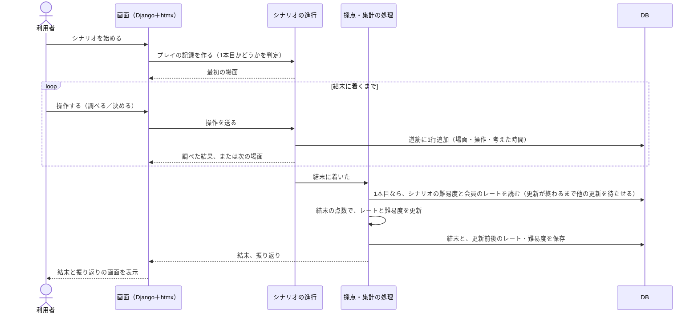
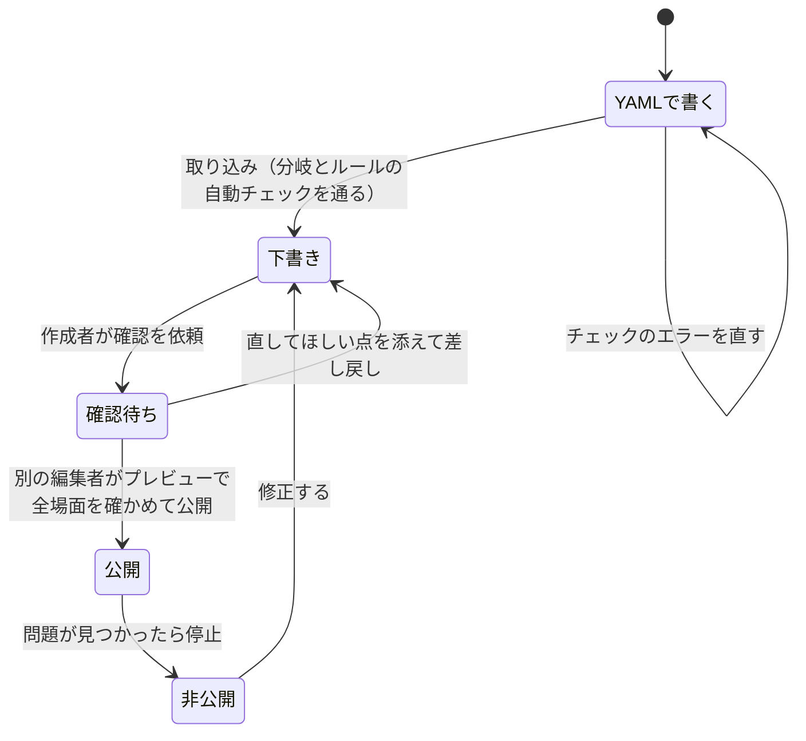
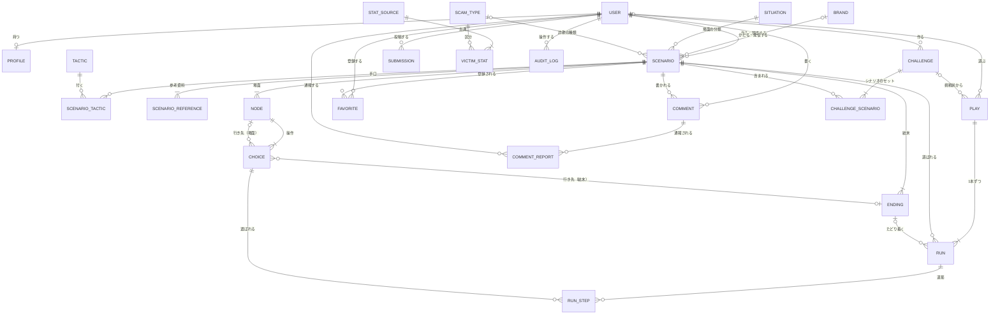

# 要件定義書：ネット詐欺見抜きトレーニング「ミヌケル」（仮称）

| 項目 | 内容 |
| --- | --- |
| 版 | 0.2（ドラフト。チームの確認待ち） |
| 作成日 | 2026年10月8日（0.2：2026年10月29日） |
| 作成 | Claude（Claude Code）。チームが確認・修正して確定する |
| 関連資料 | [概要説明](overview.md)、[チェックリスト](checklist.md)、[テーマ選定の調査（別紙2）](theme-research-more.md#31-ネット詐欺見抜きトレーニング仮称ミヌケル-89点)、[問題集（シナリオの素材）](question-bank/README.md)、[被害データの初期値](../seed/victim_stats.yaml) |

0.2 の主な変更：問題を「問題文と選択肢」から、**仮想のアプリを操作したり会話したりして進む分岐型のシナリオ**に変えた。終わったあとに、**誰がどの選択をして、どの結末になったかを分岐のフローチャートで見せる**。**実際の被害者のデータ（公的機関の統計）**を表示し、アプリの中のデータと並べる。変更の一覧は[20章](#20-変更履歴)。

## 目次

0. [この文書について](#0-この文書について)
1. [概要](#1-概要)
2. [利用者](#2-利用者)
3. [範囲（スコープ）](#3-範囲スコープ)
4. [用語](#4-用語)
5. [シナリオ（コンテンツ）の要件](#5-シナリオコンテンツの要件)
6. [機能要件](#6-機能要件)
7. [画面](#7-画面)
8. [主な処理の流れ](#8-主な処理の流れ)
9. [データ要件（DB設計）](#9-データ要件db設計)
10. [アルゴリズムの要件](#10-アルゴリズムの要件)
11. [非機能要件](#11-非機能要件)
12. [制約条件と技術構成](#12-制約条件と技術構成)
13. [外部とのやり取り](#13-外部とのやり取り)
14. [展示会の要件](#14-展示会の要件)
15. [評価の計画](#15-評価の計画)
16. [実装の順番（Issueの分け方）](#16-実装の順番issueの分け方)
17. [マイルストーン](#17-マイルストーン)
18. [未決事項](#18-未決事項チームで決めること)
19. [参考資料](#19-参考資料)
20. [変更履歴](#20-変更履歴)

---

## 0. この文書について

- **目的**：何を作るのかを決め、チーム・担当教員・Claude が同じ認識で開発を進められるようにする。
- **使い道**：必須工程の「調査書と企画書」「仕様・概要図」の元にする。開発では、6章の機能要件1つ（または数個）を GitHub の Issue 1つにして、Claude に実装を依頼する（[16章](#16-実装の順番issueの分け方)）。
- **優先度の表し方**：

| 記号 | 意味 | 完成させる時期 |
| --- | --- | --- |
| 必須 | MVP（最小限の完成形）に入れる | 12月中旬（1/14の中間プレゼンで実際に動かす） |
| 追加 | MVPのあとに作る | 1月中（2/5に機能凍結） |
| 余裕 | 時間が余ったら作る | 2/5まで |
| 対象外 | 作らない | ― |

- **確定の手順**：[18章](#18-未決事項チームで決めること)の未決事項をチームで決め、10月のアンケート結果を反映して、v1.0 として確定する。確定後の変更は、変更点と理由を[20章](#20-変更履歴)に書き足す。

---

## 1. 概要

### 1.1 背景

- フィッシングの報告件数は2024年に171万8,036件で過去最多になった。2026年7月の報告では、なりすまされたブランドが101件にのぼる。
- 特殊詐欺とSNS型投資・ロマンス詐欺の被害額は、2025年に合計3,257.4億円で過去最悪になった（警察庁の確定値）。警察官をかたる「ニセ警察詐欺」が急増し、SNS型投資詐欺の入口は広告が最も多い。
- **被害は高齢者だけのものではない。** 2025年の特殊詐欺では20代・30代の認知件数が前年の2倍以上に増えた。ニセ警察詐欺の被害者は30代が最も多く、SNS型投資詐欺は50代、SNS型ロマンス詐欺は40代〜60代が全体の75.6%を占める（警察庁の確定値。[被害データの初期値](../seed/victim_stats.yaml)）。
- 偽のセキュリティ警告で電話をかけさせる「サポート詐欺」の相談は、2026年4〜6月にIPAの相談窓口で1,428件あり、相談全体の37.3%を占めた。
- 差出人欄に実在するサービスのドメインを使ったものが、2026年7月に調査用アドレスに届いたフィッシングメールの約26.5%を占めた。**見た目だけでは見抜けない詐欺が増えている**ため、見抜くポイントを知るだけでなく、「迷ったらメッセージのリンクを使わず、公式アプリやブックマークから確かめる」行動を、**実際の操作として**身につけることが大切になる。
- 詐欺は1回の判断で終わらない。メッセージを開く、リンクを押す、入力する、電話で話す、と**何度も引き返すチャンスがある**。問題文を読んで選択肢を1つ選ぶ形式では、この「途中で気づいて引き返す」練習ができない。

### 1.2 目的

1. **手口を知り、見抜くポイントを身につける。**
2. **迷ったときの正しい行動を、操作として体験する**（リンクを開かない、公式から確かめる、電話を切る、相談する）。途中で間違えても、引き返す方法と、被害にあったあとの対処を知る。
3. **自分の選択を、ほかの人や実際の被害のデータと比べて考える**（どこで多くの人が危ない方へ進むのか、実際にはどんな人が被害にあっているのか）。
4. **家族や周りの人と一緒に学ぶ**（挑戦状で同じシナリオを遊び、誰がどの結末になったかを見比べる）。

### 1.3 コンセプト

> 本物そっくりに動く架空のメールアプリ・メッセージアプリ・ブラウザを自分で操作し、また電話や対面での口頭のやり取りをチャットで体験して、「どう対処するか」を自分で見つける。選んだ行動で物語が分かれ、結末が変わる。
> 終わったあとは、ゲーム『Detroit: Become Human』の章の終わりのように、**分岐のフローチャートで、自分の通った道と、ほかの人がどの選択肢を選び、どの結末になったかを見られる。**
> さらに、公的機関の統計から**「実際には、どんな人が被害にあっているのか」**を示し、アプリの中で集まった行動のデータと並べて見せる。

### 1.4 3階層

| 第1階層：ユーザー価値 | 第2階層：技術要素 | 第3階層：対象分野 |
| --- | --- | --- |
| **安全**（＋学べる・楽しい） | **データ分析・データの可視化**（＋WebAPI開発） | **地域社会**（＋学生生活） |

データ分析・可視化は、次の3つで前面に出す。

| 何を見せるか | データ | 機能 |
| --- | --- | --- |
| みんなはどこで、どの選択をしたか | アプリの中の操作の記録 | 分岐のフローチャート（[F-19](#f-19-分岐のフローチャート)） |
| どんな人が、どこで引っかかるか | アプリの中の操作の記録（年代別・調べたかどうか別） | 統計（[F-13](#f-13-統計分析)） |
| 実際には、どんな人が被害にあっているか | 公的機関の統計（出典付き） | 実際の被害データ（[F-20](#f-20-実際の被害データ)） |

### 1.5 成功指標

| 指標 | 目標 | 測り方 |
| --- | --- | --- |
| 学習効果 | 同じ手口のシナリオで「安全」以上の結末にたどり着いた割合が、1本目より2本目以降で15ポイント以上上がる | アプリの記録（[F-13](#f-13-統計分析)） |
| 確かめる行動 | 「差出人を確かめる」「公式アプリで確かめる」などの確かめる操作をした割合が、1本目より上がる | アプリの記録 |
| 使いやすさ | SUS 68点以上（目標75点） | 完成後のアンケート |
| 展示会 | 2日間で100人以上が体験する | 展示会モードの記録 |

---

## 2. 利用者

### 2.1 ペルソナ

| | ペルソナ | 状況 | このサービスでしたいこと |
| --- | --- | --- | --- |
| A | 専門学校生・大学生（20歳） | SNS・フリマ・ネット通販を毎日使う。高額バイトや投資の誘い、マッチングアプリでの出会いに触れる機会が多い | 自分がだまされやすい手口を知りたい。友達がどの選択をしたか見比べたい |
| B | 会社員（30代） | ネットバンクと証券口座をスマホで使う。仕事のメールも多い | 短時間で最新の手口を体験したい。自分の年代が実際に狙われている手口を知りたい |
| C | 親・祖父母（60代） | SMSや電話での詐欺が心配。スマホの操作に自信がない | 子どもから送られた挑戦状で、遊びながら学びたい。文字は大きい方がよい |
| D | 管理者（チームメンバー） | シナリオを作り、投稿を審査する。被害データを更新する | シナリオを安全に作って公開し、利用状況を確かめたい |

### 2.2 利用環境

- 主にスマホ（縦画面）。PCでも使える（画面の中央に仮想のスマホを表示する）。
- 展示会ではタブレットと大画面のモニターを使う。

### 2.3 役割と権限

| 操作 | ゲスト（未ログイン） | 会員 | 編集者 | 管理者 |
| --- | --- | --- | --- | --- |
| シナリオを遊ぶ | ○ | ○ | ○ | ○ |
| フローチャート・実際の被害データを見る | ○ | ○ | ○ | ○ |
| 結果をニックネームで当日のランキングに載せる | ○ | ○ | ○ | ○ |
| 履歴・苦手分析・お気に入り・結末の一覧 | × | ○ | ○ | ○ |
| コメントを書く、通報する | × | ○ | ○ | ○ |
| 怪しいメッセージを投稿する | × | ○ | ○ | ○ |
| 挑戦状を作る | × | ○ | ○ | ○ |
| 挑戦状で遊ぶ | ○ | ○ | ○ | ○ |
| シナリオを作る・直す | × | × | ○ | ○ |
| シナリオを確認して公開する（自分が作ったシナリオは不可） | × | × | ○ | ○ |
| 投稿の審査、コメントの非表示 | × | × | ○ | ○ |
| 利用者・手口・被害データ・展示会モードの管理 | × | × | × | ○ |

展示会のスタッフは管理者のアカウントで展示会モードを操作する。

---

## 3. 範囲（スコープ）

### 3.1 必須（MVP）

- アカウント（登録・ログイン・ログアウト・パスワード変更・退会）
- **分岐型のシナリオ**
  - アプリ型：仮想のメールアプリ・メッセージアプリ（SMS・SNSのDM）・ブラウザと、仮想のホーム画面を操作して進む
  - 会話型：電話や対面での口頭のやり取りを、チャット形式で進む
  - 「調べる」操作（情報を見る）と「決める」操作（物語が進む）。決める場面が1本に2〜4回あり、途中で引き返せる
  - 結末（最善・安全・危ない・被害の4段階）と、結末ごとの解説・被害にあったあとの対処
- **振り返りと分岐のフローチャート**（自分の道筋、みんなが選んだ割合、結末の割合、年代別の絞り込み）
- **実際の被害データ**（公的機関の統計を出典付きでグラフにし、アプリの中のデータと並べる）
- 人とシナリオのレーティング、難易度の表示、苦手な手口を多めに出す「おまかせ」
- 履歴・苦手分析・お気に入り・マイページ
- ランキング、コメント
- 統計（手口別・形式別の「被害の結末になった率」、落とし穴になった選択肢、調べた人と調べなかった人の比較、年代別）
- シナリオの作成（YAMLで書いて取り込む）・確認・公開の流れ（編集者向け）
- 相談先の案内、利用規約、プライバシーポリシー
- 初期のシナリオ12本（[問題集](question-bank/README.md)の事例と問題案を素材にして書く）

### 3.2 追加

- 展示会モード（大画面に当日のフローチャートを表示、1本だけ遊ぶ短縮版）
- 挑戦状（家族や友達が同じシナリオを遊び、誰がどの結末になったかをフローチャートで見比べる）
- 結末の一覧（見つけた結末を集める）と、行ったことがある場面からのやり直し
- 困ったときのヒント
- 怪しいメッセージの投稿と審査
- URLの読み方トレーニング
- 文字を大きくする切り替え、会話の時間差表示をやめる切り替え
- フォームでのシナリオの編集
- シナリオを24本に増やす

### 3.3 余裕があれば

- 手口図鑑（手口ごとの解説ページ）
- 急がせる演出（会話型で、返事までの時間に制限を付ける）
- 学習の連続日数の表示、バッジ
- 主催者向けのCSV出力

### 3.4 対象外（作らない）

| 内容 | 理由 |
| --- | --- |
| 実際に届いたメッセージや実在のURLが安全かどうかの判定 | 判定を誤ると利用者に実害が出る。外部のサービスも必要になる |
| 生成AIによるシナリオの作成や、自由入力の会話 | 内容の正確さを保証しにくい。今回は人が作って確認する。会話型の返事は選択肢から選ぶ |
| 電話の音声の再現 | 文章（チャット形式）で再現する |
| 長い物語（1本で10分以上） | 1本は3〜5分で終わる長さにする。分岐が増えすぎると作成と確認が間に合わない |
| 被害データの自動取得 | 外部のサイトから自動で取らない。管理者が出典を確かめて手で登録する |
| メールの送信（パスワード再設定メールなど） | 外部のメールサービスが必要になる。パスワードを忘れたら管理者が再設定する |
| スマホのネイティブアプリ、多言語対応 | Webのレスポンシブ表示で対応する |

---

## 4. 用語

| 用語 | 意味 |
| --- | --- |
| シナリオ | 1つの詐欺（または本物の連絡）の体験。場面・操作・結末のセット。1本3〜5分 |
| 形式 | シナリオの進め方。アプリ型（メール・メッセージ・ブラウザ）と会話型 |
| 場面 | シナリオの中の1つの画面の状態（例：受信トレイ、メールを開いた画面、偽のログイン画面、電話で相手が話している場面） |
| 調べる操作 | 物語を進めずに情報を見る操作（差出人の詳細を開く、リンクを長押ししてURLを見る、など）。何度でもできる |
| 決める操作 | 物語が次の場面か結末に進む操作（リンクを押す、入力する、電話を切る、公式アプリを開く、など） |
| 気づき | 調べる操作で見つかる、見抜く手がかり（例：差出人のドメインが公式と違う） |
| 結末 | シナリオの終わり方。最善・安全・危ない・被害の4段階で評価する（[5.3節](#53-結末の評価)） |
| 道筋 | 1回のプレイで通った場面と、選んだ操作の順番 |
| フローチャート | シナリオの全体の分岐を図にしたもの。自分の道筋と、みんなが選んだ割合を重ねて表示する |
| 1本目の記録 | ある人があるシナリオを初めて遊んだときの記録。フローチャートの割合はこれで計算する |
| おまかせ | 3本のシナリオを自動で選んで続けて遊ぶモード |
| レート | 利用者の見抜く力を表す数値 |
| 難易度 | シナリオの難しさを表す数値。プレイが集まるほど正確になる |
| 挑戦状 | 会員が固定したシナリオのセットと、それで遊ぶためのURL・QRコード |
| 架空ブランド | シナリオ用に作った、実在しない会社・サービス |
| 登録ドメイン | URLのうち、その持ち主を表す部分（例：`login.kotori-bank.example` の `kotori-bank.example`） |
| 詐欺の種類 | 公的機関の統計の区分（特殊詐欺、ニセ警察詐欺、SNS型投資詐欺、SNS型ロマンス詐欺など）。シナリオと被害データを結び付ける |
| 被害データ | 公的機関の統計から登録した、実際の被害の件数・構成など。必ず出典を付ける |

---

## 5. シナリオ（コンテンツ）の要件

このサービスの価値はシナリオの質で決まる。シナリオは人（チーム）が Claude と一緒に作り、別の人が確認してから公開する。

### 5.1 形式

**アプリ型**：仮想のスマホの中で、本物らしく動くアプリを操作する。選択肢を文章で並べず、**アプリの画面の中のボタン・メニュー・長押しとして置く**。対処法は、利用者が画面の中から自分で見つける。

| 形式 | 再現するアプリ | 主な操作（調べる／決める） | 主な手口の例 |
| --- | --- | --- | --- |
| メール | メールアプリ（受信トレイ、メール本文、差出人の詳細、迷惑メールとして報告、削除、返信） | 調べる：差出人の詳細、リンクの長押し（URL表示）。決める：リンクを押す、返信する、報告する、削除する | カード会社・通販・証券会社のなりすまし |
| メッセージ | SMS、SNSのダイレクトメッセージ | 調べる：送信元の番号・アカウントの詳細、リンクの長押し。決める：リンクを押す、返信する、ブロック・報告する | 宅配の不在通知、料金の未払い、投資グループへの勧誘、高額バイト |
| ブラウザ | アドレスバーとページ（偽のログイン画面、偽の通販サイト、偽のセキュリティ警告） | 調べる：アドレスバー、会社概要のページ。決める：入力して送信する、電話をかける、タブを閉じる | 偽のログイン画面、偽の通販サイト、サポート詐欺 |

アプリ型のシナリオでは、どの場面からでも**仮想のホーム画面**に戻れる。ホーム画面には、架空ブランドの公式アプリ、ブックマーク付きのブラウザ、電話（家族・相談窓口・架空ブランドの公式窓口）、家族とのチャットを置く。「公式から確かめる」「家族に相談する」は、ここから自分で見つける。

**会話型**：電話・対面・ビデオ通話での口頭のやり取りを、チャット形式で再現する。相手の発言が順に表示され、利用者は返事や行動を2〜4個の選択肢から選ぶ。電話の場面では「電話を切る」、どの場面でも「家族に相談する」を常に選べる。

| 再現する場面 | 主な手口の例 |
| --- | --- |
| 電話（固定電話・携帯電話） | ニセ警察詐欺、オレオレ詐欺、還付金詐欺、サポート詐欺の電話 |
| ビデオ通話 | 警察官を装ってビデオ通話に誘う手口 |
| 対面（自宅への訪問など） | キャッシュカードの受け取りに来る手口 |
| SNSでの長いやり取り | ロマンス詐欺、投資グループでの勧誘 |

### 5.2 シナリオの組み立て

| 項目 | 決まり |
| --- | --- |
| 長さ | 1本3〜5分。決める場面（分岐点）は2〜4個。結末は3〜5個 |
| 一回選んで終わりにしない | 危ない操作をしても、すぐに結末にしない。次の場面で**引き返すチャンス**を置く（例：偽のログイン画面で、入力する前にアドレスバーを確かめて閉じる） |
| 調べる操作 | 各場面に1〜4個。見抜く手がかりになるもの（気づき）を1つ以上入れる。気づきを見なくても進めるが、見た気づきは振り返りで「見つけた気づき」として数える |
| 詐欺と本物 | 本物の連絡のシナリオも入れる（詐欺7：本物3を目安）。本物では、公式から確かめて手続きを終えるのが最善で、本物を無視して困る結末（例：本物の配達を受け取れない）も置く |
| 分岐の形 | 同じ場面に戻る輪（ループ）を作らない。すべての場面からいずれかの結末にたどり着ける。たどり着けない場面を作らない（[10.7節](#107-シナリオの検証)で自動チェック） |
| 被害の結末のあと | 被害にあったあとの正しい対処（カード会社に連絡する、パスワードを変える、警察や消費者ホットラインに相談する）を必ず示す |

**例：宅配の不在通知のSMS（架空ブランド「ハシレ運輸」、詐欺）**



### 5.3 結末の評価

| 評価 | 意味 | 点数（[10.1節](#101-レーティング)） |
| --- | --- | --- |
| 最善 | 被害なし。公式から確かめる・相談する・報告するなど、勧められる行動まで取った | 1.0 |
| 安全 | 被害なし。ただし確かめずに無視した、本物を無視して手続きできなかった、など | 0.7 |
| 危ない | 被害の一歩手前。個人情報の一部を渡した、途中まで手続きした | 0.3 |
| 被害 | だまされた（お金・カード情報・アカウントを取られた） | 0 |

### 5.4 手口の分類（タグ）

| コード | 手口 | 内容 |
| --- | --- | --- |
| T01 | なりすまし | 企業・サービス・公的機関の名前をかたる |
| T02 | そっくりドメイン | つづり違い、紛らわしい文字（l と 1 など）、別の文字体系の文字を使う。公式の名前に単語を足したもの（`kotori-bank-login.example` など）も含む |
| T03 | URLの見せかけ | 短縮URL、正規の名前をサブドメインに入れる、表示と飛び先が違う |
| T04 | 急がせる・不安をあおる | 「アカウント停止」「本日中に」「逮捕状が出ている」 |
| T05 | 利益で釣る | 当選、高額報酬、「必ずもうかる」 |
| T06 | 情報を入力させる | ID・パスワード、カード番号、ワンタイムパスワード |
| T07 | お金を払わせる | 電子マネーのカード番号を伝えさせる、暗号資産、個人名義の口座への振込 |
| T08 | 電話をかけさせる | 偽の警告画面に出るサポートの番号、「至急連絡を」 |
| T09 | 不在通知 | 宅配業者をかたる再配達の案内 |
| T10 | 偽のセキュリティ警告 | 警告音・全画面表示で慌てさせるサポート詐欺 |
| T11 | 投資・副業の勧誘 | SNS広告、著名人の名前、投資グループへの招待 |
| T12 | 親しくなってから | 恋愛感情や信頼関係を作ってから、投資やお金の話をする |
| T13 | 警察・公的機関をかたる | ニセ警察詐欺、税金・公共料金の未納 |
| T14 | 闇バイトの勧誘 | 「高額・即日」「荷物を受け取るだけ」 |
| T15 | 偽の通販サイト | 極端な値引き、不自然な日本語、個人名義の振込先 |

本物のシナリオには手口のタグを付けず、「本物と確かめる方法」を解説に書く。シナリオには、被害データと結び付けるための**詐欺の種類**（ニセ警察詐欺、SNS型投資詐欺など）も付ける。公的な統計がない種類（フィッシングの一部など）は付けなくてよい。

### 5.5 本数と配分

| 項目 | MVP | 最終 |
| --- | --- | --- |
| 本数 | 12本 | 24本 |
| 形式 | メール3、メッセージ3、ブラウザ2、会話型4 | 各形式5本以上 |
| 詐欺と本物 | およそ7：3 | 同じ |
| 手口 | 主な手口（T01・T04・T06・T09・T10・T11・T13）を1本以上 | すべての手口を1本以上 |
| 被害データと結び付くシナリオ | 4本以上（ニセ警察詐欺、SNS型投資詐欺、SNS型ロマンス詐欺、特殊詐欺のいずれか） | 8本以上 |
| 初期の難易度 | やさしい・ふつう・むずかしいを作成者が設定（プレイが集まると自動で更新される） | 同じ |

[問題集](question-bank/README.md)の事例（出典を開いて確かめた128件）と問題案（92問）を素材にする。問題案のメッセージ・見るべき場所・最善の行動を、シナリオの最初の場面・調べる操作・最善の結末に書き直す。

### 5.6 作成のルール（必ず守る）

| ID | ルール |
| --- | --- |
| C-01 | **実在の企業名・サービス名・ロゴ・人名を使わない。** 架空ブランドを作って使う（例：コトリ銀行、ハシレ運輸、ポチッと通販。一覧は [seed/brands.yaml](../seed/brands.yaml)）。架空ブランドの名前は、実在しないことをWeb検索で確かめる。被害データの区分名（出典のとおりの名前）はこのルールの対象外 |
| C-02 | **URLは予約済みのドメインを使う。** 例示用に予約されている `.example` や `.test` を基本とする（例：`kotori-bank.example`）。シナリオの中のURLはリンクにせず、押しても外部のサイトに移動しない |
| C-03 | **電話番号は一部を伏せる。** 例：`010-XXXX-XXXX`。相談窓口（#9110、188）は本物の番号を書くが、仮想の電話では実際に発信しない |
| C-04 | **実際の詐欺メッセージの画面写真をそのまま使わない。** 公的機関の注意喚起などを参考に、自分たちで書き直す |
| C-05 | **だます側のやり方は書かない。** 会話型でも、相手の発言は公的機関の注意喚起に書かれている範囲にとどめ、見抜き方と正しい行動に絞る |
| C-06 | **解説には必ず書く**：結末ごとに「何が起きたか」「どこで気づけたか（見るべき場所）」「正しい行動」、被害の結末では「被害にあったあとの対処」、シナリオに1つ以上の参考資料（公的機関の注意喚起など） |
| C-07 | **作った人とは別の人が確認してから公開する**（[8.2節](#82-シナリオの作成から公開まで)） |
| C-08 | 必要以上に怖がらせる表現や、特定の人を傷つける表現を使わない。被害の結末も、責める言い方にしない（「だれでもだまされうる」を前提に書く） |
| C-09 | **分岐の形の決まり**（[5.2節](#52-シナリオの組み立て)）を守る。取り込むときに自動でチェックし、守れていないシナリオは公開できない |

### 5.7 シナリオのデータ項目

画面はHTMLとして保存せず、項目ごとに保存して、形式ごとのテンプレートで組み立てる（XSS対策）。シナリオは YAML ファイルで書き、コマンドでDBに取り込む（[F-16](#f-16-シナリオの管理編集者管理者)）。

**シナリオ**

| 項目 | 必須 | 内容 |
| --- | --- | --- |
| コード・管理用の名前 | ○ | 一覧で見分けるための短い名前 |
| 形式 | ○ | メール・メッセージ・ブラウザ・会話 |
| シチュエーション | ○ | 場面の分類（S01〜S18。[問題集](question-bank/README.md)を参照） |
| 導入 | ○ | 始める前に表示する状況（例：「あなたは20歳。ネット通販の荷物を待っている」） |
| 架空ブランド | | どのブランドをかたるか（またはどのブランドからの本物か） |
| 詐欺か本物か | ○ | |
| 手口のタグ | 詐欺なら○ | T01〜T15から1つ以上 |
| 詐欺の種類 | | 被害データと結び付ける区分 |
| 最初の場面 | ○ | |
| 参考資料 | ○ | 公的機関などの資料名とURL。1つ以上 |
| 初期の難易度・状態・作成者・確認者 | ○ | 確認者は作成者と別の人 |

**場面**

| 項目 | 必須 | 内容 |
| --- | --- | --- |
| キー | ○ | シナリオの中で一意の名前（例：`sms_arrived`） |
| 画面 | ○ | 受信トレイ・メール本文・メッセージ・ブラウザ・ホーム画面・公式アプリ・会話 |
| 画面の内容 | ○ | 画面ごとの決まった形式（送信元・件名・本文・リンクの文字とURL・アドレスバー・ボタン・入力欄・会話の発言の並び など）。本文は文字のみ |
| 振り返りの説明 | | この場面で見るべき場所と説明（振り返りで強調する） |

**操作（選択肢）**

| 項目 | 必須 | 内容 |
| --- | --- | --- |
| 種類 | ○ | 調べる／決める |
| 置き場所 | ○ | 画面のどこに置くか（差出人・リンク・ボタン・メニュー・ホーム画面のアイコン・会話の返事） |
| 表示する文字 | ○ | ボタンの文字や返事の文章 |
| 調べた結果 | 調べるなら○ | 表示する情報。気づきかどうか |
| 行き先 | 決めるなら○ | 次の場面か結末のどちらか1つ |

**結末**

| 項目 | 必須 | 内容 |
| --- | --- | --- |
| キー・題名 | ○ | 例：「入力せずに引き返せた」 |
| 評価 | ○ | 最善・安全・危ない・被害 |
| 何が起きたか | ○ | 結末の物語（短く） |
| 解説 | ○ | どこで気づけたか、正しい行動 |
| 被害にあったあとの対処 | 被害・危ないなら○ | 連絡先と手順 |

---

## 6. 機能要件

各機能の「確認方法」は、完成したかどうかを判断する条件（受け入れ条件）。自動テストか、手での操作で確かめる。

### F-01 アカウント

| ID | 優先度 | 要件 | 確認方法 |
| --- | --- | --- | --- |
| F-01-1 | 必須 | ユーザー名・パスワード・ニックネームで会員登録できる。メールアドレスと氏名は集めない | 登録後にログイン状態になる。同じユーザー名では登録できない |
| F-01-2 | 必須 | ログイン・ログアウトできる | 誤ったパスワードではログインできず、「ユーザー名またはパスワードが違います」と表示される |
| F-01-3 | 必須 | パスワードを変更できる | 変更後は新しいパスワードでだけログインできる |
| F-01-4 | 必須 | 年代を任意で登録できる（10代以下〜80代以上） | 未登録でもすべての機能を使える |
| F-01-5 | 必須 | 退会できる | 退会するとアカウントが削除され、プレイの記録は個人と結び付かない形で統計用に残る |
| F-01-6 | 必須 | ログインに続けて失敗すると、一定時間ログインできなくなる | 5回失敗すると15分間ログインできない |

### F-02 プレイ

| ID | 優先度 | 要件 | 確認方法 |
| --- | --- | --- | --- |
| F-02-1 | 必須 | ゲストでも会員でも、シナリオの一覧から1本選ぶか、「おまかせ」（3本）で始められる | トップ画面から2タップ以内で導入の画面が表示される |
| F-02-2 | 必須 | 導入を表示してから、最初の場面を表示する | 導入には状況と、「このシナリオは架空です」を表示する |
| F-02-3 | 必須 | 調べる操作をすると、物語は進まずに情報が表示される | 同じ場面にとどまり、調べた操作が記録される |
| F-02-4 | 必須 | 決める操作をすると、次の場面か結末に進む | 行き先はサーバーが決める。ブラウザにはシナリオの分岐の全体を送らない |
| F-02-5 | 必須 | 1本のプレイで、道筋（場面と操作の順番）と、場面ごとの考えた時間を記録する | 記録から道筋を再現できる |
| F-02-6 | 必須 | 結末に着くと、結末と振り返りを表示する（[F-04](#f-04-結末と振り返り)） | |
| F-02-7 | 必須 | おまかせの3本が終わると結果画面を表示する | 結末の評価、見つけた気づきの数、点数、会員ならレートの変化を表示する |
| F-02-8 | 必須 | 結果をニックネームで当日のランキングに載せるかどうかを選べる | 載せないを選ぶとランキングに表示されない |
| F-02-9 | 追加 | 60秒操作がないと「ヒント」ボタンが目立つ。押すと、その場面で調べるとよい場所を1つ示す | ヒントを使ったことが記録され、振り返りに表示される |
| F-02-10 | 余裕 | 途中でやめても、同じ端末なら続きから再開できる | 再開すると、最後の場面から始まる |

### F-03 仮想アプリと会話の再現

| ID | 優先度 | 要件 | 確認方法 |
| --- | --- | --- | --- |
| F-03-1 | 必須 | メールアプリ：受信トレイ（問題のメールのほか、ふつうのメールも並ぶ）、メール本文、差出人の詳細、リンクの長押し（PCではマウスを乗せる）でURLを表示、迷惑メールとして報告、削除、返信 | シナリオに登録した操作が、それぞれの置き場所に表示される |
| F-03-2 | 必須 | メッセージアプリ：SMSとSNSのダイレクトメッセージの画面。送信元の詳細、リンクの長押し、ブロック・報告、返信 | 同上 |
| F-03-3 | 必須 | ブラウザ：アドレスバー（押すとURL全体を表示）、ページ本体、入力欄、タブを閉じる | 同上 |
| F-03-4 | 必須 | ホーム画面：公式アプリ、ブックマーク付きのブラウザ、電話、家族とのチャットのアイコン。アプリ型のどの場面からでも開ける | シナリオに登録していない操作を押すと「このシナリオでは使いません」と表示し、記録しない |
| F-03-5 | 必須 | 会話型：相手の発言を1つずつ、入力中の表示のあとに表示する。返事は2〜4個の選択肢から選ぶ。電話の場面では通話中の表示と「電話を切る」ボタンを常に表示する | 発言の順番がシナリオのとおりになる |
| F-03-6 | 必須 | シナリオの中のURLはリンクにしない。仮想の電話は実際に発信しない | HTMLに外部のサイトへのリンクや `tel:` が出力されないことを自動テストで確かめる |
| F-03-7 | 必須 | スマホの縦画面で、横にスクロールせずに操作できる。PCでは画面の中央に仮想のスマホ（幅最大420px）を表示する | 幅360pxの画面で横スクロールが出ない |
| F-03-8 | 追加 | 会話の時間差表示をやめて、すぐに全部表示する設定 | 設定が端末に保存される |

### F-04 結末と振り返り

| ID | 優先度 | 要件 | 確認方法 |
| --- | --- | --- | --- |
| F-04-1 | 必須 | 結末の題名、評価（アイコン＋文字）、何が起きたかを表示する | 色だけでなく、アイコンと文字でも分かる |
| F-04-2 | 必須 | 道筋を順にたどり、決めた場面ごとに「ここで見るべきだった場所」を画面の上で強調して説明する | 道筋のすべての場面に、登録した振り返りの説明が表示される |
| F-04-3 | 必須 | 見つけた気づきと、見逃した気づきを一覧にする | 「見つけた気づき 2 / 3」のように表示する |
| F-04-4 | 必須 | 正しい行動、（被害・危ないの結末なら）被害にあったあとの対処、参考資料を表示する | 参考資料は新しいタブで開く公的機関などのページ |
| F-04-5 | 必須 | 振り返りの下に、相談先の案内へのリンクを表示する | 相談先のページ（[F-15](#f-15-案内ページ)）に移動できる |
| F-04-6 | 必須 | 振り返りから、フローチャート（[F-19](#f-19-分岐のフローチャート)）と実際の被害データ（[F-20](#f-20-実際の被害データ)）に進める | |

### F-05 レーティングとおまかせ

| ID | 優先度 | 要件 | 確認方法 |
| --- | --- | --- | --- |
| F-05-1 | 必須 | 1本終わるたびに、会員のレートとシナリオの難易度を、結末の点数で更新する（[10.1節](#101-レーティング)） | 計算例どおりの値になることを自動テストで確かめる |
| F-05-2 | 必須 | シナリオの難易度を★1〜5で表示する | 難易度の値と★の対応が10.1節のとおりになる |
| F-05-3 | 必須 | 会員のおまかせでは、ちょうどよい難しさのシナリオと、苦手な手口のシナリオを多めに選ぶ（[10.2節](#102-おまかせの選び方)） | 苦手な手口が分かっている会員で、3本中1本以上が苦手な手口になることを自動テストで確かめる |
| F-05-4 | 必須 | ゲストのおまかせでは、難易度と形式を混ぜて選ぶ | 3本の形式がすべて同じにならない |
| F-05-5 | 必須 | 同時にプレイしても、レートが壊れない | 同じシナリオへの同時の更新を再現した自動テストで、更新が失われないことを確かめる |
| F-05-6 | 必須 | レートと難易度の更新には、その人のそのシナリオの1本目の記録だけを使う | やり直しや2回目のプレイでは更新されない |

### F-06 履歴・苦手分析（保存）

| ID | 優先度 | 要件 | 確認方法 |
| --- | --- | --- | --- |
| F-06-1 | 必須 | 会員は、過去のプレイの一覧と結末を見られる | 新しい順に表示される |
| F-06-2 | 必須 | 手口ごとの「安全以上の結末になった率」と、苦手な手口の上位3つを表示する | プレイが2本未満の手口は「データ不足」と表示する |
| F-06-3 | 必須 | 過去のプレイの振り返りをもう一度見られる | 一覧から振り返りを開ける |
| F-06-4 | 必須 | レートの推移をグラフで表示する | プレイのたびの値が折れ線で表示される |

### F-07 お気に入り（保存）

| ID | 優先度 | 要件 | 確認方法 |
| --- | --- | --- | --- |
| F-07-1 | 必須 | 振り返りの画面から、シナリオをお気に入りに登録・解除できる | 同じシナリオを二重に登録できない |
| F-07-2 | 必須 | マイページでお気に入りの一覧を見られる | 一覧からシナリオを始められる |

### F-08 マイページ（保存）

| ID | 優先度 | 要件 | 確認方法 |
| --- | --- | --- | --- |
| F-08-1 | 必須 | 現在のレート、プレイ数、見つけた結末の数、苦手な手口、最近の結果をまとめて表示する | ログインしていないと開けない |

### F-09 ランキング（共有）

| ID | 優先度 | 要件 | 確認方法 |
| --- | --- | --- | --- |
| F-09-1 | 必須 | 会員のレートのランキングを表示する（全期間と週間） | プレイが5本未満の会員は載せない |
| F-09-2 | 必須 | 当日のおまかせの点数ランキングを表示する（ゲストを含む。点数は[10.1節](#101-レーティング)） | 載せることを選んだ人だけが載る |
| F-09-3 | 必須 | ランキングにはニックネームだけを表示する | ユーザー名は表示されない |
| F-09-4 | 必須 | 不適切なニックネームを登録できない | 禁止語を含むニックネームは登録時に断られる |

### F-10 コメント（共有）

| ID | 優先度 | 要件 | 確認方法 |
| --- | --- | --- | --- |
| F-10-1 | 必須 | 会員は、振り返りの画面でシナリオにコメントを書ける（例：「似た電話が実際に来た」） | 500文字まで。空欄では投稿できない |
| F-10-2 | 必須 | 禁止語を含むコメントは投稿できない | 禁止語の一覧はDBで管理する |
| F-10-3 | 必須 | 会員は不適切なコメントを通報でき、編集者は非表示にできる | 同じ人は同じコメントを二重に通報できない |
| F-10-4 | 必須 | コメントの中のURLはリンクにせず、無害化して表示する | `https://` が `hxxps://`、`.` が `[.]` で表示される |
| F-10-5 | 必須 | まだそのシナリオを遊んでいない人には、コメントを隠す（結末のネタバレを防ぐ） | 1本目を終えるまでコメント欄が表示されない |
| F-10-6 | 追加 | 1人が1日に書けるコメントの数を制限する | 1日20件を超えると投稿できない |

### F-11 怪しいメッセージの投稿（共有）

| ID | 優先度 | 要件 | 確認方法 |
| --- | --- | --- | --- |
| F-11-1 | 追加 | 会員は、受け取った怪しいメッセージを文字で投稿できる | 画像は受け付けない（文字のみ） |
| F-11-2 | 追加 | 投稿画面に「自分の名前・電話番号・住所などは消してください」と表示する | 電話番号やメールアドレスらしい文字列は、保存時に自動で伏せ字にする |
| F-11-3 | 追加 | 投稿はそのまま公開せず、編集者が審査する | 状態は「受付・採用・見送り」。採用した投稿は、作成のルール（5.6節）に沿って書き直してシナリオの素材にする |

### F-12 挑戦状（共有）

| ID | 優先度 | 要件 | 確認方法 |
| --- | --- | --- | --- |
| F-12-1 | 追加 | 会員は、1〜3本のシナリオを固定した挑戦状を作り、共有用のURLとQRコードを発行できる | 有効期限（初期値30日）が過ぎると遊べない |
| F-12-2 | 追加 | 挑戦状を受け取った人は、ゲストのままで同じシナリオを遊べる | シナリオの順番は全員同じ |
| F-12-3 | 追加 | 挑戦状の参加者は、フローチャートで「誰が、どの選択をして、どの結末になったか」をニックネームで見られる（[F-19-4](#f-19-分岐のフローチャート)） | 挑戦状の参加者以外には、ニックネームは見えない |
| F-12-4 | 追加 | 作った人は、参加者の結果の一覧（ニックネーム・結末・点数）を見られる | 作った本人以外は一覧を見られない |

### F-13 統計（分析）

| ID | 優先度 | 要件 | 確認方法 |
| --- | --- | --- | --- |
| F-13-1 | 必須 | 手口ごと・形式ごとの「被害の結末になった率」と「最善の結末になった率」をグラフで表示する | 公開中のシナリオの1本目の記録だけを集計する |
| F-13-2 | 必須 | 落とし穴ランキング：多くの人が危ない方へ進んだ選択肢の上位（シナリオ・場面・選んだ割合） | 選んだ人が10人未満の選択肢は載せない |
| F-13-3 | 必須 | 調べた人と調べなかった人の比較：気づきを見つけた人と見つけなかった人で、安全以上の結末になった率を比べる | 例：「差出人の詳細を開いた人は、被害の結末が◯ポイント少ない」。両方が5人以上のときだけ表示する |
| F-13-4 | 必須 | 年代ごとの「被害の結末になった率」を、詐欺の種類・手口ごとに表示する | 回答者が5人未満の年代は表示しない |
| F-13-5 | 必須 | シナリオごとのプレイ数・結末の割合・難易度・場面ごとの考えた時間の一覧（編集者向け） | 並び替えができる |
| F-13-6 | 必須 | 日ごとのプレイ数を表示する | 直近30日の折れ線グラフ |
| F-13-7 | 必須 | 学習効果：同じ手口について、1本目と2本目以降の「安全以上の結末になった率」と「確かめる操作をした率」を比べる | 会員の記録から計算する |

### F-14 URLの読み方トレーニング

| ID | 優先度 | 要件 | 確認方法 |
| --- | --- | --- | --- |
| F-14-1 | 追加 | URLを部品（スキーム・サブドメイン・登録ドメイン・パス）に分けて色分け表示する | 10.3節の解析結果どおりに表示される |
| F-14-2 | 追加 | 「このURLの本当の持ち主はどこ？」と登録ドメインをタップさせる練習を出す | 正解の範囲をタップすると正解になる |
| F-14-3 | 追加 | 紛らわしい文字や `xn--` 形式を見つけて強調し、説明する | 10.3節の解析で見つかった文字が強調される |
| F-14-4 | 追加 | シナリオの中でリンクを長押ししたときにも、同じ色分けでURLを表示する | 色分けが10.3節の解析結果どおりになる |

### F-15 案内ページ

| ID | 優先度 | 要件 | 確認方法 |
| --- | --- | --- | --- |
| F-15-1 | 必須 | 相談先の案内：警察（#9110）、消費者ホットライン（188）、IPA 情報セキュリティ安心相談窓口、フィッシング対策協議会への報告方法 | 掲載前に、番号と連絡先を公式サイトで確かめて日付を記録する |
| F-15-2 | 必須 | 利用規約とプライバシーポリシー | 集める情報、使い方、退会時の扱いを書く |
| F-15-3 | 必須 | 「このサービスは学習用で、シナリオはすべて架空です」と表示する | トップ画面とシナリオの導入画面に表示される |
| F-15-4 | 余裕 | 手口図鑑：手口ごとの説明と、その手口のシナリオの一覧 | 手口のタグから開ける |

### F-16 シナリオの管理（編集者・管理者）

| ID | 優先度 | 要件 | 確認方法 |
| --- | --- | --- | --- |
| F-16-1 | 必須 | YAMLファイルで書いたシナリオを、コマンドでDBに取り込める | 取り込むと「下書き」になる。同じコードのシナリオは上書きする（公開中なら下書きの版として取り込む） |
| F-16-2 | 必須 | 取り込むときに、分岐の形（[10.7節](#107-シナリオの検証)）と作成のルールの機械で確かめられる部分（予約済みドメイン・電話番号の伏せ字など）をチェックする | エラーがあると取り込めず、場所と理由を表示する |
| F-16-3 | 必須 | 管理画面でシナリオをプレビューできる（実際のプレイと同じ画面。すべての場面を順に開ける）。分岐図も表示する | プレビューは記録・統計に入らない |
| F-16-4 | 必須 | 状態を「下書き → 確認待ち → 公開 → 非公開」と変えられる | 作った本人は自分のシナリオを公開できない |
| F-16-5 | 必須 | 公開には、作成のルール（5.6節）のチェック項目にすべてチェックを入れる必要がある | チェックが欠けていると公開できない |
| F-16-6 | 必須 | 架空ブランド・手口・詐欺の種類を管理できる | コードは重複できない |
| F-16-7 | 必須 | 公開・非公開・削除の操作を記録する | 誰が・いつ・何をしたかが残る |
| F-16-8 | 追加 | 管理画面のフォームで、場面・操作・結末を直せる | 直したあとも10.7節のチェックを通らないと保存できない |
| F-16-9 | 追加 | 投稿の審査ができる | 採用・見送りと、その理由を記録できる |
| F-16-10 | 余裕 | プレイの記録と統計をCSVで出力できる | 個人を特定できる項目は出力しない |

### F-17 展示会モード

| ID | 優先度 | 要件 | 確認方法 |
| --- | --- | --- | --- |
| F-17-1 | 追加 | 管理者が展示会モードをオンにすると、トップ画面がゲスト向けの「1本だけ遊ぶ」になる（2〜3分で終わるシナリオから選ぶ） | オフにすると通常の画面に戻る |
| F-17-2 | 追加 | 60秒操作がなければトップ画面に戻る | 前の人の結果が次の人に見えない |
| F-17-3 | 追加 | 大画面用のダッシュボードを5秒ごとに自動更新する | 当日のフローチャート（来場者の選択の割合が増えていく）、当日のプレイ数、落とし穴になった選択肢、年代別の結末、当日のランキング |
| F-17-4 | 追加 | 年代を任意で選んでから始められる | 選ばなくても始められる |

### F-18 表示の調整

| ID | 優先度 | 要件 | 確認方法 |
| --- | --- | --- | --- |
| F-18-1 | 追加 | 「文字を大きく」を切り替えられる | 本文が約1.25倍になり、選んだ設定が端末に保存される |

### F-19 分岐のフローチャート

ゲーム『Detroit: Become Human』の章の終わりに出るフローチャートのように、シナリオの分岐の全体と、自分とみんなの選択を1枚の図で見せる。

| ID | 優先度 | 要件 | 確認方法 |
| --- | --- | --- | --- |
| F-19-1 | 必須 | 結末のあとに、シナリオの全体を分岐図で表示する。上から下へ、場面を箱、決める操作を矢印、結末を最下段の箱で描き、自分の道筋を太線と色で強調する | 道筋の場面と操作がすべて強調される |
| F-19-2 | 必須 | まだ通っていない場面と結末は、題名を伏せて「？」で表示する（どんな結末があるかは、遊んで見つける） | 通ったことのある場面・結末だけ題名が表示される（会員は過去のプレイも含む） |
| F-19-3 | 必須 | 各矢印に「みんなが選んだ割合」、各結末に「たどり着いた割合」を表示する。割合は各人の1本目の記録で計算する | 分母が5人未満なら「データ不足」と表示する |
| F-19-4 | 追加 | 挑戦状・展示会の当日の集計では、選んだ人のニックネームを矢印と結末の横に表示する（誰が、どの選択をして、どの結末になったか） | ニックネームは挑戦状の参加者どうし、または展示会の大画面でだけ表示する |
| F-19-5 | 必須 | 絞り込み：全員／自分と同じ年代／年代ごと | 年代を選ぶと割合が変わる。5人未満の年代は選べない |
| F-19-6 | 必須 | 結末の評価ごとに色とアイコンを分ける（最善・安全・危ない・被害） | 色だけで区別しない |
| F-19-7 | 必須 | スマホでは、図を拡大・移動できる枠の中に表示する（ページ全体は横にスクロールしない） | 幅360pxで、枠の中だけ動かせる |
| F-19-8 | 追加 | 結末の一覧：シナリオごとに、見つけた結末と「？」の結末、各結末にたどり着いた割合を表示する | 会員ごとに見つけた結末が保存される（プレイの記録から求める） |
| F-19-9 | 追加 | 図の中の、通ったことのある場面を押すと、その場面からやり直せる | やり直しの記録は、割合とレートの計算に使わない |

### F-20 実際の被害データ

公的機関の統計から「実際には、どんな人が被害にあっているか」を示す。数字にはすべて出典を付ける。

| ID | 優先度 | 要件 | 確認方法 |
| --- | --- | --- | --- |
| F-20-1 | 必須 | 詐欺の種類ごとに、被害データ（年代別の件数、最初に接触した手段・ツール、お金の渡し方、年代別の1件当たりの被害額など）をグラフで表示する | グラフの下に、発信元・資料名・ページ・確認日・URLを表示する |
| F-20-2 | 必須 | 詐欺の種類が付いたシナリオの振り返りのあとに、「実際には、こんな人が被害にあっています」を表示する | 例：ニセ警察詐欺なら「被害者は30代が最も多い。1件当たりの被害額は70代が最も多い」と、年代別のグラフ |
| F-20-3 | 必須 | アプリの中のデータと並べる：同じ詐欺の種類について、年代別の「被害の結末になった率」（アプリ）と、年代別の被害件数の構成比（実際）を並べて表示する | 「アプリの結果は体験した人の傾向で、実際の被害の起こりやすさを表すものではありません」と注意書きを添える。アプリの年代が5人未満なら表示しない |
| F-20-4 | 必須 | 自分の年代を登録している人には、自分の年代の位置を強調する | 年代が未登録なら強調しない |
| F-20-5 | 必須 | 管理者は、被害データと出典を管理画面で登録・更新できる。初期データは [seed/victim_stats.yaml](../seed/victim_stats.yaml) をコマンドで取り込む | 出典のない被害データは登録できない |
| F-20-6 | 必須 | 統計ページ（S-12）に「実際の被害データ」のタブを置き、詐欺の種類を切り替えて見られる | |
| F-20-7 | 追加 | 「当初接触ツール」とシナリオの形式を結び付け、「実際に多い入口」と「アプリでだまされやすかった形式」を並べる | 例：特殊詐欺の入口は電話が約8割（実際）、アプリでは会話型の被害の結末が◯% |

### 必須機能（保存・共有・分析）との対応

| 概要説明の必須機能 | 対応する機能 |
| --- | --- |
| 保存（お気に入り・履歴・マイページ） | F-06 履歴・苦手分析、F-07 お気に入り、F-08 マイページ、F-19-8 結末の一覧 |
| 共有（ランキング・レビュー・コメント） | F-09 ランキング、F-10 コメント、F-11 投稿、F-12 挑戦状、F-19-4 みんなの選択 |
| 分析（統計・トレンドの可視化） | F-13 統計、F-19 フローチャート、F-20 実際の被害データ、F-06 苦手分析、F-17 展示会のダッシュボード |

---

## 7. 画面

### 7.1 画面一覧

| ID | 画面 | 利用者 | 優先度 | 関係する機能 |
| --- | --- | --- | --- | --- |
| S-01 | トップ | 全員 | 必須 | F-02、F-15-3 |
| S-02 | 会員登録・ログイン | ゲスト | 必須 | F-01 |
| S-03 | シナリオの一覧・おまかせの開始（年代の選択） | 全員 | 必須 | F-02 |
| S-04 | 導入 | 全員 | 必須 | F-02-2 |
| S-05 | プレイ（アプリ型：仮想のスマホ） | 全員 | 必須 | F-02、F-03-1〜4 |
| S-06 | プレイ（会話型：チャット） | 全員 | 必須 | F-02、F-03-5 |
| S-07 | 結末と振り返り | 全員 | 必須 | F-04、F-07、F-10 |
| S-08 | フローチャート | 全員 | 必須 | F-19 |
| S-09 | 実際の被害データ（シナリオのあと） | 全員 | 必須 | F-20-2〜4 |
| S-10 | おまかせの結果 | 全員 | 必須 | F-02-7、F-02-8 |
| S-11 | マイページ | 会員 | 必須 | F-08 |
| S-12 | 履歴・苦手分析 | 会員 | 必須 | F-06 |
| S-13 | お気に入り | 会員 | 必須 | F-07 |
| S-14 | ランキング | 全員 | 必須 | F-09 |
| S-15 | みんなの統計（アプリのデータ／実際の被害データのタブ） | 全員 | 必須 | F-13、F-20-6 |
| S-16 | 相談先・利用規約・プライバシーポリシー | 全員 | 必須 | F-15 |
| S-17 | アカウント設定（パスワード変更・年代・表示の設定・退会） | 会員 | 必須 | F-01、F-18 |
| S-18 | シナリオの管理（一覧・取り込み結果・プレビュー・分岐図・確認） | 編集者 | 必須 | F-16 |
| S-19 | 管理サイト（Django標準。被害データの管理を含む） | 管理者 | 必須 | F-16、F-20-5 |
| S-20 | 結末の一覧 | 会員 | 追加 | F-19-8 |
| S-21 | 投稿 | 会員 | 追加 | F-11 |
| S-22 | 挑戦状（作成・共有・結果） | 会員・ゲスト | 追加 | F-12 |
| S-23 | URLの読み方トレーニング | 全員 | 追加 | F-14 |
| S-24 | 大画面ダッシュボード | 展示会 | 追加 | F-17 |

### 7.2 画面の流れ



### 7.3 主な画面の構成

**S-05 プレイ（アプリ型）**

| 場所 | 内容 |
| --- | --- |
| 上部（スマホの外） | シナリオ名、「1 / 3」（おまかせのとき）、ヒントボタン（追加） |
| 中央 | 仮想のスマホ。上にステータスバー（時刻・電波）、中にアプリの画面。下にホームボタン（ホーム画面に戻る） |
| 調べたとき | アプリの中に、本物のアプリと同じ形で情報を出す（例：差出人の詳細のシート、長押しで出るURLのメニュー） |
| PC | 仮想のスマホを中央に置き、右に「状況」（導入の要約）を表示する |

**S-06 プレイ（会話型）**

| 場所 | 内容 |
| --- | --- |
| 上部 | 相手の表示名（例：「〇〇警察署（と名乗る人）」）、通話中の表示と通話時間、「電話を切る」ボタン |
| 中央 | 発言の吹き出し（相手は左、自分は右）。相手の発言は入力中の表示のあとに1つずつ出る |
| 下部（固定） | 返事の選択肢（2〜4個の大きなボタン）と「家族に相談する」 |

**S-08 フローチャート**

| 場所 | 内容 |
| --- | --- |
| 上部 | 結末の評価、「みんなのうち◯%がこの結末」、絞り込み（全員・同じ年代・年代ごと） |
| 中央 | 分岐図（拡大・移動できる枠）。自分の道筋は太線、通っていない場面と結末は「？」、矢印に選んだ割合、結末に到達した割合 |
| 下部 | 凡例（結末の評価の色とアイコン）、「実際の被害データを見る」ボタン |

**S-24 大画面ダッシュボード（1920×1080）**

| 場所 | 内容 |
| --- | --- |
| 左半分 | 当日いちばん遊ばれたシナリオのフローチャート（矢印の太さと割合が5秒ごとに更新される。直近のプレイのニックネームが流れる） |
| 右上 | 今日のプレイ数（大きな数字）、今日のランキング |
| 右中 | 落とし穴になった選択肢の上位3つ |
| 右下 | 実際の被害データ（年代別）と、来場者の年代別の結末を並べたグラフ |

---

## 8. 主な処理の流れ

### 8.1 プレイと採点



- 次の場面はサーバーが決める。ブラウザにはシナリオの分岐の全体を送らない（ネタバレと、記録の改ざんを防ぐ）。
- 送られた操作が、その場面に登録された操作でないときは受け付けない。

### 8.2 シナリオの作成から公開まで



シナリオのYAMLは Git で管理し、作成者と確認者のやり取りは GitHub の Pull Request で行ってもよい。

### 8.3 投稿の審査

1. 会員が怪しいメッセージを文字で投稿する（電話番号・メールアドレスらしい文字列は自動で伏せ字になる）。
2. 編集者が内容を確かめ、「採用」か「見送り」を決めて理由を記録する。
3. 採用した投稿は、作成のルール（5.6節）に沿って架空ブランドに置き換え、シナリオの素材にする。投稿そのものは公開しない。

---

## 9. データ要件（DB設計）

### 9.1 ER図



ng_words（禁止語）と site_settings（展示会モードの設定）は、他のテーブルと関係しないため図から省略している。

### 9.2 テーブル定義

| テーブル | 主な列 | 制約・ポイント |
| --- | --- | --- |
| users（Django標準） | id, username, password, is_staff, date_joined | username はユニーク。password はソルト付きハッシュ。メールアドレスは使わない |
| profiles | id, user_id, nickname, age_group（NULL可）, large_text, instant_chat | user_id はユニーク（1対1）。nickname は NOT NULL |
| brands | id, name, category, official_domain | name はユニーク。すべて架空 |
| situations | id, code（S01〜）, name | code はユニーク |
| tactics | id, code（T01〜）, name, description | code はユニーク |
| scam_types | id, code, name | code はユニーク（例：`nise_keisatsu`） |
| scenarios | id, code, title, format（メール・メッセージ・ブラウザ・会話）, situation_id, scam_type_id（NULL可）, brand_id（NULL可）, is_scam, intro, start_node_id, initial_level, status, version, author_id, reviewer_id, published_at, created_at, updated_at | code はユニーク。reviewer_id は author_id と別の人（アプリ側で検証） |
| scenario_tactics | id, scenario_id, tactic_id | (scenario_id, tactic_id) はユニーク |
| scenario_references | id, scenario_id, title, url | 公的機関などの参考資料 |
| nodes | id, scenario_id, key, screen, content（JSON：画面の部品・会話の発言）, review_note, sort_order | (scenario_id, key) はユニーク。content は screen ごとの決まった形（JSON Schema で検証） |
| choices | id, node_id, kind（調べる・決める）, placement, label, reveal_text, is_clue, next_node_id（NULL可）, ending_id（NULL可）, sort_order | 決めるなら next_node_id と ending_id のどちらか一方だけが入る。調べるならどちらも NULL（アプリ側とDBのCHECK制約で検証） |
| endings | id, scenario_id, key, title, grade（最善・安全・危ない・被害）, story, explanation, aftercare, sort_order | (scenario_id, key) はユニーク。被害・危ないなら aftercare は必須 |
| plays | id, user_id（NULL可：ゲスト）, guest_key（ハッシュ。NULL可）, nickname, age_group（NULL可）, mode（1本・おまかせ・展示会・挑戦状）, challenge_id（NULL可）, show_in_ranking, started_at, finished_at | 会員ならuser_id、ゲストならguest_keyのどちらか一方が入る |
| runs | id, play_id, scenario_id, scenario_version, ending_id（NULL可：途中）, is_first, is_retry, used_hint, user_rating_before, user_rating_after, scenario_rating_before, scenario_rating_after, started_at, finished_at | is_first は「その人がそのシナリオを初めて遊んだ記録」。割合とレートの計算は is_first かつ is_retry でないものだけを使う |
| run_steps | id, run_id, seq, node_id, choice_id, elapsed_ms, created_at | (run_id, seq) はユニーク。choice_id は node_id の操作であること（アプリ側で検証） |
| favorites | id, user_id, scenario_id, created_at | (user_id, scenario_id) はユニーク |
| comments | id, scenario_id, user_id, body, is_hidden, created_at | body は500文字まで |
| comment_reports | id, comment_id, user_id, reason, created_at | (comment_id, user_id) はユニーク |
| ng_words | id, word | word はユニーク。ニックネームとコメントのチェックに使う |
| submissions | id, user_id, channel, body, status（受付・採用・見送り）, reviewer_id, review_note, created_at | body は伏せ字にしたあとの文字だけを保存 |
| challenges | id, creator_id, code, title, expires_at, created_at | code はユニーク（推測されにくいランダムな文字列） |
| challenge_scenarios | id, challenge_id, scenario_id, sort_order | (challenge_id, sort_order) と (challenge_id, scenario_id) はユニーク |
| stat_sources | id, key, publisher, title, url, published（NULL可）, checked | key はユニーク。checked（確認日）は NOT NULL |
| victim_stats | id, source_id, scam_type_id, year, dimension, category, value, unit, page, note, sort_order | (source_id, scam_type_id, year, dimension, category) はユニーク。source_id は NOT NULL（出典のない数字は入れない） |
| audit_logs | id, user_id, action, target_type, target_id, created_at | シナリオの公開・非公開・削除、被害データの更新などの記録 |
| site_settings | id, exhibition_mode, exhibition_date | 1行だけのテーブル（展示会モードの設定） |

**設計のポイント**

- **重複を持たない。** 結末の評価、点数、見つけた気づきの数、見つけた結末の一覧、現在のレート・難易度は保存しない。プレイの記録（runs・run_steps）とシナリオの定義から求める（現在のレート＝最新の記録の更新後の値。記録がないシナリオは初期の難易度から決める）。
- **シナリオの版。** 公開中のシナリオを直すと version を上げる。runs には遊んだときの版を残し、フローチャートの割合は今の版の記録だけで計算する（分岐が変わると割合の意味が変わるため）。
- **退会したら匿名にする。** 退会時は users と profiles を削除し、plays の user_id を NULL にする。難易度とフローチャートの割合の計算に記録が必要なため。
- **ゲストの識別。** 端末ごとにランダムな値を Cookie に保存し、DBにはそのハッシュだけを保存する。1本目かどうかの判定にも使う。

---

## 10. アルゴリズムの要件

### 10.1 レーティング

教育向けのシステムで使われている方法（Pelánek, 2016）にならい、1本のプレイを「人とシナリオの対戦」とみなしてイロレーティングで計算する。結果 R は、結末の点数（[5.3節](#53-結末の評価)）を使う。

```
予想の点数    P = 1 / (1 + 10^((D − S) / 400))     S：人のレート、D：シナリオの難易度
人のレート    S' = S + K人 × (R − P)              R：結末の点数（最善1.0、安全0.7、危ない0.3、被害0）
シナリオの難易度 D' = D − Kシ × (R − P)
```

| 項目 | 初期値（運用しながら調整する） |
| --- | --- |
| 人のレートの初期値 | 1500 |
| シナリオの難易度の初期値 | やさしい 1300、ふつう 1500、むずかしい 1700 |
| K人 | 32 |
| Kシ | 1本目の記録が30件になるまでは32、それ以降は16 |
| ゲストのプレイ | 人のレートを1500とみなし、シナリオの難易度だけを K=8 で更新する |
| 難易度の★ | 1350未満 ★1、1450未満 ★2、1550未満 ★3、1650未満 ★4、1650以上 ★5 |

計算例：レート1500の人が難易度1700のシナリオで最善の結末になると、P≒0.24、人のレートは＋24.3、シナリオの難易度は−24.3（K=32の場合）。同じ条件で安全の結末なら、R−P≒0.46 で、人のレートは＋14.7。

**おまかせの点数（当日のランキング用）**：1本ごとに、結末（最善100・安全70・危ない30・被害0）＋見つけた気づき1つにつき10点（1本30点まで）。3本の合計（最大390点）。

### 10.2 おまかせの選び方

**会員（3本）**

1. 候補は、公開中のシナリオから、その人がまだ遊んでいないもの（すべて遊んだら、最後に遊んでから7日以上たったもの）。
2. 各シナリオの予想の点数 P を計算し、P が0.6〜0.75に近いシナリオを優先する（簡単すぎず、難しすぎない）。
3. 苦手な手口（安全以上の率が低い上位2つ）のシナリオを、3本中1本以上入れる。
4. 3本の形式がすべて同じにならないようにする。詐欺と本物は、3本がすべて本物にならないようにする。
5. 条件を満たすシナリオが足りないときは、条件を順に緩めて補う。

**ゲスト（3本）**：難易度を混ぜ（★1〜2、★3、★4〜5 から1本ずつ）、形式を混ぜる。**展示会（1本）**：2〜3分で終わるシナリオから、当日のプレイ数が少ないものを優先する（フローチャートの割合を偏りなく集めるため）。

**テストのために**：乱数の種（シード）を外から渡せるようにして、自動テストで同じ選び方を再現できるようにする。

### 10.3 URLの解析

URLの読み方トレーニング（F-14）と、シナリオの中でリンクを長押ししたときの表示に使う。**実在のURLが安全かどうかを判定する機能ではない。**

1. **部品に分ける**：スキーム、ユーザー情報（`@` の前の部分）、ホスト名、ポート、パス、クエリ。
2. **登録ドメインを求める**：Public Suffix List（ドメインの区切りの公開リスト）を同梱し、ネットにつながなくても計算できるようにする。
3. **国際化ドメインを戻す**：`xn--` で始まる表記（Punycode）を元の文字に戻して並べて表示する。
4. **紛らわしい文字を見つける**：Unicode が公開している「見た目が紛らわしい文字」のデータ（UTS #39）を使い、架空ブランドの公式ドメインと見た目がそっくりなドメインを見つける。複数の文字体系が混ざったドメインも見つける。
5. **よくある見せかけを見つける**：公式の名前がサブドメインに入っているだけのもの（`kotori-bank.example.login-check.test`）や、`@` の前に公式の名前を置いたものなど。

### 10.4 文字の無害化

- 利用者が書いた文字（コメント・投稿）の中のURLは、リンクにせず、`hxxps://example[.]com` の形で表示する。
- 投稿の中の電話番号・メールアドレスらしい文字列は、保存する前に伏せ字にする。
- 画面に出す文字は、すべてテンプレートのエスケープを通す。

### 10.5 集計のルール

- フローチャートの割合（F-19）、落とし穴ランキング（F-13-2）、年代別の結末（F-13-4）、レートと難易度の更新は、**各人の1本目の記録**（is_first かつ is_retry でない、今の版の記録）だけを使う。2回目以降は結末を知っているため、最初の反応が分からなくなる。
- 学習効果（F-13-7）は、1本目と2本目以降を比べる。
- 年代別などの区分は、人数が5人未満なら表示しない。挑戦状と展示会のニックネームの表示（F-19-4）を除き、個人が分かる形では表示しない。
- 展示会の集計は、展示会の日付で区切る。
- 統計には、公開中のシナリオの記録だけを使う。プレビューの記録は残さない。

### 10.6 フローチャートの配置

外部のライブラリを使わず、サーバーで座標を計算して SVG で描く（ネットにつながなくても動く。N-03、N-04）。

1. **段を決める**：最初の場面を0段目とし、各場面の段を「最初の場面からの最も長い道のりの手数」にする（ループがないので必ず決まる）。結末はすべて最下段に置く。
2. **段の中の並び**：親の場面の並び順の平均で並べ替える（重心法）。これを上下に2〜3回繰り返し、矢印の交差を減らす。
3. **大きさ**：箱の幅と段の高さを決め、全体が収まる大きさを計算する。スマホでは拡大・移動できる枠に入れる。
4. **重ねる情報**：自分の道筋（太線・色）、矢印ごとの選んだ割合（矢印の太さにも反映）、結末ごとの到達した割合、伏せる場面（「？」）。
5. **テスト**：配置の計算は、決まった入力に対して同じ座標を返すことを自動テストで確かめる。

### 10.7 シナリオの検証

取り込み（F-16-1）とフォームでの編集（F-16-8）のたびに、次をすべて確かめる。1つでも満たさなければ保存しない。

| チェック | 内容 |
| --- | --- |
| 行き先 | 決める操作は、同じシナリオの場面か結末のどちらか1つだけを指す。調べる操作は行き先を持たない |
| ループがない | 場面と決める操作をたどったとき、同じ場面に戻らない |
| たどり着ける | すべての場面と結末に、最初の場面からたどり着ける |
| 行き止まりがない | すべての場面から、いずれかの結末にたどり着ける。決める操作のない場面はない |
| 長さ | 最初の場面から結末までの決める回数が、どの道筋でも1〜5回。結末は3〜5個 |
| 結末 | 最善の結末が1つ以上ある。被害・危ないの結末には aftercare がある |
| 気づき | 詐欺のシナリオには、気づき（is_clue）が1つ以上ある |
| 作成のルール | URLのドメインが予約済み（`.example`・`.test` など）、電話番号が伏せ字（相談窓口の番号を除く）、架空ブランドが一覧にある |

### 10.8 被害データとアプリのデータの比較

1. **実際の構成比**：詐欺の種類と区分（例：年代）ごとに、各カテゴリの件数 ÷ 区分の合計。合計は、登録した値の合計を使う（グラフに数値がない区分は入れていないので、出典の総数とは合わないことがある。その旨を注意書きに書く）。
2. **アプリの率**：同じ詐欺の種類のシナリオの1本目の記録で、年代ごとに「被害の結末になった人数 ÷ 遊んだ人数」。
3. **並べ方**：年代を横軸にして、実際の構成比（棒）とアプリの率（折れ線）を2つの軸で表示する。意味が違う数字なので、凡例と注意書きで区別する。
4. **年代の区分**：被害データの区分（10代以下〜80代以上）に、プロフィールの年代の区分を合わせる。

---

## 11. 非機能要件

| ID | 区分 | 要件 |
| --- | --- | --- |
| N-01 | 性能 | 通常の画面は1秒以内に表示する（展示会で10人ほどが同時に使う状態）。プレイ中の操作から次の場面の表示までは0.5秒以内 |
| N-02 | 性能 | 大画面のダッシュボードは5秒ごとに更新しても、他の画面が遅くならない。フローチャートの割合は集計結果を数秒だけキャッシュしてよい |
| N-03 | 可用性 | 外部のサービスを使わず、ネットにつながっていなくても（LANの中だけで）すべての機能が動く |
| N-04 | 可用性 | CSS・JavaScript・フォントはCDNを使わず、サーバーから配信する |
| N-05 | 対応環境 | サーバーは Windows 10／11。ブラウザは Chrome・Edge・Safari の最新版と1つ前の版 |
| N-06 | 画面 | 幅360px〜1920pxでページ全体の横スクロールが出ない（フローチャートの枠の中は除く）。大画面ダッシュボードは1920×1080に合わせる |
| N-07 | 使いやすさ | 本文の文字は16px以上。ボタンは指で押しやすい高さ（44px以上） |
| N-08 | 使いやすさ | 文字と背景のコントラスト比は4.5：1以上（WCAG 2.x のAA、JIS X 8341-3 を参考にする） |
| N-09 | 使いやすさ | 結末の評価などの意味を、色だけで伝えない（アイコンと文字を添える） |
| N-10 | 使いやすさ | 初めての人が説明なしで最初の操作ができる。長押しの操作には、PCでのマウスを乗せる操作と、キーボードでの操作の代わりを用意する |
| N-11 | セキュリティ | パスワードはソルト付きでハッシュ化する（Django標準の PBKDF2-SHA256） |
| N-12 | セキュリティ | SQLは ORM のプレースホルダで実行し、生のSQLを書かない |
| N-13 | セキュリティ | 画面に出す文字はすべてエスケープする。シナリオの画面もHTMLを保存せず、テンプレートで組み立てる |
| N-14 | セキュリティ | すべてのフォームとプレイの操作の送信にCSRFトークンを付ける。他のサイトの枠の中で表示させない（クリックジャッキング対策） |
| N-15 | セキュリティ | 権限のない画面やデータは、URLを直接打っても開けない（他人の履歴、挑戦状の参加者以外へのニックネーム、作成者以外による公開など）。プレイの操作は、そのプレイの持ち主からしか受け付けない |
| N-16 | セキュリティ | ファイルのアップロードは受け付けない（シナリオのYAMLは、サーバーの上でコマンドで取り込む）。将来受け付ける場合は、ファイル名をUUIDにしてDBにはIDだけを保存し、拡張子を許可リストで制限する |
| N-17 | セキュリティ | 秘密の設定値（`SECRET_KEY` など）は `.env` に置き、Gitに入れない |
| N-18 | プライバシー | メールアドレス・氏名・住所は集めない。年代は任意 |
| N-19 | プライバシー | アクセスログのIPアドレスは統計に使わない |
| N-20 | ログ | エラーと警告をログファイルに記録する。シナリオの公開・削除、被害データの更新などの操作を記録する（audit_logs） |
| N-21 | エラー処理 | エラーが起きても画面が真っ白にならず、「うまく表示できませんでした。トップに戻ってやり直してください」などと表示する |
| N-22 | 保守性 | Django 5.2 LTS を使う。コードのコメントは日本語で、理由を書く |
| N-23 | テスト | シナリオの進行・検証、レーティング・おまかせ、フローチャートの集計と配置、被害データの比較、URL解析・無害化・権限は自動テストを書く。これらの処理のカバレッジは80%以上 |
| N-24 | テスト | GitHub Actions で、Linux と Windows の両方でテストを自動実行する。シナリオのYAMLの検証（10.7節）も実行する |
| N-25 | データ | 初期データ（架空ブランド・手口・詐欺の種類・シナリオ・被害データ・デモ用アカウント）を1つのコマンドで投入できる |
| N-26 | データ | DB（SQLiteのファイル）のバックアップと戻し方の手順を README に書く |

---

## 12. 制約条件と技術構成

### 12.1 制約条件

| 制約 | 出典 |
| --- | --- |
| Windows上で動く Python のフレームワークを使う | 概要説明 |
| DBを使い、テーブルを3つ以上作る（予定は26個） | 概要説明 |
| Bootstrap か Tailwind CSS を使う | 概要説明 |
| スマホに対応したレスポンシブデザインにする | 概要説明 |
| 外部APIは使わない（被害データは手で登録する） | チェックリスト（使うなら1つ）、展示会のオフライン対策 |
| 学校の他部署や外部の協力に頼らない | チームの条件 |
| コードの開発は主に Claude Code が行い、人間がレビューと細かな修正をする | チームの条件 |
| 2/5に機能凍結、2/22に発表会、2/26・27に展示会 | 概要説明 |

### 12.2 技術構成

| 区分 | 採用技術 |
| --- | --- |
| 言語・フレームワーク | Python 3.12 または 3.13、Django 5.2 LTS |
| データベース | SQLite（必要なら MySQL／MariaDB に切り替え） |
| CSSフレームワーク | Bootstrap 5.3 ＋ Bootstrap Icons |
| JavaScript | htmx（操作の送信と場面の差し替え、大画面の自動更新）、Chart.js（グラフ）、少しの素のJS（長押し、会話の時間差表示、フローチャートの拡大・移動） |
| フローチャート | サーバーで座標を計算し、SVG をテンプレートで出力する（10.6節） |
| シナリオの記述 | YAML（PyYAML で読み、JSON Schema と10.7節のチェックで検証する） |
| 主なライブラリ | PyYAML、jsonschema、QRコードの生成、Public Suffix List の処理、python-dotenv、waitress（展示会でのWebサーバー） |
| テスト・CI | Django のテスト機能、coverage、GitHub Actions（Linux と Windows） |
| 開発 | Claude Code、Git／GitHub |

---

## 13. 外部とのやり取り

- **外部API**：使わない。被害データは、管理者が出典を確かめて手で登録する。
- **自前のJSON API**（グラフ・フローチャート・大画面の表示用。WebAPI開発としても説明できる）：

| API | 内容 | 利用者 |
| --- | --- | --- |
| 統計 | 手口別・形式別・年代別の結末の集計、落とし穴ランキング、調べた人と調べなかった人の比較 | 全員（集計結果のみ） |
| フローチャート | シナリオの分岐の形（通った場面だけ題名付き）、選んだ割合、到達した割合、自分の道筋 | 全員（自分の道筋は本人のみ。通っていない場面の題名は返さない） |
| 被害データ | 詐欺の種類ごとの被害データと出典、アプリの率との比較 | 全員 |
| 個人の分析 | レートの推移、手口別の結末の率、見つけた結末 | 本人のみ |
| 展示会の要約 | 当日のプレイ数・ランキング・フローチャート・落とし穴 | 全員 |

- 個人の分析のAPIは、ログインしている本人のデータしか返さない。どのAPIも、DBの値をそのまま返さず、必要な項目だけを返す。

---

## 14. 展示会の要件

| 項目 | 内容 |
| --- | --- |
| 体験時間 | 1本で2〜3分 |
| 機材 | チームのWindowsノートPC（サーバー）、大きめのモニター（ダッシュボード）、タブレット2〜3台、Wi-Fiルーター（またはスマホのテザリング） |
| ネット | 不要（LANの中だけで動く） |
| 事前準備 | デモ用アカウントとシナリオ・被害データを投入する。当日の集計を空にする。前日にリハーサルをする |
| 声かけ | 「あなたはこのSMS、どうする？」「このあと、ほかの人の選択と比べられます」。年代の入力は任意であることを伝える。ニックネームに本名を入れないよう伝える |
| 見せ場 | 自分で操作して引き返す体験、結末のあとのフローチャート（大画面で来場者の選択の割合が増えていく）、「実際の被害者は30代が最多」などの意外なデータ |
| 緊急時 | サーバーが止まったら、予備のPCで同じデータを起動する（DBファイルのコピーを用意する） |

---

## 15. 評価の計画

要件が正しかったかを、3回のユーザー調査で確かめる（すべてクラスの中と、メンバーの家族で完結する）。

| 時期 | 目的 | 方法 | 要件への反映 |
| --- | --- | --- | --- |
| 10月〜11月 | 困りごとと、よく受け取る手口を確かめる。試作品のシナリオ1本で、操作が分かるかを見る | Googleフォームのアンケート（10〜20人）、3〜5人への聞き取りと試作品の操作 | 形式と手口の優先順位、シナリオの配分（5.5節）、仮想アプリの操作の分かりやすさ |
| 12月〜1月 | 操作に迷う場所を見つける | 試作品で課題を決めて操作してもらう（例：ゲストでおまかせを3本遊び、フローチャートの意味を説明してもらう）。メンバーの家族にも試してもらう | 画面の構成、文字の大きさ、ヒントの出し方、解説の書き方 |
| 2月 | 完成後の評価 | SUS、1本目と2本目以降の結末の変化、確かめる操作をした割合の変化 | 最終プレゼンで発表する |

---

## 16. 実装の順番（Issueの分け方）

1つのIssueを Claude に依頼し、テストを含めて実装してもらう。上から順に進める。

| # | Issue | 含む要件 | 目安 |
| --- | --- | --- | --- |
| 1 | プロジェクトの初期設定（Django、Bootstrap、CI、`.env`、CLAUDE.md） | N-17、N-22、N-24 | 10月 |
| 2 | 試作品（企画プレゼン用）：SMSの不在通知のシナリオ1本が、仮想のスマホで分岐して結末とフローチャートまで動く（データは固定） | F-02-3〜6、F-03-2、F-19-1 の一部 | 10月〜11月初め |
| 3 | DBのモデル、シナリオのYAMLの取り込みと検証のコマンド、初期データの投入、管理サイト | 9章、F-16-1〜2、10.7節、N-25 | 11月 |
| 4 | アカウント | F-01 | 11月 |
| 5 | シナリオの進行（場面・調べる・決める・道筋の記録） | F-02-1〜6、8.1節 | 11月 |
| 6 | 仮想アプリのテンプレート（メール・メッセージ・ブラウザ・ホーム画面） | F-03-1〜4、F-03-6〜7 | 11月 |
| 7 | 会話型のテンプレート | F-03-5 | 11月 |
| 8 | 結末と振り返り | F-04 | 12月 |
| 9 | フローチャート（集計と配置、SVG） | F-19-1〜3、F-19-5〜7、10.5節、10.6節 | 12月 |
| 10 | 実際の被害データ（取り込み・グラフ・アプリとの比較） | F-20、10.8節 | 12月 |
| 11 | レーティングとおまかせ、結果画面 | F-02-7〜8、F-05、10.1節、10.2節 | 12月 |
| 12 | 履歴・苦手分析・お気に入り・マイページ | F-06、F-07、F-08 | 12月 |
| 13 | ランキングとコメント（禁止語・通報・無害化・ネタバレ防止） | F-09、F-10、10.4節 | 12月 |
| 14 | 統計とグラフ、JSON API | F-13、13章 | 12月 |
| 15 | 案内ページ、シナリオの管理（プレビュー・状態・公開のチェック） | F-15、F-16-3〜7 | 12月 |
| 16 | 展示会モードと大画面ダッシュボード | F-17 | 1月 |
| 17 | 挑戦状（ニックネーム付きのフローチャート） | F-12、F-19-4 | 1月 |
| 18 | 結末の一覧、場面からのやり直し、ヒント | F-19-8〜9、F-02-9 | 1月 |
| 19 | 投稿と審査、フォームでのシナリオの編集 | F-11、F-16-8〜9 | 1月 |
| 20 | URLの読み方トレーニング | F-14、10.3節 | 1月 |
| 21 | 文字を大きく、会話をすぐに表示 | F-18、F-03-8 | 1月 |

シナリオ（コンテンツ）は、Issue 3 が終わったら人間が Claude と一緒に並行して作る。1人あたり3本を目安に、12月中旬までに12本を公開状態にする。

---

## 17. マイルストーン

| 日付 | 内容 |
| --- | --- |
| 10月末〜11月初め | 要件定義 v1.0 を確定。アンケートの結果を反映。試作品（シナリオ1本） |
| 11/12 | 企画プレゼン（試作品のデモで、操作 → 結末 → フローチャートを見せる） |
| 12月中旬 | MVPが完成（必須の要件がすべて動く。シナリオ12本） |
| 1/14 | 中間プレゼン（実際に動くデモと、ユーザーテストの結果） |
| 2/5 | 機能凍結（シナリオ24本） |
| 2/6〜2/19 | システムテスト、利用者マニュアル、完成後の評価（SUS） |
| 2/22 | 発表会 |
| 2/26・27 | 展示会 |

---

## 18. 未決事項（チームで決めること）

| # | 決めること | 期限 | 備考 |
| --- | --- | --- | --- |
| 1 | サービス名（仮称：ミヌケル） | 10月中 | 既存のサービス名・商標と重ならないかWeb検索で確かめる |
| 2 | 架空ブランドの一覧 | 10月中 | 案：[seed/brands.yaml](../seed/brands.yaml)（26ブランド。2026年10月9日にWeb検索で同じ名前の実在サービスがないことを確かめた）。チームで最終確認する |
| 3 | MVPの12本の題材と、作成・確認の分担 | 11月初め | 1人3本。被害データと結び付く題材（ニセ警察詐欺、SNS型投資詐欺、SNS型ロマンス詐欺など）を4本以上入れる |
| 4 | 仮想アプリの操作の標準セット（どのアプリに、どの調べる・決める操作を置くか） | 11月初め | 試作品で確かめてから決める |
| 5 | 年代の区分 | 10月中 | 案：被害データに合わせて、10代以下、20代、30代、40代、50代、60代、70代、80代以上 |
| 6 | 会員登録に年齢の条件を設けるか | 10月中 | 個人情報を集めない設計のため条件なしを案とする。担当教員にも確認する |
| 7 | 挑戦状を家族に自宅から使ってもらうか | 12月中 | 使う場合はインターネットへの公開が必要（無料のクラウドなど）。展示会はローカルで動かす |
| 8 | 結末の点数とレーティングの数値（K など） | 1月中 | プレイが集まってから調整する |
| 9 | フローチャートでニックネームを出す範囲 | 12月中 | 案：挑戦状の参加者どうしと、展示会の大画面だけ |
| 10 | 被害データの範囲（どの統計を、どこまで入れるか） | 11月中 | 初期値は警察庁の令和7年の確定値（[seed/victim_stats.yaml](../seed/victim_stats.yaml)）。フィッシングやサポート詐欺の統計を足すか決める |
| 11 | Claude中心で開発すること、シナリオがすべて架空であること、ゲームを参考にした見せ方の説明方法 | 10月中 | 担当教員に確認する |

---

## 19. 参考資料

2026年10月8日に確認。被害データの出典は2026年10月29日に確認。

**詐欺の状況・被害データ**

- [警察庁：令和７年における特殊詐欺及びＳＮＳ型投資・ロマンス詐欺の認知・検挙状況等について（確定値）](https://www.npa.go.jp/bureau/criminal/souni/tokusyusagi/sagi_keihatsu2025.pdf)（被害データの初期値の出典。4・9・13・18ページ）
- [2025年の特殊詐欺：ニセ警察詐欺が顕著（nippon.com）](https://www.nippon.com/ja/japan-data/h02795/)
- [SNS型投資・ロマンス詐欺の被害が過去最悪（時事ドットコム）](https://www.jiji.com/jc/article?k=2026021200462&g=soc)
- [フィッシングレポート2025の公開（ScanNetSecurity）](https://scan.netsecurity.ne.jp/article/2025/06/12/53031.html)
- [フィッシングレポート2026の公開（ScanNetSecurity）](https://scan.netsecurity.ne.jp/article/2026/06/11/55466.html)
- [2026年7月のフィッシング報告状況（ScanNetSecurity）](https://scan.netsecurity.ne.jp/article/2026/08/27/56042.html)
- [2025年7月のフィッシング報告状況：証券会社をかたるメールの増加（ScanNetSecurity）](https://scan.netsecurity.ne.jp/article/2025/08/28/53521.html)
- [IPA：情報セキュリティ安心相談窓口の相談状況［2026年第2四半期］](https://www.ipa.go.jp/security/anshin/reports/2026q2outline.html)
- [IPA：偽セキュリティ警告（サポート詐欺）対策特集](https://www.ipa.go.jp/security/anshin/measures/fakealert.html)

**見せ方の参考**

- ゲーム『Detroit: Become Human』（Quantic Dream、2018年）：章の終わりに、分岐のフローチャートと、ほかのプレイヤーが選んだ割合を表示する

**技術**

- [Pelánek (2016) Applications of the Elo rating system in adaptive educational systems（Computers & Education）](https://www.fi.muni.cz/~xpelanek/publications/CAE-elo.pdf)
- [RFC 2606：Reserved Top Level DNS Names（.test、.example など）](https://www.rfc-editor.org/rfc/rfc2606)
- [Unicode Technical Standard #39（Unicode Security Mechanisms）](https://unicode.org/reports/tr39/)
- [Public Suffix List](https://publicsuffix.org/)
- [IDNホモグラフ攻撃についての解説（NEC）](https://jpn.nec.com/cybersecurity/blog/220107/index.html)

---

## 20. 変更履歴

| 版 | 日付 | 変更 | 理由 |
| --- | --- | --- | --- |
| 0.1 | 2026-10-08 | 初版 | ― |
| 0.2 | 2026-10-29 | 問題を「判定と行動の2択・多択」から、分岐型のシナリオ（仮想アプリを操作するアプリ型と、口頭のやり取りをチャットで進める会話型）に変えた。5章・F-02〜F-05・7〜10章・16章を書き直した | 選択肢を1回選んで終わりの形式では、途中で気づいて引き返す練習ができない。体験としての独自性を高める |
| 0.2 | 2026-10-29 | F-19（分岐のフローチャート）を追加した | 誰がどの選択肢を選び、どの結末になったかを見せ、データの可視化を前面に出す |
| 0.2 | 2026-10-29 | F-20（実際の被害データ）と、テーブル stat_sources・victim_stats を追加した。初期データ [seed/victim_stats.yaml](../seed/victim_stats.yaml) を作った | どんな人が実際に被害にあっているかを出典から示し、データ分析を前面に出す |
| 0.2 | 2026-10-29 | 年代の区分を、被害データに合わせて80代以上まで広げた | 被害データと比べるため |
