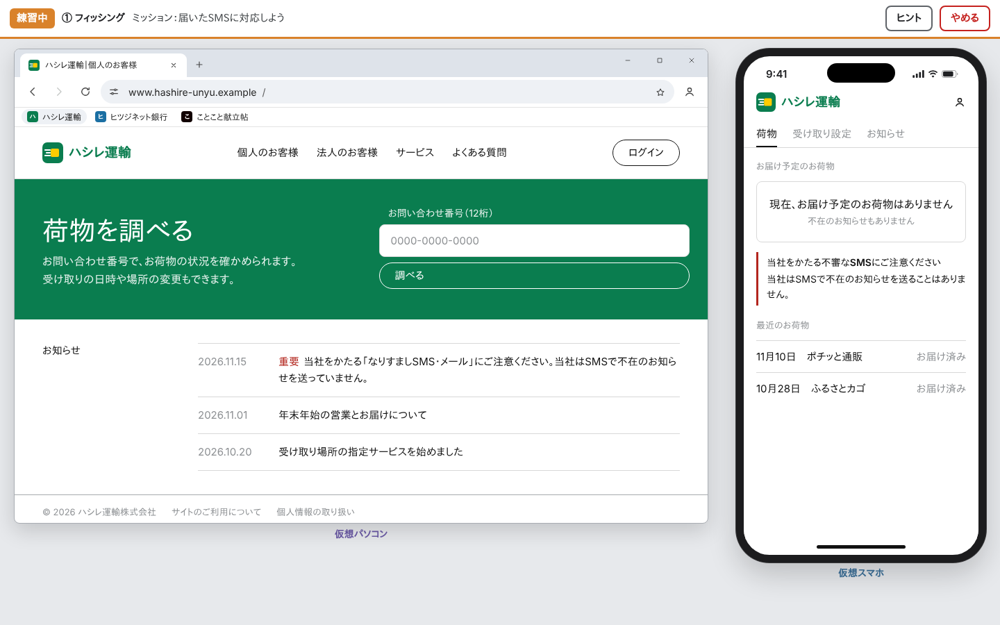
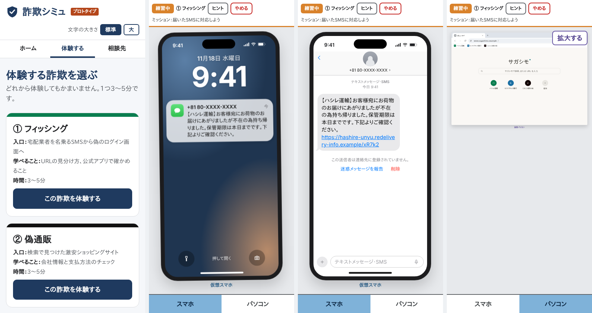
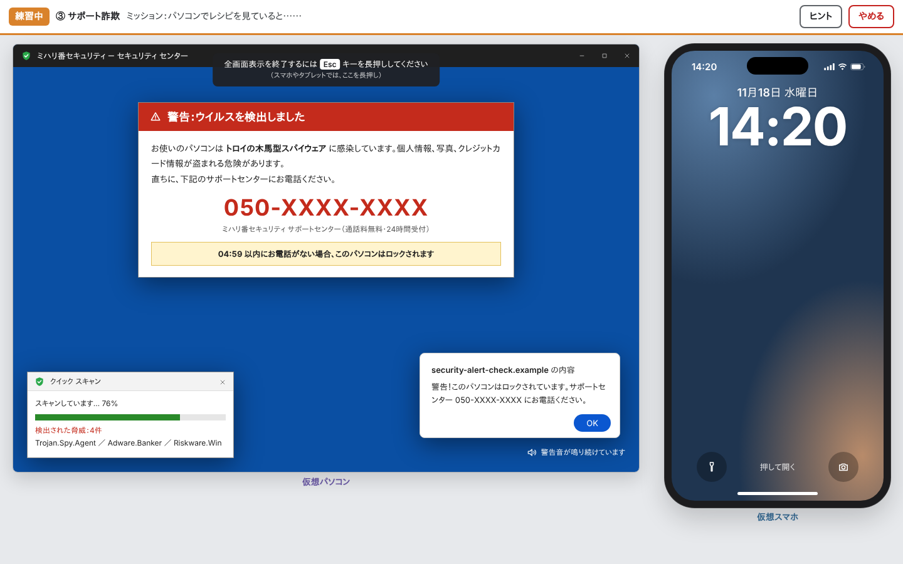
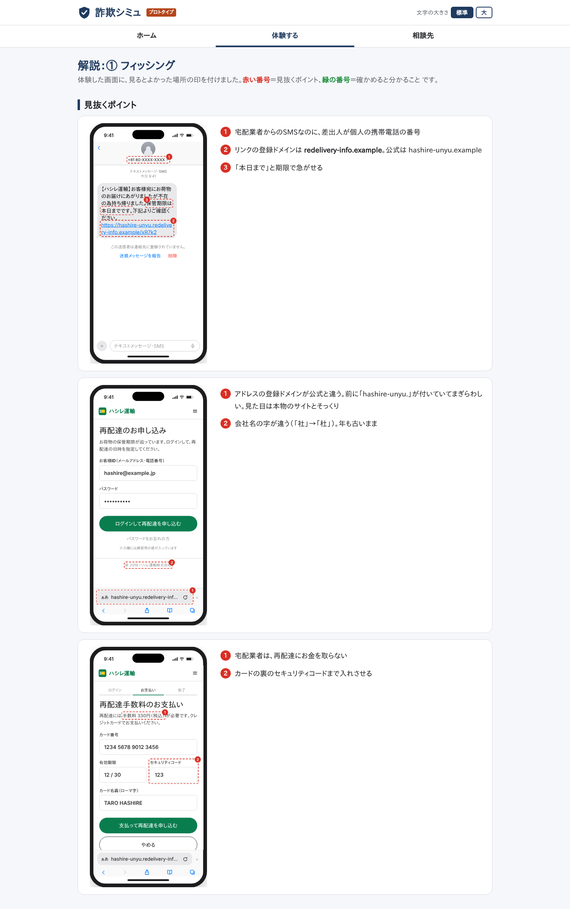

# 詐欺シミュ プロトタイプ

> チームF｜2026年11月19日｜検討資料の [4章 仮想環境](../docs/design/04-virtual-env.md) と [5章 画面デザイン](../docs/design/05-screen-design.md) を、実際に動かして確かめるための試作品
> 画面の見た目は、実在のサイトのスタイル（[Refero Styles](https://styles.refero.design)）を参考に作っている：[DESIGN.md](DESIGN.md)

ブラウザの中の**仮想環境**（仮想パソコンと仮想スマホ）で、3本のシナリオを最後まで体験できます。HTML・CSS・JavaScript だけで作っていて、サーバーもインターネットも要りません。

## 開き方

| 使う機械 | 開き方 |
| --- | --- |
| パソコン | `prototype/index.html` をダブルクリックして、ブラウザで開く |
| スマホ・タブレット | パソコンで `prototype` フォルダを開いたターミナルから `python -m http.server 8000` を実行する。同じ Wi-Fi につないだスマホで `http://（パソコンのIPアドレス）:8000/` を開く |

## できること

| 画面（[2章 画面一覧](../docs/design/02-screen-flow.md#21-画面一覧)） | 内容 |
| --- | --- |
| P01 ホーム | 作品の説明、体験の流れ、「これは練習用です」の説明 |
| P04 モード選択 | 3つの詐欺のカード。体験したものには「体験済み：見抜けた／だまされた」が付く |
| P05 開始画面 | これから起きること、ミッション、使うもの、音を出すかどうか |
| P06 仮想環境 | 下の表のとおり |
| P07・P08 結果 | 見抜けた！／だまされた（被害の「その後」）と、自分の行動の記録（調べた・決めた・ヒント） |
| P09 解説 | 体験した画面に、見抜くポイント（赤）と確かめると分かること（緑）の印を重ねて説明する。防ぎ方、だまされたときの対処、相談先 |
| P15 相談先 | 本物の窓口（#9110、188、IPA 情報セキュリティ安心相談窓口。2026年11月19日に公式の情報で確かめた） |

**仮想環境でできること**

- パソコン・タブレットの幅では2台を並べ、スマホの幅（900px未満）では下のボタンで1台ずつ切り替える。もう1台に通知が来ると、ボタンに赤い印が付く
- 仮想スマホ：ロック画面と通知、ホーム画面の8つのアプリ、メッセージ、電話（通話はチャット形式で1つずつ出る）、ブラウザ、ハシレ運輸の公式アプリ、銀行のアプリ、家族とのチャット（トモトモ）
- 仮想パソコン：ブラウザ（タブ、アドレスバー、ブックマーク）、全画面の偽の警告（Escキーの長押し、またはスマホでは帯の長押しで終わる）、警告音（開始画面で「音を出す」を選んだとき）
- アドレスバーを押すと、URL全体と「登録ドメイン」を確かめられる（「調べる」操作として記録）
- 「ヒント」で、今の画面の見るとよい場所が光り、問いかけが出る。「やめる」でいつでもやめられる
- 入力欄には練習用の値が入っていて、書きかえられない。入力した内容はどこにも保存・送信しない

| シナリオ | だまされる道 | 見抜く道 |
| --- | --- | --- |
| ① フィッシング | SMSのリンク → 偽のログイン → 支払い（カード番号も盗まれる）／支払いはやめる（IDとパスワードを盗まれる） | SMSを削除・報告する／偽のページを閉じる。公式アプリ・パソコンのブックマーク・家族とのチャットで確かめられる |
| ② 偽通販 | 激安の店 → 注文 → スマホの銀行アプリで個人の口座に振り込む | 店のページを閉じる／振込をやめる／いつもの店で買う。特定商取引法の表示・店の名前での検索・市の注意喚起で確かめられる |
| ③ サポート詐欺 | 警告の番号に電話 → 遠隔操作のアプリ → 電子マネー（電話を切っても、アプリを入れていれば被害） | Escキーの長押しで全画面を終わらせて閉じる／電話を切る。スマホで警告の文を検索・家族とのチャットで確かめられる |

## 入っていないもの（本番の Django で作る）

- ログイン・新規登録・マイページ（体験の記録を残す）
- 体験の前後のテストとアンケート、みんなの結果（集計とグラフ）
- Django の管理画面からのシナリオの追加
- テンプレート（tp_universal1）のヘッダー・メニュー・フッター。テンプレートはGoogleドライブに置く決まりなので、このプロトタイプは Bootstrap 5.3 と自作のCSSで作っている

体験の結果は、そのブラウザの中にだけ（ブラウザを閉じるまで）置いています。文字の大きさと音の設定は、そのブラウザに覚えさせています。

## ファイル

| ファイル | 中身 |
| --- | --- |
| `index.html` | 1枚のページ。画面は `#/mode` のような # のあとの名前で切り替える |
| `js/engine.js` | 仮想環境のエンジン（2台の表示・切り替え・通知・調べる操作・ヒント・全画面・音・結果） |
| `js/app.js` | アプリの画面（ホーム・モード選択・開始・結果・解説・相談先） |
| `js/scenarios/common.js` | 3本で共通の部品（スマホのアプリ、ロゴ、家族とのチャット、相談窓口） |
| `js/scenarios/phishing.js` ほか | シナリオのデータ（画面・操作・結末・解説） |
| `css/devices.css` | 仮想デバイスとシナリオに出てくるサイト・アプリの見た目（参考にしたスタイルは [DESIGN.md](DESIGN.md)） |
| `img/` | 写真（CC0・パブリックドメイン。出典は [img/CREDITS.md](img/CREDITS.md)） |
| `DESIGN.md` | 場面ごとに参考にした Refero Styles のスタイルと、借りた数値 |
| `css/vm.css` | 仮想環境の配置（帯・2台・切り替え・シート） |
| `css/app.css` | アプリの画面の見た目 |
| `vendor/bootstrap.min.css` | Bootstrap 5.3.3（MITライセンス）。インターネットにつながらなくても使えるように同梱 |
| `tests/playthrough.js` | 自動で操作して、3本の道を最後まで通すテスト |

## シナリオの作り方

シナリオは `js/scenarios/*.js` の1つのデータで、`S.register({ ... })` で登録します。

| 項目 | 内容 |
| --- | --- |
| `screens` | 画面のHTML。`dev`（`phone` か `pc`）、パソコンなら `url` と `title`、全画面なら `fullscreen: true` |
| `actions` | 押したときの動き。`kind`（`check`＝調べる、`decide`＝決める）と `label`（結果の画面に出る文）を書くと、記録が残る |
| `endings` | 結末。`type`（`ok`／`ng`／`quit`）、`title`、`short`、`after`（その後）、`onEnd`（その後の通知など） |
| `explain` | 解説。`points`（見抜くポイントを見せる画面と説明）、`checks`、`prevent`、`ifScammed` |

画面のHTMLの中では、次の印を使います。

| 印 | 意味 |
| --- | --- |
| `data-act="名前"` | `actions` の動きを呼ぶ |
| `data-go="pc:画面"` | 画面を移る |
| `data-back` | 1つ前の画面に戻る |
| `class="clue" data-n="1" data-tip="問いかけ"` | 見抜くポイント（解説で赤い番号になる。ヒントで光る）。`clue good` は確かめると分かること（緑） |
| `class="seq"` と `class="after-seq"` | チャットや通話の文を1つずつ出し、最後に選択肢を出す |

## 確かめたこと（2026年11月19日）

`node prototype/tests/playthrough.js` で、Chromium（パソコンの幅 1440×900、スマホの幅 390×844）を使って次を確かめ、エラーは出なかった。

- 3本それぞれ、だまされる道と見抜く道を最後まで通し、正しい結末になる
- 通知・ロックの解除・アプリの起動・ブックマーク・アドレスバーの確認・家族への相談・ヒント
- Escキーの長押しと、スマホでの帯の長押しで全画面が終わる
- スマホの幅で、2台の切り替えと、仮想パソコンの拡大（左端から横に動かせる）

**まだ確かめていないこと**：iPhone の Safari、Windows の Edge、実際のスマホでの操作。メンバーの機械で確かめる。
